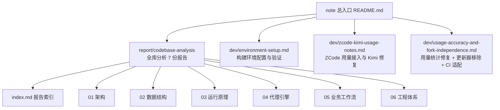

# cc-switch 项目要点总览（note 索引）

> 本文件是 `note/` 目录总入口：汇总四次工作流的全部要点（全库代码分析 + 本机构建环境配置 + ZCode/Kimi 用量接入 + 用量修复与 fork 独立化），并索引详细文档。最后更新：2026-11-21，对应版本 v4.0.35。

## 1. 文档索引



| 文档 | 内容 | 产出背景 |
|---|---|---|
| [codebase-analysis/index.md](report/codebase-analysis/index.md) | 分析报告索引 + 核心发现 + 关键数据速查 | 2026-11-19 全库分析 |
| [01-architecture.md](report/codebase-analysis/01-architecture.md) | 分层架构、目录全景、模块依赖图、16 应用能力矩阵、预设体系 | 同上 |
| [02-data-structures.md](report/codebase-analysis/02-data-structures.md) | 类/变量级数据结构全表、17 表 ER 图、DAO 映射、前后端类型镜像 | 同上 |
| [03-operation-principles.md](report/codebase-analysis/03-operation-principles.md) | 启动/退出流程、事件系统、日志脱敏、崩溃恢复（写前意图/墓碑） | 同上 |
| [04-proxy-engine.md](report/codebase-analysis/04-proxy-engine.md) | 本地代理 103,943 行：请求生命周期、重试/熔断/故障转移、协议转换矩阵 | 同上 |
| [05-workflows.md](report/codebase-analysis/05-workflows.md) | 供应商切换、代理接管、同步、13 CLI 用量采集、深链接等 13 个业务流程 | 同上 |
| [06-engineering.md](report/codebase-analysis/06-engineering.md) | 测试体系、8 个 CI workflow、构建配置、发布与 R2 分发 | 同上 |
| [dev/environment-setup.md](dev/environment-setup.md) | 本机工具链（F 盘）、镜像、版本锁定变更、fork CI 降级、验证结果 | 2026-11-19 环境配置 |
| [dev/zcode-kimi-usage-notes.md](dev/zcode-kimi-usage-notes.md) | ZCode 会话格式实测、用量导入实现与前端展示、Kimi usage.record 按需降级修复、门禁与遗留事项 | 2026-11-20/21 用量接入 |
| [dev/usage-accuracy-and-fork-independence.md](dev/usage-accuracy-and-fork-independence.md) | ZCode/Kimi/MCode 用量漏计审计根因与修复设计（主源切换 + 清理重导）、更新器与上游分发移除、release.yml fork 独立化、验证结果与遗留事项 | 2026-11-21 用量修复与 fork 独立化 |

## 2. 项目速览

| 项 | 值 |
|---|---|
| 定位 | 面向 16 个 CLI 编码工具的 API 供应商切换器 + 本地反向代理 + MCP/Skills/Prompts 统一管理器 |
| 技术栈 | Tauri 2（Rust）+ React 18 + TypeScript + TanStack Query + axum + SQLite |
| 规模 | Rust 436 文件 / 354,569 行；TypeScript 520 文件 / 166,304 行 |
| 关键数量 | 304 个 Tauri 命令；16 个 AppType；17 张数据库表（SCHEMA_VERSION 27）；默认代理 127.0.0.1:15721 |
| 仓库 | fork：`hershate/cc-switch` ← upstream `farion1231/cc-switch` |

## 3. 架构核心要点（五条）

1. **SSOT + 投影**：SQLite 为唯一事实源，各 CLI 原生配置文件仅是「关键字段」投影，非托管字节原样保留（`live/` 写入引擎）。
2. **崩溃安全贯穿**：live-state.json 写前意图五步提交、Claude 空值墓碑（10s TTL）、数据库迁移前自动快照、锁中毒恢复。
3. **本地代理是复杂度核心**：占 29% 代码；手动 hyper accept 保留 wire 级 header 大小写；四协议互转（Anthropic/ChatCompletions/Responses/Gemini Native）；熔断 HalfOpen 轮次化名额。
4. **双来源用量合流**：代理实时记账（`data_source='proxy'`）与 13 个 CLI 会话文件解析（`'session_log'`）经语义去重写入同一 `proxy_request_logs` 表。
5. **前后端强契约**：304 命令 + 16 类事件 + 5 份金标 JSON 双端比对测试，保证 35 万行 Rust 与 17 万行 TS 结构对齐。

## 4. 构建环境要点

| 项 | 值 / 结论 |
|---|---|
| Node.js 24.22.1 / pnpm 10.12.3 | `F:\Program Files\nodejs`；store 在 `F:\DevCache\pnpm-store`（全部 F 盘，符合全局规范） |
| Rust 1.99.1（项目锁定） | `RUSTUP_HOME/CARGO_HOME = F:\soft`；rustup 补装走 USTC 镜像（`RUSTUP_DIST_SERVER=https://mirrors.ustc.edu.cn/rust-static`；TUNA/rsproxy 缺 1.9x 频道不可用） |
| MSVC | VS 18 Community @ `F:\Program Files\Microsoft Visual Studio\18` |
| crates.io | 直连可用，未配镜像 |
| 版本唯一改点 | Rust 只改 `rust-toolchain.toml#channel`；Node 改 `.node-version` + workflow 的 node-version |

## 5. 验证过的命令（2026-11-19 实测）

```bash
pnpm install --frozen-lockfile        # 34.4s
pnpm typecheck                        # 0 错误
pnpm build:renderer                   # 21.6s
cargo build                           # debug 全量 2m15s（Rust 1.99.1）
# 完整打包（2026-11-19 实测，当时需关闭 updater 产物；updater 已于 2026-11-21 移除，现直接用：
#   pnpm tauri build --bundles msi）
pnpm tauri build --bundles msi --config '{"bundle":{"createUpdaterArtifacts":false},"plugins":{"updater":{"active":false}}}'
#   → release 5m44s；产出 src-tauri/target/release/bundle/msi/CC Switch_4.0.35_x64_en-US.msi（19.06 MiB）
#   → 便携版 src-tauri/target/release/cc-switch.exe
# 测试：
pnpm test:unit                        # 前端 vitest
cargo nextest run --profile ci        # 后端（或 cargo test）
```

## 6. CI / 发布要点（fork 独立维护形态，2026-11-21 起）

- `release.yml` 已重写为无 secrets 形态：`whats-new-check → release（四平台未签名矩阵：windows-2022 / windows-11-arm / ubuntu-22.04 / ubuntu-22.04-arm）→ publish-release`，仅依赖自动提供的 `GITHUB_TOKEN`；不再产出 `.sig` / updater 产物 / `latest.json`（历史降级逻辑与签名链已随更新器移除删除）。
- `sync-r2.yml`、`claude.yml`、`FUNDING.yml`、`prepare-tauri-signing-key` 复合动作已删除；`ci.yml` / `wsl2-nightly.yml` / `labeler.yml` / `stale.yml` 保留未动。
- fork 推 tag 发布前必须存在 `src/whats-new/<版本>.json`（whats-new-check 强制）。
- 外部 PR 改 `SCHEMA_VERSION` 会被 schema-version.yml 自动关闭；改表先 `SCHEMA_VERSION += 1` 再在 `schema.rs` match 加迁移。
- 原 Rust 1.99.1 下 3 处 `fetch_update` 弃用警告已随 `76f489f3` 改用 `try_update` 消除（见 `dev/environment-setup.md` §4 的历史记录）。

## 7. 提交记录

| commit | 内容 |
|---|---|
| `529f56e2` | 全库分析报告（note/report/codebase-analysis 7 份，2,587 行 28 图） |
| `68225faa` | 工具链对齐本地（rust-toolchain 1.99.1、.node-version 24.22.1、6 处 workflow node 24） |
| `283c7f64` | release.yml fork 降级改造 |
| `9d66f783` | 环境配置记录（note/dev/environment-setup.md） |
| `7231f656` | ZCode 会话用量导入器（后端接入 + cache-inclusive 计价白名单） |
| `1dd72211` | Kimi Code 用量导入 usage.record 按需降级修复 |
| `feab86b4` | 用量仪表盘 ZCode 展示（前端用量域，未动配置域） |
| `76f489f3` | clippy 与弃用警告清零（rust 1.99.1 门禁对齐） |
| `1c868d98` | Windows 符号链接/系统代理测试夹具加固 |
| `4b9217a6` | vitest minWorkers 固定与平台组件 mock |
| `0dbe814a` | ZCode 用量主源切换 db.sqlite model_usage（v1 残留清理 + rollout 回退） |
| `a96c5a60` | Kimi usage.record 主源 + v2 游标迁移重导；MCode 重建水位停摆与模型回查修复 |
| `76a9f661` | 更新器与上游分发移除（后端 18 + 前端 13 + 测试 2 + 脚本 2 项） |
| `c18f5a12` | CI 适配 fork 独立维护（release.yml 重写 369 行） |
