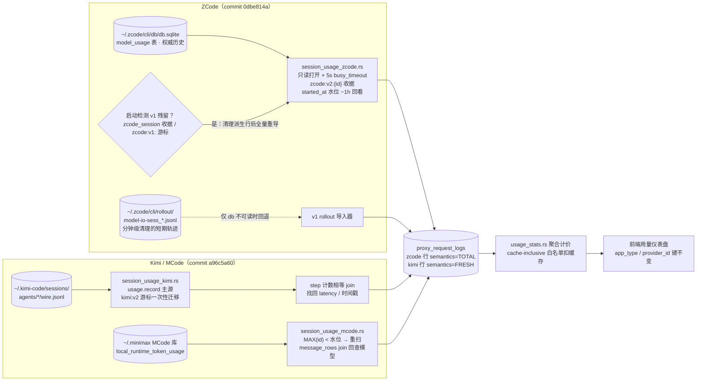
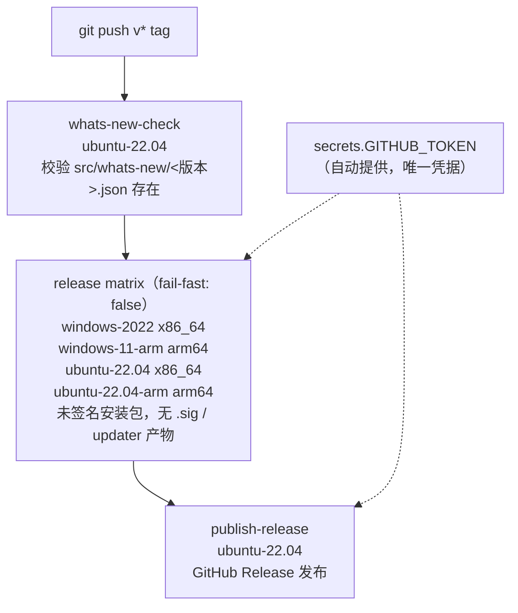

# 用量统计修复与 fork 独立化收尾记录

> 工作流日期：2026-11-21。范围：三段工程——ZCode / Kimi / MCode 用量统计修复（按 2026-11-21 只读审计结论）、应用内更新器与上游分发链路整体移除、GitHub Actions 适配 fork（`hershate/cc-switch`）独立维护形态。审计报告原文（audit-zcode.md、audit-kimi-mcode.md、updater-inventory.md）随 TEMP/ 清理删除，量化结论收录于本文 §1。数据库 schema、`SCHEMA_VERSION`、AppType 枚举均未改动。

## 1. 审计根因（量化结论）

### 1.1 ZCode：rollout 短期轨迹导致覆盖率 0.0346%

导入器（`7231f656` 引入）以 `~/.zcode/cli/rollout/` 为唯一数据源，而 rollout 是分钟级滚动清理的短期轨迹：

| 项 | 实测结论 |
|---|---|
| rollout 生命周期 | 会话结束文件即删：审计期间主会话文件 8.2MB 在约 20 分钟内消失；游标 4 条中 3 条指向已删文件；审计时点仅存 3 文件 / 15 请求 / 30.5 秒跨度 |
| 权威历史位置 | `~/.zcode/cli/db/db.sqlite` 的 `model_usage` 表：四类 token 合计 35,604,894,272（144,003 请求，2026-10-24 → 11-20） |
| cc-switch 实际导入 | 12,318,423 token / 81 行，全部来自 2026-11-20 15:52–17:47 的 4 个 rollout 文件被删前的残留 |
| 差距 | 覆盖率 0.0346%，约 2,890 倍，与用户报告「几十亿 vs 几百万、约千倍」吻合 |
| 两源格式差异 | rollout：JSONL 每行一个完整请求，用量在 `/response/usage` 五字段，`requestId` + `attempt` 构成请求标识；db.sqlite：每请求一行，`id` 为表主键、`started_at` 记时、`input_tokens` cache-inclusive（与 rollout 同为 OpenAI 语义） |
| 两源 join 可行性 | 0/81 个 rollout `requestId` 命中 `model_usage.logical_request_id`，无请求级关联键，两源数据不得并存 |

### 1.2 Kimi：新协议不写旧投影 + 游标停在 EOF，三因叠加漏计

| # | 根因 | 量化 |
|---|---|---|
| ① | 2026-11-13/14 起 Kimi Code 新协议 wire 完全不再写 `agent.message.appended(assistant)` 与 `llm.request` 事件，旧导入路径 pending 恒为 0 | 5 个 main wire 的 3,587 条 `usage.record` 一行未导（records 是 pending 的超集，每 wire records ≥ pending） |
| ② | 兜底 commit `1dd72211`（2026-11-21 00:58）晚于最后一次 kimi 同步（2026-11-19 16:00:57），且这 5 个 wire 游标已停在 EOF（`last_line_offset` == 文件字节数）且 mtime/size 匹配，新版也会永久跳过 | 库内 `kimi:record:` 行数与收据均为 0 |
| ③ | 混合 wire 中「pending 非空则弃用 records」的旧取舍再丢记录 | 35 行 |

unknown 占比 524 行（4.15%）= 新协议 9 个 subagent wire 无任何 `llm.request`（440 行）+ 旧 wire 83 行 step 无挂接 `llm.request`、1 行 messageId 缺失（84 行）；`usage.record` 本身 100% 携带真实模型（`kimi-code/k3.1-pro` → `k3.1-pro`、`KDS/k3.1-pro-highspeed`）。

### 1.3 MCode：模型不可恢复 + 库重建水位停摆

| 项 | 实测结论 |
|---|---|
| 模型回查三重落空 | 导入时 `model` 列 NULL：`pi_history_rows` 0 行、`message_rows` 831 条 assistant `data_json` 的 `$.model` 存在数 0、精确 ts join 0/618——历史 618 行模型在本机数据中不可恢复 |
| 水位停摆 | MCode 库重建后 AUTOINCREMENT 重计：水位 9687 > max(id) 830，现库 830 行（含 212 行已填 `minimax/MiniMax-M3.1-Flash` 的新数据）永久停摆未导 |

## 2. 修复设计

### 2.1 ZCode 主源切换（commit `0dbe814a`）

`src-tauri/src/services/session_usage_zcode.rs` 改为 db.sqlite 主源、rollout 回退的双源结构：

| 设计点 | 取值 | 位置 |
|---|---|---|
| 主源 | `<ZCODE_HOME\|~/.zcode>/cli/db/db.sqlite` 表 `model_usage`，每请求一行 | `session_usage_zcode.rs:3-13` |
| 打开方式 | `SQLITE_OPEN_READ_ONLY` + `busy_timeout` 5s；WAL 读实测可行（live 冒烟验证）；只读打开失败即判定「源不可用」转回退 | `session_usage_zcode.rs:110-114` |
| 收据命名空间 | `zcode:v2:{model_usage.id}`，表主键天然幂等 | `session_usage_zcode.rs:65-66` |
| 增量 | `started_at` 水位（游标键 `zcode:v2:{db path}`）回看 1 小时（`WATERMARK_LOOKBACK_MS`），请求完成才落库故需回看；收据保证重扫幂等 | `session_usage_zcode.rs:70-76` |
| 全量导入分块 | 每 2,000 行提交一次，缩短 cc-switch 连接锁占用（审计库约 144k 行） | `session_usage_zcode.rs:77-80` |
| v1 残留清理 | 启动时检测 `zcode_session` 收据或 `zcode:v1:` 游标，存在则一次性清理 `proxy_request_logs` / `session_usage_dedup` / `session_log_sync` / `usage_daily_rollups` 的 zcode 派生行并全量重导（两源无 join 键，必须先清后导） | `session_usage_zcode.rs:184-240` |
| rollout 回退 | 仅当 db.sqlite 无法只读打开时运行 v1 导入器，防止暂时不可读的库静默丢用量；回退行与 db 行在该窗口内短暂并存双算，下次 db 可读时由启动清理自动纠正 | `session_usage_zcode.rs:94-99` |
| 映射约定 | `app_type='zcode'`、`provider_id='_zcode_session'`、cache-inclusive `TOTAL` 语义均不变，前端零改动 | `session_usage_zcode.rs:1-13` |
| 全零行 | error/cancelled 行不带 token（审计：181 + 377 行全零），一律跳过 | `session_usage_zcode.rs:12-13` |

### 2.2 Kimi usage.record 主源（commit `a96c5a60`）

`src-tauri/src/services/session_usage_kimi.rs`：

- **主源反转**：`usage.record` 事件为唯一主源，仅当某 wire 一条 record 都没有时才走旧投影路径（pending）——新协议 wire 只有 records，旧 wire 两者皆有则只取 records，绝不双计（`session_usage_kimi.rs:240-247`）。
- **一次性迁移**：游标键版本化为 `kimi:v2:{path}`，启动时 `migrate_to_record_namespace` 删除 legacy `kimi:*` 游标并清理 `kimi_session` 派生行与收据，全部 wire 重扫一遍；pre-v2 游标即迁移标记，至多执行一次（`session_usage_kimi.rs:33-35, 85-110`）。
- **计时找回**：records 无原生计时，按「step 计数相等」join 回挂：`RequestIndex` 以 `[input, output, cache_read, cache_creation]` 四元计数索引已完成 step，`take_timing` 取回 latency / first_token / request 时间（`session_usage_kimi.rs:248-256`、`kimi_session.rs:212`）。设计前用 node 脚本在 51 条真实 wire 上验证 join 命中率：turn 域 16,208/16,214 命中、session 域 0/31（无对应 step）、中位时差 18ms。
- **unknown 清零**：model 一律取自 record 并 `rsplit('/')` 剥离供应商前缀命中 `model_pricing`（`session_usage_kimi.rs:325-340`）。
- `kimi_session.rs` 的 `timestamp_ms` 接受 epoch 毫秒与 RFC3339 字符串两种 `time` 形态（`kimi_session.rs:44`）。

### 2.3 MCode 停摆修复（同 commit `a96c5a60`）

`src-tauri/src/services/session_usage_mcode.rs`：

- **重建检测**：水位 > `MAX(id)` 即判定库被重建（剪枝只会移除低 id，水位越过表尾只能是重建），清 `#timing` 游标从头重扫；request_id 去重保证幸存行不双计（`session_usage_mcode.rs:36-52`）。
- **模型回查换源**：由三重落空的旧路径改为 `local_runtime_message_rows` 的 `data_json` join 回查。

### 2.4 数据流总览

## 3. 更新器与上游分发移除（commit `76a9f661`）

按清单整体移除应用内更新检查与上游分发依赖：

| 范围 | 内容 |
|---|---|
| 后端 18 项 | 删 `app_update.rs` 整文件；`lib.rs` 插件注册 / 后台循环 / 6 命令注册；`commands/settings.rs` 5 命令与 `UpdateDownloadProgress`；`commands/misc.rs` 的 `check_for_updates` / `portable_zip_url` / `open_portable_update_download`；`settings.rs` 的 `auto_update_enabled` 字段；`tray.rs` `INSTALL_UPDATE_ID` / 菜单项 / `MenuStatus.update_ready` / `PanelModel.update` / `TrayTexts.install_update`（8 语言）/ 2 处测试；`Cargo.toml` + `Cargo.lock` 移除 `tauri-plugin-updater`；`tauri.conf.json` 删 `createUpdaterArtifacts` 与 `plugins.updater`（含上游 pubkey / endpoints）；`capabilities/default.json` 删 `updater:default` |
| is_portable 迁移 | 4 行实现迁入 `commands/misc.rs` 的 `is_portable_mode`（`misc.rs:90`），前端 `isPortable` API 不变 |
| 前端 13 项 | 删 `UpdateContext.tsx` / `updater.ts` / `AutoUpdatePrompt.tsx`；`main.tsx` Provider；`App.tsx` / `Sidebar.tsx` / `AboutSection.tsx` / `SettingsPage.tsx` / `TrayPanel.tsx` / `tray-panel/api.ts` / `types.ts` / `lib/api/settings.ts` 的类型与 UI 引用 |
| i18n | 8 个 locale 各删 22 键（`autoUpdate` 块 + settings 12 键 + `nav.settingsHasUpdate` + `dbUpgrade` 8 键） |
| 测试 2 项 | 删 `UpdateContext.autoUpdate.test.tsx`、`AutoUpdatePrompt.test.tsx`；`App.test` / `SidebarToday.test` 移除 mock 块 |
| 上游分发脚本 2 项 | 删 `scripts/generate-download-manifest.mjs`、`scripts/rewrite-updater-manifest.mjs`（scripts/ 目录随之清空）；`package.json` + `pnpm-lock.yaml` 移除 `@tauri-apps/plugin-updater` |
| 链接改向 | About 页与 `NewLayoutDialog` 的 RELEASES_URL 改指 fork `hershate/cc-switch`（fork remote 经 `.git/config:11` 确认）；`DatabaseUpgrade.tsx` 收敛为手动指引单态 |
| 未动 | `whats-new`、`check_tool_updates_on_startup`（CLI 工具更新检查与本次应用自更新无关）、`.github/`（归 CI 段） |

残留核验（grep 实测零命中）：`plugin-updater` / `UpdateContext` / `AutoUpdatePrompt` / `lib/updater` / `autoUpdateEnabled` / `installUpdateAndRestart` / `app-update-ready` / `update-download-progress` 在 src + tests + src-tauri 均为 0；`tauri-plugin-updater` 在 `Cargo.lock`、`@tauri-apps/plugin-updater` 在 `pnpm-lock.yaml` 均为 0。

## 4. CI 适配 fork 独立维护（commit `c18f5a12`）

| 项 | 处置 |
|---|---|
| 删除 | `sync-r2.yml`（上游 R2 分发）、`claude.yml`（上游专属）、`.github/FUNDING.yml`、`.github/actions/prepare-tauri-signing-key/`（仅服务 minisign） |
| `release.yml` 重写 | 1,056 → 369 行：`whats-new-check → release → publish-release` 三 job 链（`release.yml:23,65,323`）；四平台未签名矩阵（`release.yml:71-78`）；全程仅依赖自动提供的 `GITHUB_TOKEN`（`release.yml:369`），无 secrets 也可完整跑通；不再生成 `.sig` / updater 产物 / `latest.json` |
| `schema-version.yml` | 文案改指 fork 仓库与维护者 `@hershate` |
| 保留未动 | `ci.yml` / `wsl2-nightly.yml` / `labeler.yml` / `stale.yml`（grep 验证无上游绑定引用） |
| `scripts/` | 目录已不存在（两脚本由本工作流删除） |

## 5. 验证结果

### 5.1 各工程段自验（改动落定后由各段执行）

| 段 | 命令 / 方式 | 结果 |
|---|---|---|
| ZCode 单测 | `cargo test --manifest-path src-tauri/Cargo.toml --lib services::session_usage_zcode` | 14 passed / 0 failed（8 个 rollout 回退 + 6 个新 db 源测试） |
| ZCode live 冒烟 | 同过滤器 `-- --ignored zcode_usage_live_db_smoke` | 真实只读打开 `C:\Users\Z\.zcode\cli\db\db.sqlite` 成功：143,577 非零行 / 35,624,797,845 四类 token（审计 35,604,894,272 + 一天增量）；对库执行 DELETE 正确报错 |
| Kimi 单测 | `cargo test --lib services::session_usage_kimi` | 11 passed / 0 failed |
| MCode 单测 | `cargo test --lib services::session_usage_mcode` | 5 passed / 1 ignored（既有 `native_validation` 需 `CC_SWITCH_TEST_HOME`，未动） |
| 真实快照端到端干跑 | 临时测试 + `CC_SWITCH_TEST_HOME`/`KIMI_CODE_HOME`/`MINIMAX_DATA_DIR` 指向 TEMP 快照（已删除） | kimi 首同步 imported=16,245、files_scanned=51，input=70,506,980、output=11,213,445、cache_read=7,738,842,343、unknown=0、k3.1-pro=15,670（highspeed=575）、latency>0 行 16,178；二次同步 files_scanned=0、imported=0（幂等）。mcode imported=827=快照可见全部行（活动库 830 行中最新 3 行在未 checkpoint 的 WAL 内，真实路径经 rusqlite 读 WAL 可见 830），MiniMax-M3.1-Flash 209 行（=212−3 WAL 行），水位推进至 max(id) |
| 更新器门禁 | `cargo check` / `cargo test` 全量 / `cargo clippy` / `pnpm typecheck` / 受影响 vitest 10 文件 | 220 passed / 0 failed；clippy 零警告；typecheck 0 错误；vitest 176 passed / 0 failed |
| CI 校验 | node + 仓库 `yaml` 包解析全部 workflow | 6 个 workflow 全部 OK（ci 6 job / labeler 1 / release 3 / schema-version 1 / stale 1 / wsl2-nightly 1）；release.yml 结构断言（job 链、4 平台矩阵、banned 串零命中）通过；`grep -rn "secrets\."` 仅剩 GITHUB_TOKEN |

### 5.2 收尾门禁（本文提交前全量实测）

| 命令 | 结果 |
|---|---|
| `cargo fmt --manifest-path src-tauri/Cargo.toml --check` | 通过（无输出） |
| `cargo clippy --manifest-path src-tauri/Cargo.toml --all-targets -- -D warnings` | 通过（exit 0） |
| `cargo test --manifest-path src-tauri/Cargo.toml` | lib 4,892 passed / 0 failed / 12 ignored；集成 220 passed / 0 failed |
| `pnpm typecheck` | 0 错误（exit 0） |
| `pnpm test:unit` | 317 文件 / 4,199 tests 全部通过 |

## 6. 提交记录

| commit | 内容 |
|---|---|
| `0dbe814a` | ZCode 用量主源切换（db.sqlite model_usage + v1 残留清理 + rollout 回退） |
| `a96c5a60` | Kimi usage.record 主源 + 一次性迁移重导 + MCode 水位停摆与模型回查修复 |
| `76a9f661` | 更新器与上游分发移除（后端 18 + 前端 13 + 测试 2 + 脚本 2 项，lockfile 双双重生成） |
| `c18f5a12` | CI 适配 fork 独立维护（release.yml 重写 369 行、删 4 个上游文件） |
| （本文所在 commit） | 收尾文档（本文件 + note/README.md 索引） |

## 7. 遗留事项与已知取舍

| 项 | 现状 / 影响 |
|---|---|
| 真实端到端未执行 | 需运行应用触发下一次同步后确认：`proxy_request_logs` 的 zcode 合计 ≈ 356 亿 token 且时间回溯到 2026-10-24（审计 §5.5 口径）；kimi 16,245 行重导；mcode 830 行水位推进。首次运行含一次性迁移：zcode 清 81 条 v1 收据重导、kimi 删旧 12,623 行重写 16,245 行（同一同步内完成；期间其他读库工具会看到短暂中间态） |
| GLM-5.3 无预置定价 | `find_model_pricing` 无命中，zcode 行成本列默认 0；有定价数据后自动生效，无需改码 |
| 水位回看窗 1 小时 | 个别耗时超 1 小时且晚于水位 1 小时后才落库的请求理论上漏计（审计报告未提供更长窗口依据）；收据保证扩大窗口后重扫幂等 |
| rollout 回退窗口双算 | db 不可读期间回退行与 db 行短暂并存双算，下次 db 可读时由启动清理自动纠正（回退仅防数据丢失，模块文档已说明） |
| Kimi 计时 join 边界 | session 域 record（0/31 命中）无对应 step，latency 记 0；turn 域 16,208/16,214 命中，6 条未命中行计时缺失但 token 不受影响 |
| MCode 历史 618 行 unknown | 模型在本机数据中不可恢复（审计 §4.1 结论），保持 unknown |
| MCode 重建撞 id | 「删光再重灌同 id 数据」的库理论上与新行 request_id 撞车被 `INSERT OR IGNORE` 跳过（沿用既有去重语义） |
| Kimi 不删 rollup | kimi 导入器上线 28 天 < 30 天 rollup 窗口，现网不可能存在 kimi_session 汇总行（本机实测 0 行）；更老部署理论上可能汇总+明细双算，窗口关闭前无实际影响 |
| GitHub Actions 实际运行未验证 | 本地无法执行 runner；workflow 仅经 YAML 解析与结构断言验证 |
| 未触碰外部数据 | 全程只读访问 `~/.zcode` / `~/.kimi-code` / `~/.minimax`，未对其执行任何写入；快照验证在 TEMP/ 内完成并已清理 |
