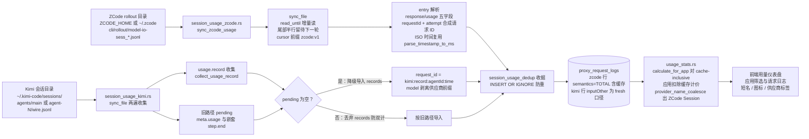

# ZCode 用量接入与 Kimi Code 用量修复记录

> 工作流日期：2026-11-20 至 2026-11-21。范围：新增 ZCode 会话用量导入器（后端 + 前端用量域展示）、修复 Kimi Code 协议变体会话的用量漏计。数据格式结论来自 2026-11-20 对本机 `~/.zcode/` 与 `~/.kimi-code/sessions/` 的只读采样（采样报告原文随 TEMP/ 清理删除，要点已收录于本文 §1、§2）。未改动 AppType 配置域枚举、`SCHEMA_VERSION`、数据库 schema 与前端配置域（`appSpecs`）。

## 1. ZCode 会话格式实测结论

数据源：`ZCODE_HOME`（未设置时 `~/.zcode`）下 `cli/rollout/model-io-sess_*.jsonl`（`src-tauri/src/services/session_usage_zcode.rs:48-52`）。采样时点该目录仅存在 3 个 model-io 文件（42 行），未观察到 `transcript.jsonl` 或其他会话转录文件——ZCode 会话数据即 model-io 记录，不存在 Claude Code 式 transcript。

| 项 | 结论 |
|---|---|
| 行事件类型 | 每行一个完整 model 请求，顶层 `type=="model_io"` 占 42/42（100%），JSON 解析失败 0 行 |
| 用量位置 | JSON 指针 `/response/usage`，五字段 `inputTokens/outputTokens/totalTokens/cacheReadTokens/cacheWriteTokens` 齐全且为数值：40/42 行；其余 2 行为空对象 `{}`（中断/失败请求，同时缺 `responseId`、`headers` 为空），导入时跳过 |
| `attempt` | 重试计数，非恒为 1；观测分布 {1: 41 行, 11: 1 行}。与 `requestId` 共同构成请求标识，重试行按独立行入库 |
| `requestId` | 每行唯一（28 行样本 28 个不同值）；同一 `turnId` 被同轮多条记录共享。缺失时回退为整行 SHA-256（`session_usage_zcode.rs:148-152`），观测缺失率为 0 |
| 时间 | `startedAt`/`completedAt` 为 UTC 毫秒精度 ISO 8601（`Z` 后缀），复用 `session_manager::providers::utils::parse_timestamp_to_ms` 解析（`session_usage_zcode.rs:164-167`） |
| `inputTokens` 口径 | 含 `cacheReadTokens`：样例 121664 + 4142 = 125806 = `totalTokens`，即 OpenAI cache-inclusive 语义，按 `INPUT_TOKEN_SEMANTICS_TOTAL` 存储并加入 `CACHE_INCLUSIVE_APP_TYPES`。`cacheWriteTokens` 全部样例为 0，`inputTokens` 是否含写缓存未实测 |
| 单行大小 | 最大 1,489,216 字节（含完整请求/响应体），必须按行流式读取：`read_until` 增量读，尾部半行留待下一轮 |
| 目录波动 | rollout 目录由活跃会话实时写入与清理（采样期间 1 文件被删、1 文件新增），消费端须容忍文件消失与不完整尾行 |
| 日志不可用 | `cli/log/` 下日志的 usage 字段被脱敏为 `[Redacted]`，不能作为数据源（`session_usage_zcode.rs:16-17`） |
| 子代理 | 子代理独立成文件（`model-io-sess_subagent_agent_<uuid>.jsonl` 等），无特殊处理必要 |

## 2. Kimi usage.record 事件差异与「按需降级」修复设计

### 2.1 事件形态差异（采样：3 个会话、35 个 agent 目录、75,917 行）

Kimi 用量在 wire.jsonl 中以多形态并存：

| 形态 | 位置 | 旧导入器处理 |
|---|---|---|
| `message.meta.usage` | main 目录 `agent.message.appended` 的 assistant 行（存在率 100%，四键 `inputOther/output/inputCacheRead/inputCacheCreation`） | main 路径，正常导入 |
| 嵌套 `step.end` 的 `event.usage` | agent 目录 `context.append_loop_event` 内嵌（顶层独立 `step.end` 计数为 0） | agent 路径，正常导入 |
| 顶层 `usage.record` | main 与 agent 目录均出现（合计 5,409 条），含 `agentId/model/usage/usageScope/time` | **旧版直接丢弃** |

协议变体会话（采样 S2，`protocol_version 1.5`）完全没有 `agent.message.appended`：消息以 `context.append_message` 落盘（无 meta 包裹），用量仅由 `usage.record`（1,356 条）与嵌套 `step.end` 承载——旧导入器对这类 main wire 导入 0 行，即本次修复目标。

关键取舍依据：

- `usageScope` 以 `turn` 为绝对主体（5,398/5,409 = 99.80%），`session` 少量收尾（11 条）；未按 scope 过滤，11 条 session 域记录按独立行入库。
- `usage.record` 与嵌套 `step.end` 数量接近但不恒等（如 22 对 31）：两种形态描述同一批调用，只能择一导入。

### 2.2 修复设计

`src-tauri/src/services/session_usage_kimi.rs` 的 `sync_file` 改为两遍式：先按旧两路径收集 `pending`，同时独立收集 `usage.record` 到 `records`（`session_usage_kimi.rs:121-127`）；导入前判定 `pending.is_empty()`——仅当旧路径一无所获时才降级导入 `records`，否则丢弃 `records`（`session_usage_kimi.rs:200-205`），保证任一 wire 只从单一来源导入、绝不双计。

降级路径细节（`collect_usage_record`，`session_usage_kimi.rs:239-287`）：

| 设计点 | 取值 | 理由 |
|---|---|---|
| request_id 命名空间 | `kimi:record:{agentId}:{time_ms}` | 与旧路径 `kimi:{provider}:{messageId}` 永不相交，降级导入不与旧数据碰撞、不重复导入；同毫秒同 agent 多条记录由收据 `INSERT OR IGNORE` 仅保留首条 |
| model 别名 | `rsplit('/')` 剥离供应商前缀（`kimi-code/k3.1-pro` → `k3.1-pro`） | 裸别名才能命中 `model_pricing` |
| 全零 usage | 跳过 | 与其他导入器一致 |
| time 字段 | 数字毫秒或 RFC3339 字符串 | `kimi_session.rs:38-54` 的 `timestamp_ms` 新增字符串分支，复用 `parse_timestamp_to_ms`（无需改可见性） |

历史已导入数据零影响：旧路径行为逐字节不变，降级仅在 pending 为空时触发，且收据命名空间隔离。

## 3. 数据流

## 4. 改动文件清单

| 组 | commit | 文件 |
|---|---|---|
| ZCode 后端 | `7231f656` | `src-tauri/src/services/session_usage_zcode.rs`（新增 565 行导入器）；`services/mod.rs:75` 模块注册；`services/session_usage.rs:202-206` `sync_all_unlocked` 在 DeepSeek Harness 后加 ZCode 步骤；`services/usage_stats.rs:398` `provider_name_coalesce` 加 `'ZCode (Session)'`；`services/sql_helpers.rs:23` `CACHE_INCLUSIVE_APP_TYPES` 加 `"zcode"` |
| Kimi 修复 | `1dd72211` | `src-tauri/src/services/session_usage_kimi.rs`（两遍收集 + `collect_usage_record` 降级 + 3 个新测试）；`src-tauri/src/kimi_session.rs`（`timestamp_ms` RFC3339 分支 + 1 个新测试） |
| 前端（用量域） | `feab86b4` | `src/types/usage.ts:215/233/252`（AppType、KNOWN_APP_TYPES、CACHE_INCLUSIVE_APP_TYPES 追加 `zcode`）；`src/components/shell/AppGlyph.tsx:11/28/33/50`（名称与图标键集放宽，图标复用已注册 `zhipu` 即 Z.ai Logo）；`src/components/usage/UsageDashboard.tsx:567-577`（`visible[app] !== false`，无键即显示）；`src/components/usage/providerLabel.ts:11/25`；`src/components/usage/RequestLogTable.tsx:102/114/131`；测试 `tests/components/UsageDashboard.test.tsx`、`tests/components/usageProviderLabel.test.ts` |
| 门禁修复（clippy） | `76f489f3` | `src-tauri/Cargo.toml`（`rust-version` 1.85.0 → 1.95.0）；`commands/tool_lifecycle_command.rs`（`as_chunks`）；`gemini_mcp.rs`（`values_mut`）；`proxy/circuit_breaker.rs`、`services/auto_sync.rs`（`fetch_update` → `try_update`）；`session_manager/search.rs`（`is_multiple_of`）；`proxy/forwarder.rs`、`proxy/handlers.rs`（`ForwardError::provider` 装箱消 `result_large_err`） |
| 门禁修复（Windows 测试） | `1c868d98` | `codex_config.rs`、`services/session_usage_grokbuild.rs`（符号链接夹具降级 junction）；`tests/integration/skill_sync.rs`（`symlink_dir` 降级 `mklink /J`）；`proxy/error.rs`（reqwest `no_proxy`）；`services/workbuddy_account/tests.rs`（`cfg(unix)` 内绑定消未用变量警告） |
| 门禁修复（vitest） | `4b9217a6` | `vitest.config.ts`（`minWorkers: 1`，修复 32 核主机 `--maxWorkers=16` 下 Tinypool 崩溃）；`tests/components/CodexOAuthSection.test.tsx`（mock `AgyOAuthSection`）；`tests/components/ProviderCard.agyModel.test.tsx`（mock `isWindows`） |

前端展示机制说明：品牌名经 `APP_DISPLAY_NAME` 注入，不走翻译键（`usage.sessionProvider.label` 以 `{{app}}` 插值），8 个 locale 自动生效，故本次未改 `src/i18n/`。

## 5. 验证结果

各工程段自验记录（命令均在改动落定后执行）：

| 命令 | 结果 |
|---|---|
| `cargo test --manifest-path src-tauri/Cargo.toml --lib services::session_usage_zcode` | 8 passed / 0 failed（fmt 前后各一次均绿；覆盖基本导入、增量只导新增、半行重试、收据防重重扫、attempt 区分 + latency clamp、usage 缺失/空/全零跳过、ISO 时间 + 模型回退、根目录缺失） |
| `cargo test --manifest-path src-tauri/Cargo.toml --lib services::session_usage_kimi` | 9 passed / 0 failed（6 旧 + 3 新） |
| `cargo test --manifest-path src-tauri/Cargo.toml --lib kimi_session` | 7 passed / 0 failed（含新增时间戳测试） |
| `cargo check --manifest-path src-tauri/Cargo.toml` | 0 errors（3 条警告均为既有文件） |
| `cargo fmt`（改动文件）+ `cargo fmt --check` | clean |
| `pnpm typecheck` | 0 错误 |
| `pnpm exec vitest run tests/components/UsageDashboard.test.tsx` | 27 tests passed |
| `pnpm exec vitest run`（UsageDashboard、usageProviderLabel、RequestLogTable、appSpecs 四文件） | 4 files, 63 tests passed |

门禁结论：cargo fmt --check、clippy `-D warnings`、cargo test 全量、pnpm typecheck、vitest 全量五项全部通过；门禁所需的既有代码修复落在 `76f489f3`、`1c868d98`、`4b9217a6` 三个 commit（`note/dev/environment-setup.md:56` 记录的 3 处 `fetch_update` 弃用警告已随 `76f489f3` 消除）。

## 6. 遗留事项与已知取舍

| 项 | 现状 / 影响 |
|---|---|
| GLM-5.3 无预置定价 | `find_model_pricing` 无命中，zcode 行成本列默认 0；有定价数据后自动生效，无需改码 |
| 内部探测请求全计 | `provider_settings_connectivity` 等 ZCode 内部探测请求与正常请求同形态入库，按全计口径统计 |
| 真实端到端未执行 | 需运行应用后在用量页确认 zcode 应用筛选、请求日志行、图标与供应商标签的实际显示（本次仅单测与类型层验证） |
| cacheWrite 口径未实测 | 全部样例 `cacheWriteTokens=0`，`inputTokens` 是否含写缓存未知；按 OpenAI/codex 同口径存 TOTAL，若实际不含，`cacheWrite>0` 的行在 fresh-input 归一时略微少计 |
| requestId 缺失回退 | 缺失时以整行 SHA-256 为 identity，文件重写导致行字节级变化会生成新 request_id（观测缺失率 0，实际风险低） |
| Kimi session-scope 记录 | 采样中 11/5,409 条 `usageScope=="session"` 的 `usage.record` 按独立行入库；若 session 域为累计计数，该 11 条可能高估 |
| Kimi 同毫秒去重 | 同毫秒同 agent 多条 `usage.record` 仅保留首条（有测试覆盖）；双形态数量不恒等的差额不入库（择一导入的既定取舍） |
| ZCode 专属图标 | 当前复用 `zhipu`（Z.ai Logo）；产品侧提供专属 SVG 后仅需改 `AppGlyph.tsx` 的 `APP_ICON_NAME.zcode` 一行 |

## 7. 后续维护提示

- ZCode「哪些记录算一次请求」的口径变更时，递增 `CURSOR_PREFIX` 版本号（`session_usage_zcode.rs:45`）：`session_usage_dedup` 的永久收据保证强制全量重读不双计。
- 新增 cache-inclusive 应用时，`src-tauri/src/services/sql_helpers.rs:23` 与 `src/types/usage.ts:249-253` 两处白名单必须同步（跨语言镜像，`sql_helpers.rs:22` 注释有明确要求）。
