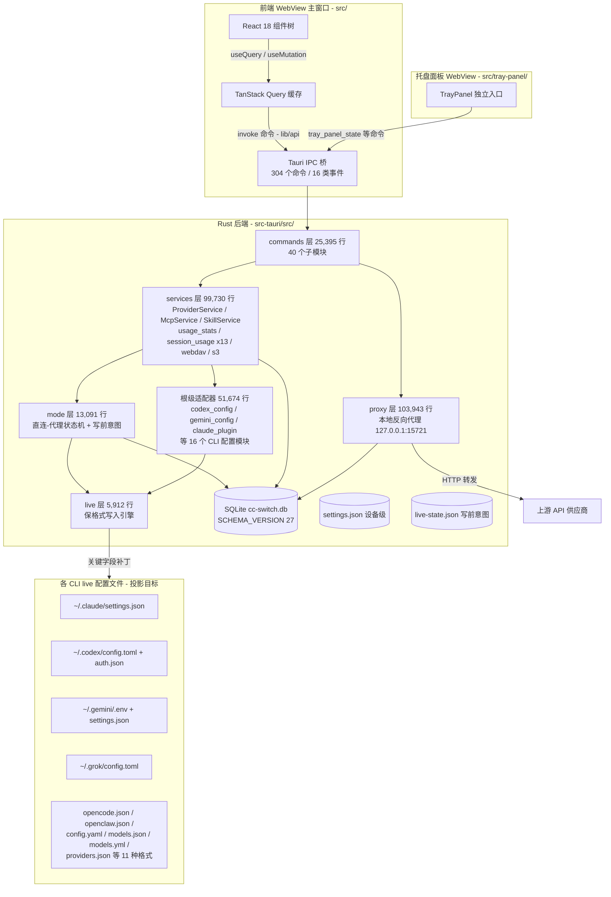
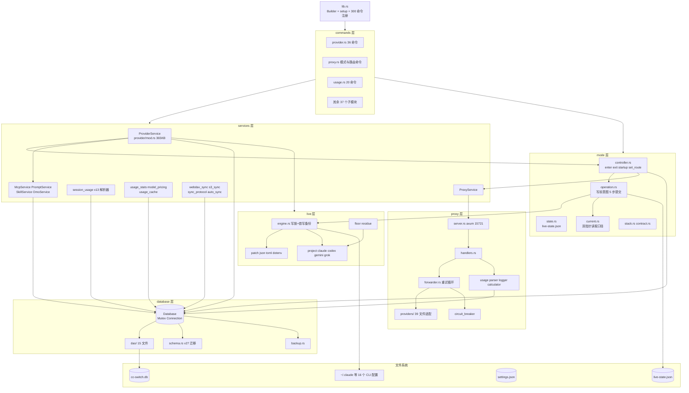
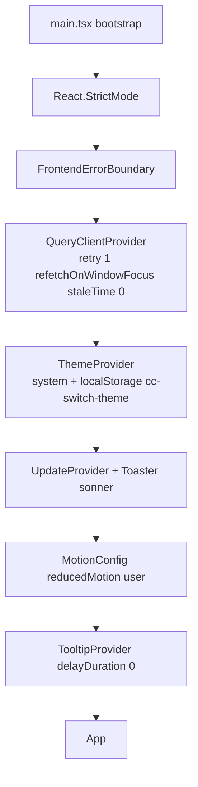
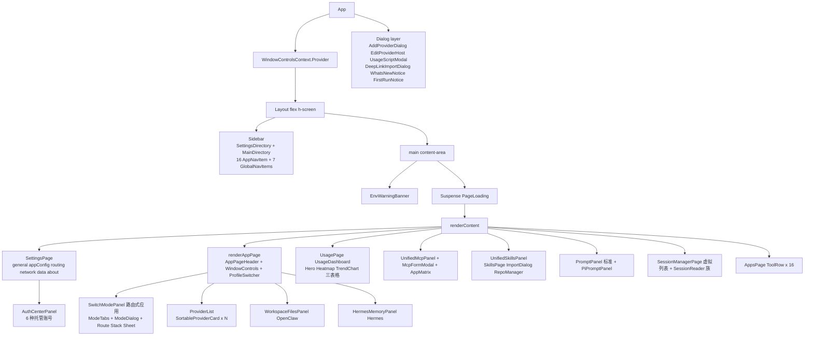
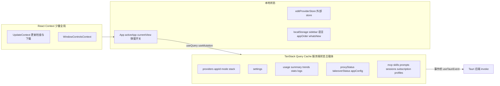
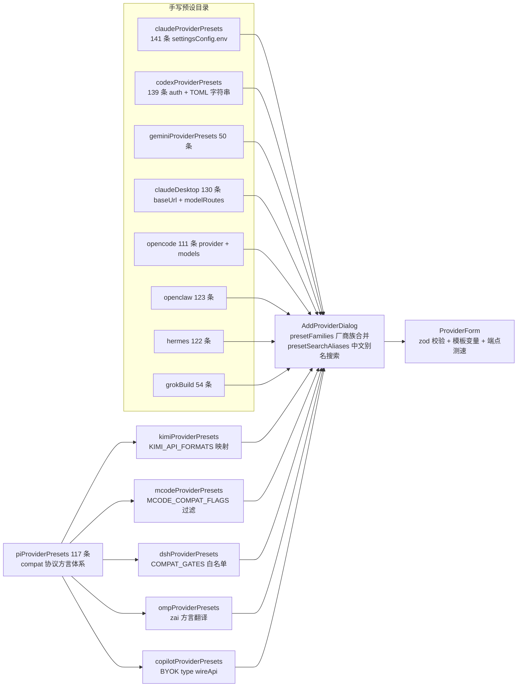

# 01 · 项目架构报告

> 分析对象：`F:\Github\repo\cc-switch`（v4.0.35，commit `6a6ad60e`）
> 分析模式：大规模项目采样精读（Rust 侧精读入口/数据层/服务层/代理层/模式层，前端精读入口/注册表/状态层/API 层）
> 所有论断均附 `文件路径:行号` 引用；行号基于当前工作区版本。

---

## 1. 项目快照

| 维度 | 内容 |
|---|---|
| 项目名称 | cc-switch（`package.json:2`、`src-tauri/Cargo.toml:3`） |
| 版本 | 4.0.35（`package.json:3`、`src-tauri/Cargo.toml:4`） |
| 定位 | "All-in-One Assistant for Claude Code, Codex & Gemini CLI"（`package.json:4`）——面向 16 个 CLI 编码工具的 API 供应商切换器 + 本地反向代理 + MCP/Skills/Prompts 统一管理器（README.md:338-421） |
| 技术栈 | Tauri 2（Rust 1.95 后端）+ React 18 + TypeScript 5.3 + Vite 7 + TanStack Query 5 + Tailwind 3 + Radix UI + CodeMirror 6 + recharts |
| Rust 后端规模 | 436 个 `.rs` 文件，约 354,569 行（`find src-tauri/src -name "*.rs"` 统计） |
| 前端规模 | 520 个 `.ts/.tsx` 文件，约 166,304 行 |
| 测试规模 | 前端 319 个测试文件（`tests/` 299 个 + src 内联 20 个）；Rust 侧 4,449 个 `#[test]` + 610 个 `#[tokio::test]` |
| Tauri 命令 | 304 个 `#[tauri::command]`（grep 统计），`lib.rs:1585-1959` 注册约 300 个 |
| 数据库 | SQLite（rusqlite bundled），`SCHEMA_VERSION = 27`（`src-tauri/src/database/mod.rs:54`） |
| CI | GitHub Actions 8 个 workflow（ci / release / sync-r2 / wsl2-nightly / claude / labeler / stale / schema-version） |
| 贡献者 | 10 人以上活跃（`git log --format="%an"` 统计，Jason 2713 次提交居首） |
| 许可证 | MIT |

### 1.1 各子系统代码规模（Rust，按行数）

| 模块 | 行数 | 职责 |
|---|---|---|
| `src-tauri/src/proxy/` | 103,943 | 本地反向代理服务器（HTTP 转发、协议转换、熔断、故障转移、用量记账） |
| `src-tauri/src/services/` | 99,730 | 业务服务层（供应商切换、用量统计、会话同步、WebDAV/S3 同步、MCP、Skills） |
| 根级 `*.rs`（60 余文件） | 51,674 | 各 CLI 配置适配器（codex_config 6,914 / tray 5,271 / claude_desktop_config 3,233 等） |
| `src-tauri/src/session_manager/` | 27,555 | 会话浏览器（15 个 CLI 的会话扫描/缓存/全文检索） |
| `src-tauri/src/commands/` | 25,395 | Tauri 命令层（304 个命令） |
| `src-tauri/src/database/` | 14,736 | SQLite 持久层（schema 27 版迁移 + 15 个 DAO 文件） |
| `src-tauri/src/mode/` | 13,091 | 直连/代理模式状态机（live-state.json、写前意图、崩溃恢复） |
| `src-tauri/src/deeplink/` | 6,872 | `ccswitch://` 深链接导入协议 |
| `src-tauri/src/mcp/` | 4,931 | 各 CLI 的 MCP 投影器（15 个应用） |
| `src-tauri/src/live/` | 5,912 | 客户端配置文件的保格式写入引擎 |

### 1.2 前端各目录规模

| 目录 | 行数 | 职责 |
|---|---|---|
| `src/components/` | 100,857 | 245 个组件（16 个应用页、用量仪表盘、会话阅读器、设置中心、托盘面板） |
| `src/config/` | 36,659 | 供应商预设目录（claude 141 条 / codex 139 条 / 其余 8 份 50-130 条）+ 应用能力注册表 |
| `src/lib/` | 10,277 | Tauri API 绑定层（26 个文件）+ TanStack Query 组织 + 工具 |
| `src/hooks/` | 5,312 | 36 个自定义 hook |
| `src/utils/` | 5,045 | 前端工具（deeplink 风险分类、供应商能力、TOML 工具等） |
| `src/tray-panel/` | 1,911 | 托盘面板独立 WebView 入口 |
| `src/types/` + `types.ts` | 926 + ~1,070 | 前端类型定义 |

---

## 2. 技术栈全景

### 2.1 Rust 后端依赖要点（`src-tauri/Cargo.toml`）

| 类别 | 依赖 | 用途 |
|---|---|---|
| 框架 | tauri 2.8.2（tray-icon/protocol-asset/macos-private-api） | 桌面应用框架 |
| HTTP 服务 | axum 0.7 + hyper 1 + hyper-util + httparse | 本地代理服务器 |
| TLS | rustls 0.23 + hyper-rustls + rustls-native-certs + webpki-roots | 出站 TLS（ring provider，`lib.rs:612`） |
| HTTP 客户端 | reqwest 0.12（rustls/json/stream/socks） | 池化出站请求（支持 SOCKS5 全局代理） |
| 数据库 | rusqlite 0.31（bundled/backup/hooks） | SQLite（update_hook 驱动自动同步，`database/mod.rs:129-140`） |
| 脚本沙箱 | rquickjs 0.8 | 用户用量查询脚本执行（QuickJS，16 MiB 内存上限） |
| MCP | rmcp 0.8.5（client/transport-sse/transport-streamable-http） | MCP 服务器连通性检测 |
| 序列化 | serde/serde_json（preserve_order）/serde_yaml/toml/toml_edit/json5/json-five | 各 CLI 配置格式保格式读写 |
| 压缩 | flate2/brotli/zstd/zip | 代理响应解压、rollout 压缩会话、Skills zip |
| 精度 | rust_decimal | 用量成本计算（金额全 TEXT 定点存储） |
| 平台 | winreg/webview2-com/windows（Windows）、objc2 系（macOS 托盘玻璃）、gtk/webkit2gtk（Linux） | 原生集成 |

### 2.2 前端依赖要点（`package.json:44-90`）

| 类别 | 依赖 | 用途 |
|---|---|---|
| 状态 | @tanstack/react-query 5.90 | 服务端状态主载体（QueryKey 前缀级联失效） |
| 表单 | react-hook-form 7.65 + @hookform/resolvers + zod 4.1 | 供应商表单（JSON 校验本地化到行列号） |
| UI | radix-ui 10 组件 + tailwindcss 3.4 + tailwindcss-animate + framer-motion 12 | 设计系统 |
| 编辑器 | codemirror 6 + @codemirror/lang-json/lang-markdown/lang-javascript + lint | 配置/提示词/脚本编辑器 |
| 拖拽 | @dnd-kit/core/sortable/utilities | 供应商排序、侧栏应用排序 |
| 虚拟化 | @tanstack/react-virtual | 会话列表虚拟滚动 |
| 图表 | recharts 3.5 | 用量趋势/热力图 |
| 搜索 | flexsearch | 会话元数据索引 |
| 解析 | smol-toml + yaml | 前端侧 TOML/YAML 处理 |
| 更新 | @tauri-apps/plugin-updater | 自动更新 |

---

## 3. 总体架构

cc-switch 是单进程桌面应用：Rust 后端承载全部业务（数据库、本地代理服务器、配置文件写入、用量解析），React 前端经 Tauri `invoke` 调用 304 个命令并监听 16 类事件。核心设计是「**数据库为 SSOT（Single Source of Truth），各 CLI 的 live 配置文件是投影**」：所有供应商/MCP/Skills/Prompts 存于 SQLite，切换供应商时仅把「关键字段」写入各 CLI 的原生配置文件（`live/mod.rs:1-13`："CC Switch 只拥有客户端配置里的关键字段，其余字节不碰"）。



### 3.1 分层规则

| 层 | 位置 | 规则 |
|---|---|---|
| 命令层 | `src-tauri/src/commands/` | 每个 `#[tauri::command]` 薄封装；等数据库锁/切换锁的命令经 `run_db_task` 放入 `spawn_blocking`（`commands/mod.rs:98-112`） |
| 服务层 | `src-tauri/src/services/` | 业务逻辑主体；多数为无字段单元结构体 + 关联函数（`services/mod.rs:52-66`） |
| 模式层 | `src-tauri/src/mode/` | 直连/代理双模式状态机；所有「读当前供应商」必须经 `mode::current::provider_for`（`mode/current.rs:56-67`，白名单测试 123-191 强制） |
| 写入引擎 | `src-tauri/src/live/` | `floor`（关键字段谓词）/`project`（投影器）/`patch`（JSON/TOML/.env 保序改写）/`residue`（冻结残留键）/`engine`（写锁+首写备份+重读比对）五模块（`live/mod.rs:1-13`） |
| 数据层 | `src-tauri/src/database/` | 单连接 `Mutex<Connection>` + 锁中毒恢复（`database/mod.rs:124-117`）；schema 迁移以 `PRAGMA user_version` 步进（`schema.rs:494-771`） |
| 适配器 | 根级 `*_config.rs` | 每个 CLI 一个模块，负责路径解析与原生格式读写 |

---

## 4. 目录结构全景

```text
cc-switch/
├── src/                          # 前端（React 主窗口 + 托盘面板）
│   ├── main.tsx                  # 主窗口引导（Provider 嵌套、init 错误恢复界面）
│   ├── App.tsx                   # 2072 行主组件（无路由库，自管视图状态机）
│   ├── tray-panel/               # 托盘面板独立入口（tray-panel.html）
│   ├── components/
│   │   ├── apps/                 # AppsPage：CLI 工具安装与升级页
│   │   ├── providers/            # 供应商列表/卡片/表单（forms/ 按应用拆 14 套字段组件）
│   │   │   └── mode/             # SwitchModePanel：直连/路由/聚合三态面板
│   │   ├── usage/                # 用量仪表盘（趋势/热力图/请求日志/定价管理）
│   │   ├── sessions/             # 会话管理页 + reader/ 阅读器族 20+ 组件
│   │   ├── settings/             # 设置中心 6 分区 + AuthCenterPanel 授权中心
│   │   ├── mcp/                  # UnifiedMcpPanel（AppMatrix 应用启用矩阵）
│   │   ├── skills/               # UnifiedSkillsPanel（已安装/发现）
│   │   ├── prompts/              # PromptPanel + PiPromptPanel
│   │   ├── deeplink/ env/ hermes/ openclaw/ profiles/ proxy/ quota/ shell/ universal/ workspace/
│   │   └── ui/ common/           # shadcn/ui 基件与通用组件
│   ├── config/                   # ★ 预设与能力注册表（36,659 行）
│   │   ├── appSpecs.ts           # 16 应用能力矩阵（AppCaps 12 项）
│   │   ├── appConfig.tsx         # APP_ICON_MAP 展示层注册表
│   │   ├── claudeProviderPresets.ts    # 141 条预设
│   │   ├── codexProviderPresets.ts     # 139 条（auth + TOML 字符串载体）
│   │   ├── piProviderPresets.ts        # 117 条（Pi 目录 = 派生中心）
│   │   ├── kimi/mcode/dsh/omp/copilot ProviderPresets.ts  # 全部由 Pi 目录换算生成
│   │   └── presetFamilies.ts / presetModelMetadata.ts / presetSearchAliases.ts
│   ├── hooks/                    # 36 个自定义 hook
│   ├── lib/
│   │   ├── api/                  # 26 个 Tauri 命令绑定文件
│   │   ├── query/                # QueryKey 工厂 + queries/mutations/proxy/usage 等
│   │   └── schemas/ errors/ utils/
│   ├── i18n/                     # 8 语言（de/en/ja/ko/ru/tr/zh/zh-TW），单命名空间
│   ├── types.ts + types/         # 前端类型（1070 行主文件）
│   └── whats-new/                # 36 个版本公告 JSON（import.meta.glob 打包）
├── src-tauri/
│   ├── src/
│   │   ├── main.rs               # 入口：Linux WebKit 环境变量 → cc_switch_lib::run()
│   │   ├── lib.rs                # ★ 2622 行：Builder 配置、setup 初始化、300 命令注册、退出处理
│   │   ├── commands/             # 40 个命令子模块
│   │   ├── services/
│   │   │   ├── provider/         # ProviderService（mod.rs 365KB）+ 25 个文件
│   │   │   │   ├── claude_direct.rs / codex_direct.rs / gemini_direct.rs / grok_direct.rs
│   │   │   │   ├── claude_official.rs / codex_login.rs / codex_official_models.rs
│   │   │   │   ├── claude_editor.rs / codex_editor.rs / editor_toml.rs（表单投影）
│   │   │   │   └── live.rs（live 读写编排）
│   │   │   ├── session_usage.rs + session_usage_{codex,gemini,opencode,grokbuild,pi,omp,mcode,agy,kimi,copilot,workbuddy,dsh}.rs
│   │   │   ├── usage_stats.rs / usage_cache.rs / model_pricing.rs / usage_http.rs
│   │   │   ├── webdav_sync/ s3_sync / auto_sync / sync_protocol（PROTOCOL_VERSION 2）
│   │   │   ├── mcp.rs + mcp_connectivity / skill.rs（387KB）/ prompt.rs / profile.rs
│   │   │   ├── proxy.rs（ProxyService 生命周期）
│   │   │   ├── subscription*.rs / coding_plan.rs / exchange_rates.rs / speedtest.rs
│   │   │   └── agy_account/ claude_account/ kimi_oauth/ workbuddy_account/（托管账号）
│   │   ├── proxy/                # ★ 103,943 行本地代理
│   │   │   ├── server.rs（手动 hyper accept + 保 header 大小写）
│   │   │   ├── handlers.rs / handler_context.rs / handler_config.rs
│   │   │   ├── provider_router.rs / forwarder.rs + forwarder/（10 文件）
│   │   │   ├── providers/（39 文件：协议转换器 + 3 个 OAuth 管理器）
│   │   │   ├── usage/（parser/logger/calculator）
│   │   │   ├── session.rs / circuit_breaker.rs / failover_switch.rs / switch_lock.rs
│   │   │   └── 12 个整流/守卫/工具模块（privacy_filter、opaque_state_rectifier 等）
│   │   ├── mode/                 # controller/operation/state/current/contract/stack
│   │   ├── live/                 # engine/floor/residue + patch/{json,toml,dotenv} + project/{claude,codex,gemini,grok}
│   │   ├── database/             # mod/schema（4000 行）/migration/backup + dao/（15 文件）
│   │   ├── mcp/                  # 15 个应用投影器 + json_file/validation
│   │   ├── session_manager/      # mod/cache/model/content/search + providers/（21 文件）
│   │   ├── deeplink/             # parser/provider/mcp/prompt/skill/codex_link/grok_link/icon_fetch
│   │   ├── codex_config.rs（6,914 行）/ gemini_config.rs / grok_config.rs / hermes_config.rs
│   │   ├── claude_plugin.rs / claude_mcp.rs / claude_desktop_config.rs / gemini_mcp.rs
│   │   ├── agy_config.rs / copilot_config.rs / dsh_config.rs / kimi_config.rs / kimi_session.rs
│   │   ├── mcode_config.rs / omp_config.rs / openclaw_config.rs / opencode_config.rs / pi_config/
│   │   ├── workbuddy_config.rs / codex_state_db.rs / codex_rollout_file.rs / codex_history_migration.rs
│   │   ├── tray.rs（5,271 行）/ tray_panel.rs / tray_compat.rs
│   │   ├── settings.rs（2,037 行）/ store.rs / provider.rs / provider_kind.rs / app_config.rs / app_store.rs
│   │   ├── error.rs / config.rs（路径与原子写）/ sync_utils.rs
│   │   ├── lightweight.rs / init_status.rs / panic_hook.rs / app_update.rs / auto_launch.rs
│   │   ├── window_fit.rs / linux_fix.rs / usage_events.rs / usage_script.rs
│   │   ├── prompt.rs / prompt_files.rs / model_capabilities.rs / jsonc_document.rs
│   │   └── frontend_parity_tests.rs（前后端常量金标生成）
│   ├── tauri.conf.json           # 窗口/CSP/bundle/deep-link/updater 配置
│   ├── capabilities/             # default.json + tray-panel.json（最小权限）
│   └── .config/nextest.toml      # CI 测试运行器配置
├── tests/                        # 322 个前端测试文件（components 170 / config 48 / hooks 37 / lib 26...）
├── scripts/                      # generate-download-manifest.mjs / rewrite-updater-manifest.mjs
├── docs/                         # 指南（多语言 routing guide）、design-system、user-manual
└── .github/workflows/            # 8 个 CI/CD workflow
```

---

## 5. 后端模块依赖图



关键依赖约束（由测试强制）：

- 「读当前供应商」只能经 `mode::current::provider_for`，白名单仅 `settings.rs`、`database/dao/providers.rs`、`mode/current.rs` 三处（`mode/current.rs:123-191` 测试）。
- Copilot URL 判定只允许出现在 `provider_kind.rs`（守护测试 `identity_checks_stay_in_provider_kind`，`provider_kind.rs:166-202`）。
- 前后端共享常量由 `frontend_parity_tests.rs` 生成金标 `tests/config/backendConstants.json` 并双向比对（`frontend_parity_tests.rs:102`）；应用能力矩阵同样有 `appSpecs.json` 双端对齐（`src/config/appSpecs.ts:7-8` 注释）。

---

## 6. 前端架构

### 6.1 引导流程与 Provider 嵌套

`src/main.tsx` 模块加载即执行全局错误处理安装与右键菜单禁用（`src/main.tsx:34-35`）；React 渲染前先订阅 `configLoadError` 事件（`src/main.tsx:87-93`）并主动查询 `get_init_error`——数据库版本过新（`kind == "db_version_too_new"`）时直接渲染 `DatabaseUpgrade` 恢复界面而不进入主应用（`src/main.tsx:100-117`）。

Provider 嵌套顺序（外→内，`src/main.tsx:138-157`）：



### 6.2 视图组织（无路由库）

App.tsx 自管三段状态机：`activeApp: AppId`（localStorage 持久化，缺省 "claude"，`src/App.tsx:219-232`）、`currentView: View`（`src/lib/navigation.ts:15-27` 定义 AppPage/GlobalPage/settings 三类）、`settingsSection`。全部页面组件 `lazy()` 按需加载并在空闲时预载新增表单（`src/App.tsx:146-197, 354`）。正在编辑的供应商放在 `editProviderStore`（`useSyncExternalStore` 外部 store，`src/components/providers/editProviderStore.ts:25-54`）以隔离重渲染。

### 6.3 组件树（主窗口，组件级）



### 6.4 状态管理分层



QueryKey 采用层级前缀设计：`["providers", appId]`（gcTime Infinity）、模式与 Stack 挂同一前缀（`src/lib/query/proxy.ts:62,70-71`）；`usageKeys` 把时间范围、筛选、liveEndTime 全部编入 key（`src/lib/query/usage.ts:43-166`）。mutation onSuccess 按前缀级联失效并调用 `update_tray_menu`（`src/lib/query/mutations.ts:344-381`）。

### 6.5 应用能力注册表（appSpecs.ts）

16 个应用的能力矩阵是前端单一事实来源（`src/config/appSpecs.ts:48-257`，`as const satisfies Record<AppId, AppCaps>` 保证新增应用漏写任一项即编译错误）：

| AppId | localProxy | routeMode | stack | additive | skills/mcp/prompts | managedAccount | 其他 |
|---|---|---|---|---|---|---|---|
| claude | ✓ | ✓ | ✓ | — | ✓/✓/✓ | ✓ | editorView、officialSubscription |
| claude-desktop | — | ✓ | ✓ | — | —/—/— | ✓ | |
| codex | ✓ | ✓ | ✓ | — | ✓/✓/✓ | ✓ | editorView |
| gemini | ✓ | ✓ | — | — | ✓/✓/✓ | — | editorView |
| grokbuild | ✓ | ✓ | — | — | ✓/✓/✓ | — | editorView |
| opencode | — | — | — | ✓ | ✓/✓/✓ | — | |
| openclaw | — | — | — | ✓ | —/✓/— | — | |
| hermes | — | — | — | ✓ | ✓/✓/✓ | — | |
| pi | — | — | — | ✓ | ✓/✓/✓ | — | piFamily |
| mcode | — | — | — | ✓ | ✓/—/✓ | — | |
| kimi | — | — | — | ✓ | ✓/✓/✓ | ✓ | |
| dsh | — | — | — | ✓ | ✓/✓/✓ | ✓ | |
| agy | — | — | — | — | ✓/✓/✓ | ✓ | officialSubscription |
| omp | — | — | — | ✓ | ✓/✓/✓ | — | piFamily |
| copilot | — | — | — | ✓ | ✓/✓/✓ | ✓ | |
| workbuddy | — | — | — | ✓ | ✓/✓/✓ | ✓ | |

后端对应物为 `AppSpec { id, additive, local_proxy, route_mode, stack }`（`src-tauri/src/app_config.rs:334-351`，`spec()` 355-470 穷举 16 应用）。

### 6.6 预设体系结构

预设呈「源目录 + 派生」结构：`piProviderPresets.ts`（117 条）是派生中心，kimi/mcode/dsh/omp/copilot 五份预设均由 Pi 目录程序化换算（如 `kimiProviderPresets = piProviderPresets.flatMap(...)`，`src/config/kimiProviderPresets.ts:151-190`）；claude（141 条）/codex（139 条）/gemini（50 条）/claude-desktop（130 条）/opencode（111 条）/openclaw（123 条）/hermes（122 条）/grokBuild（54 条）为手写独立目录。



---

## 7. 关键设计模式与约定

| 模式 | 位置 | 说明 |
|---|---|---|
| SSOT + 投影 | `database/` → `live/` | 数据库为唯一事实，CLI 配置文件是关键字段投影；删除 SSOT 行时同步移除投影 |
| 写前意图（Write-ahead intent） | `mode/operation.rs:65-205` | 5 步提交协议（plan→stage→set_pending→publish→commit），崩溃后按 `published` 标记丢弃或前滚 |
| 空值墓碑 | `services/provider/claude_direct.rs:132-421` | Claude 切换先写 `""` 让运行中的会话丢掉旧凭据，10 秒后真删（`TOMBSTONE_TTL`），退出时最多等 3 秒（`TOMBSTONE_MIN_VISIBLE`） |
| 适配器（协议转换） | `proxy/providers/adapter.rs:16-51` | `ProviderAdapter` trait 统一 base_url/auth/URL 构建/请求转换；39 个文件实现 Anthropic/ChatCompletions/Responses/Gemini Native 四协议互转 |
| 熔断器 | `proxy/circuit_breaker.rs` | Closed/Open/HalfOpen 三态；HalfOpen 每轮仅 1 个探测名额（AtomicU64 轮次+名额，修复 #7206/#9292） |
| RAII 计数 | `proxy/forwarder.rs:119-152` | `ActiveConnectionGuard` 维护 active_connections/total_requests，随流式 body drop 释放 |
| 锁中毒恢复 | `sync_utils.rs:1-22` + `database/mod.rs:75-117` | `MutexExt::lock_recover` 从中毒锁恢复；数据库锁中毒时回滚未完事务 |
| 双端契约测试 | `frontend_parity_tests.rs:102` + `tests/config/*.json` | Rust 生成金标 JSON，前端测试比对，防常量漂移 |
| 最小权限 capabilities | `src-tauri/capabilities/tray-panel.json` | 托盘面板 WebView 仅 `core:default`（只读数据、发事件） |
| 原子写 | `config.rs:442-747` | 临时文件 + rename；Windows `ReplaceFileW`；WSL UNC 特判；JSON 键排序确定性输出 |
| 日志脱敏 | `lib.rs:153-303` | `redact_url_for_log` 剥 userinfo/query；`redact_known_secrets` 只隐藏已知密钥值（≥8 字符），不做形状猜测 |
| 错误分类 | `proxy/error.rs:178-183` + `forwarder.rs:2416-2461` | `ErrorCategory{Retryable, NonRetryable}` 驱动故障转移；400/405/406/413/414/415/422/501 不可重试 |

---

## 8. 架构特征总结

1. **厚度反转**：业务复杂度集中在 Rust 侧（约 35 万行，占 68%），前端是薄展示层（约 17 万行）；304 个命令构成完整 API 面。
2. **一套数据模型覆盖 16 个异构 CLI**：`AppType` 枚举（`app_config.rs:311-329`）+ 每应用一个配置适配器 + `AppSpec` 能力表，新增 CLI 的成本主要是适配器 + 预设目录 + 能力行。
3. **本地代理是内置基础设施而非外置进程**：axum 服务器随主进程启动（默认 `127.0.0.1:15721`，`proxy/types.rs:16-20`），手动 hyper accept loop 保留客户端原始 header 大小写（`proxy/server.rs:5-9,151-218`）以实现对上游的 wire 级伪装。
4. **崩溃安全贯穿写入路径**：live-state.json 写前意图、首写备份、重读比对（最多 3 次 replan，`operation.rs:33`）、数据库版本升级前自动快照（`database/mod.rs:175-187`）。
5. **多通道数据回填**：用量数据来自两个独立来源（代理记账 `data_source='proxy'` + 13 个 CLI 会话文件解析 `data_source='session_log'`），经 `session_usage_dedup` 语义去重后在 `proxy_request_logs` 表合流。
