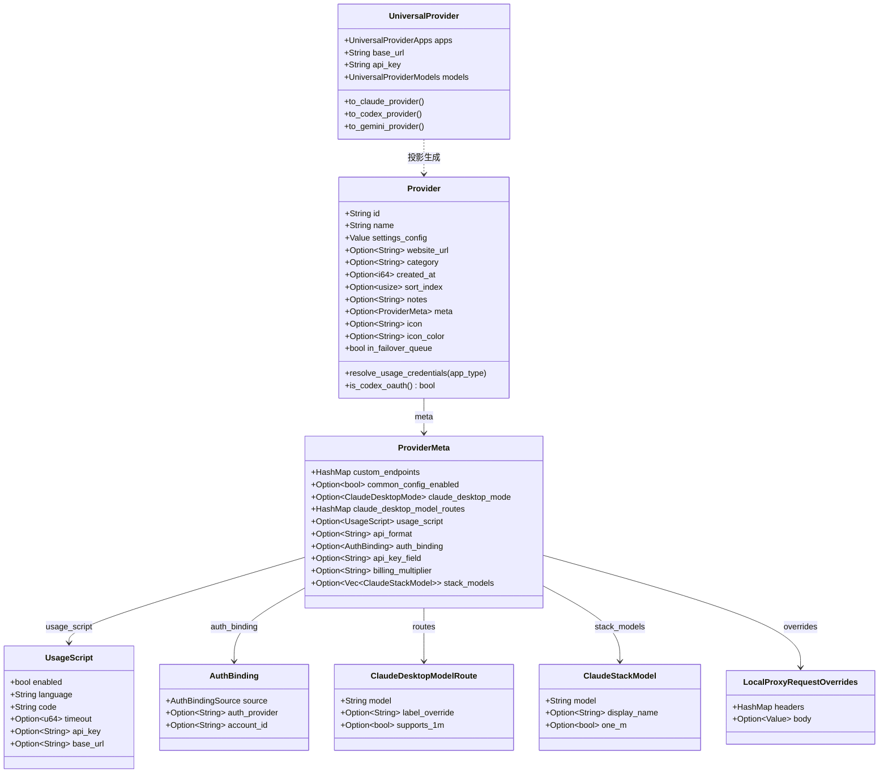

# 02 · 数据结构报告（类与变量级）

> 本报告逐字段罗列 cc-switch 的全部核心数据结构：Rust 结构体/枚举、SQLite 表结构、前端 TypeScript 类型，以及三者的映射关系。所有字段定义附 `文件路径:行号` 引用。

---

## 1. 全局状态与运行时容器

### 1.1 AppState（Tauri 全局状态）

`src-tauri/src/store.rs:7-15`，`#[derive(Clone)]`，由 `lib.rs:820` 构造、`lib.rs:1314` 注入 `app.manage()`：

```rust
pub struct AppState {
    pub db: Arc<Database>,                            // store.rs:9  SQLite 封装
    pub proxy_service: ProxyService,                  // store.rs:10 本地代理生命周期
    pub usage_cache: Arc<UsageCache>,                 // store.rs:11 托盘用量写穿缓存
    pub codex_oauth_manager: Arc<CodexOAuthManager>,  // store.rs:14 ChatGPT 反代账号
}
```

初始化 `AppState::new`（store.rs:17-31）：`CodexOAuthManager::new(get_app_config_dir())` → `ProxyService::new(db.clone())` → 组装。`CodexOAuthManager` 内部为细粒度锁（accounts/access_tokens/refresh_locks），故无需外层 RwLock（store.rs:12-13 注释）。

### 1.2 Database

`src-tauri/src/database/mod.rs:124-126`：

```rust
pub struct Database {
    pub(crate) conn: Mutex<Connection>,                    // 单连接串行
    pub(crate) log_count_cache: Mutex<Option<LogCountCache>>, // 请求日志总数缓存
}
```

- `lock_conn!` 宏（mod.rs:63-67）+ `lock_recovering` 锁中毒恢复（75-85）：中毒的 Connection 回滚未完事务，缓存置 None（`RecoverPoisoned`，88-117）。
- `Database::init()`（mod.rs:146-203）：开库 → `PRAGMA foreign_keys=ON` → 新库 `auto_vacuum=INCREMENTAL` → 注册 update_hook（129-140，INSERT/UPDATE/DELETE 时通知 WebDAV/S3 自动同步 worker）→ 建表 → **版本升级前自动快照备份**（175-187）→ schema 迁移 → 定价 seed。
- `stored_user_version_exceeds_supported`（210-219）：启动预检「数据库比应用新」。

### 1.3 ProxyService 与代理共享状态

`ProxyService`（`src-tauri/src/services/proxy.rs:20-27`）：`db: Arc<Database>`、`server: Arc<RwLock<Option<ProxyServer>>>`、`app_handle: Arc<RwLock<Option<AppHandle>>>`（故障转移 UI 更新用）、`switch_locks: SwitchLockManager`。

`ProxyState`（代理服务器每请求共享，`src-tauri/src/proxy/server.rs:36-53`）：

| 字段 | 类型 | 行号 | 说明 |
|---|---|---|---|
| `db` | `Arc<Database>` | server.rs:37 | |
| `config` | `Arc<RwLock<ProxyConfig>>` | server.rs:38 | 监听配置热更新 |
| `status` | `Arc<RwLock<ProxyStatus>>` | server.rs:39 | 运行指标 |
| `start_time` | `Arc<RwLock<Option<Instant>>>` | server.rs:40 | uptime 计算 |
| `current_providers` | `Arc<RwLock<HashMap<String,(String,String)>>>` | server.rs:42 | app_type → (provider_id, provider_name) |
| `provider_router` | `Arc<ProviderRouter>` | server.rs:44 | 持熔断器表，跨请求存活 |
| `gemini_shadow` | `Arc<GeminiShadowStore>` | server.rs:46 | thoughtSignature/tool call 回放 |
| `codex_chat_history` | `Arc<CodexChatHistoryStore>` | server.rs:48 | previous_response_id 恢复 |
| `app_handle` | `Option<AppHandle>` | server.rs:50 | 发事件/刷托盘 |
| `failover_manager` | `Arc<FailoverSwitchManager>` | server.rs:52 | 去重切换 |

`ProxyServer`（server.rs:56-62）：`config` / `state` / `shutdown_tx: Arc<RwLock<Option<oneshot::Sender<()>>>>` / `server_handle: Arc<RwLock<Option<JoinHandle<()>>>>`。

---

## 2. 领域模型：供应商

### 2.1 Provider（Rust 侧）

`src-tauri/src/provider.rs:34-68`：

```rust
pub struct Provider {
    pub id: String,                                   // provider.rs:36
    pub name: String,                                 // provider.rs:37
    #[serde(rename = "settingsConfig")]
    pub settings_config: Value,                       // provider.rs:38-39  各应用原生配置 JSON
    #[serde(rename = "websiteUrl", skip_serializing_if = "Option::is_none")]
    pub website_url: Option<String>,                  // provider.rs:40-42
    #[serde(skip_serializing_if = "Option::is_none")]
    pub category: Option<String>,                     // provider.rs:43-44  official/aggregator/...
    #[serde(rename = "createdAt", skip_serializing_if = "Option::is_none")]
    pub created_at: Option<i64>,                      // provider.rs:45-47
    #[serde(rename = "sortIndex", skip_serializing_if = "Option::is_none")]
    pub sort_index: Option<usize>,                    // provider.rs:48-50
    #[serde(skip_serializing_if = "Option::is_none")]
    pub notes: Option<String>,                        // provider.rs:51-53
    #[serde(skip_serializing_if = "Option::is_none")]
    pub meta: Option<ProviderMeta>,                   // provider.rs:54-56  不写 live 仅存库
    #[serde(skip_serializing_if = "Option::is_none")]
    pub icon: Option<String>,                         // provider.rs:57-59
    #[serde(rename = "iconColor", skip_serializing_if = "Option::is_none")]
    pub icon_color: Option<String>,                   // provider.rs:60-63
    #[serde(default, rename = "inFailoverQueue")]
    pub in_failover_queue: bool,                      // provider.rs:64-67
}
```

关键方法：`with_id`（provider.rs:82-102）、`has_official_category`（77-79，全工程唯一 `"official"` 比较点）、身份判定 `is_codex_oauth / is_xai_oauth / is_github_copilot / uses_managed_account_auth / uses_proxy_injected_oauth`（104-131，全部委托 ProviderKind）、`resolve_usage_credentials(app_type)`（179-336，按 16 个 AppType 逐一解析 `(base_url, api_key)`）。

`ProviderManager`（JSON 时代遗留，provider.rs:340-344）：`providers: IndexMap<String, Provider>` + `current: String`。

### 2.2 ProviderMeta（扩展元数据，字段级全表）

`src-tauri/src/provider.rs:546-702`，`#[serde(default)]`，camelCase rename：

| 字段 | 类型 | 行号 | 用途 |
|---|---|---|---|
| `custom_endpoints` | `HashMap<String, CustomEndpoint>` | 549-550 | 自定义端点（按 URL 去重；DB 侧权威在 provider_endpoints 表） |
| `common_config_enabled` | `Option<bool>` | 552-556 | 写 live 时应用通用配置片段 |
| `claude_desktop_mode` | `Option<ClaudeDesktopMode>` | 558-559 | direct / proxy |
| `claude_desktop_model_routes` | `HashMap<String, ClaudeDesktopModelRoute>` | 561-566 | Desktop 角色路由 |
| `usage_script` | `Option<UsageScript>` | 568-569 | 用量查询脚本 |
| `endpoint_auto_select` | `Option<bool>` | 571-572 | 测速自动选点 |
| `is_partner` / `partner_promotion_key` | `Option<bool>` / `Option<String>` | 574-581 | 赞助商标记 |
| `billing_multiplier` | `Option<String>` | 583-584 | 计费倍率（0-1000 十进制字符串） |
| `cost_multiplier` | `Option<String>` | 586-587 | 已停用，同步往返兼容 |
| `pricing_model_source` | `Option<String>` | 590-591 | 已停用 |
| `limit_daily_usd` / `limit_monthly_usd` | `Option<String>` | 593-597 | 日/月限额 |
| `api_format` | `Option<String>` | 602-603 | anthropic / openai_chat / openai_responses / gemini_native |
| `codex_copilot_api_format` | `Option<String>` | 606-610 | |
| `auth_binding` | `Option<AuthBinding>` | 614-615 | 托管账号绑定 |
| `api_key_field` | `Option<String>` | 617-618 | ANTHROPIC_AUTH_TOKEN / ANTHROPIC_API_KEY |
| `is_full_url` | `Option<bool>` | 620-621 | base_url 即完整端点 |
| `prompt_cache_key` / `prompt_cache_routing` | `Option<String>` | 626-631 | auto/enabled/disabled |
| `codex_fast_mode` | `Option<bool>` | 633-634 | |
| `codex_chat_reasoning` | `Option<CodexChatReasoningConfig>` | 636-637 | |
| `claude_reasoning_effort` | `Option<String>` | 641-645 | |
| `impersonate_claude_code` | `Option<bool>` | 649-653 | UA 伪装 |
| `max_output_tokens` | `Option<u64>` | 664-665 | Codex→Anthropic 输出上限 |
| `custom_user_agent` | `Option<String>` | 667-668 | |
| `local_proxy_request_overrides` | `Option<LocalProxyRequestOverrides>` | 670-674 | 本地路由请求头/体覆写 |
| `live_config_managed` | `Option<bool>` | 677-678 | 累加模式是否已写 live |
| `opencode_config_format` | `Option<OpenCodeConfigFormat>` | 681-685 | v1/v2 |
| `provider_type` | `Option<String>` | 688-689 | github_copilot / codex_oauth / xai_oauth |
| `github_account_id` | `Option<String>` | 692-693 | 旧版兼容 |
| `stack_models` | `Option<Vec<ClaudeStackModel>>` | 696-701 | Stack 模式发布模型 |

附属类型（同文件）：

- `UsageScript`（347-398）：`enabled: bool`、`language/code: String`、`timeout: Option<u64>` 及 12 个 `Option<String>` 凭据字段（apiKey/baseUrl/accessToken/userId/templateType/autoQueryInterval/codingPlanProvider/accessKeyId/secretAccessKey/teamOrganizationId/teamProjectId）。
- `UsageData`（401-422）：planName/extra/isValid/invalidMessage/total/used/remaining/unit。
- `UsageResult`（425-432）：`success: bool`、`data: Option<Vec<UsageData>>`、`error: Option<String>`。
- `AuthBinding`（446-457）：`source: AuthBindingSource`（ProviderConfig/ManagedAccount，435-443）、`auth_provider`、`account_id`。
- `ClaudeDesktopMode`（460-465）：`Direct`/`Proxy`（lowercase serde）。
- `ClaudeDesktopModelRoute`（468-479）：`model`、`label_override`、`supports_1m`。
- `CodexCopilotApiFormat`（482-489）：`Auto`（默认）/`OpenaiResponses`/`OpenaiChat`，未知值回退 auto（495-501）。
- `CodexChatReasoningConfig`（505-528）：supportsThinking/supportsEffort/thinkingParam/effortParam/effortValueMode/outputFormat + `#[serde(skip)] effort_levels`。
- `LocalProxyRequestOverrides`（531-537）：`headers: HashMap<String,String>` + `body: Option<Value>`。
- `ClaudeStackModel`（705-716）：`model`、`display_name`、`one_m`。

### 2.3 ProviderKind 与 UniversalProvider

```rust
pub enum ProviderKind { GitHubCopilot, CodexOAuth, XaiOAuth }   // provider_kind.rs:13-18
```

`ProviderKind::declared`（22-29）只读 `meta.providerType`；`of`（36-47）对旧 Copilot 数据做 URL 回退判定（`env.ANTHROPIC_BASE_URL` 含 `githubcopilot.com`，常量 COPILOT_URL_MARKER :11），URL 判定优先于声明。

`UniversalProvider`（跨应用共享供应商，provider.rs:848-893）：`id/name/provider_type/apps(UniversalProviderApps: claude/codex/gemini 三 bool, 786-794)/base_url/api_key/models(UniversalProviderModels 三档, 837-845)/website_url/notes/icon/icon_color/meta/created_at/sort_index`；`to_claude_provider / to_codex_provider / to_gemini_provider`（923-1066）投影为三应用 Provider。

### 2.4 类图（供应商模型）



---

## 3. 应用注册与多应用结构

### 3.1 AppType（16 变体）

`src-tauri/src/app_config.rs:311-329`：

```rust
pub enum AppType {
    Claude, ClaudeDesktop, Codex, Gemini, GrokBuild, OpenCode, OpenClaw,
    Hermes, Pi, Mcode, Kimi, Dsh, Agy, Omp, Copilot, WorkBuddy,
}
```

- 不走 serde；序列化用 `as_str()`（→ `self.spec().id`，472-474），解析只走 `FromStr` 别名表（510-537）：`grokbuild|grok-build|grok_build|grok`、`agy|antigravity|antigravity-cli`、`omp|oh-my-pi|oh_my_pi|ohmypi`、`copilot|copilot-cli|github-copilot|github-copilot-cli`、`workbuddy|work-buddy|work_buddy`、`kimi|kimi-code`、`dsh|deepseek-harness` 等。
- `AppType::ALL: [AppType; 16]`（477-494）与 `all()`（496-498）。
- `AppSpec { id, additive, local_proxy, route_mode, stack }`（334-351），`spec()`（355-470）穷举。
- 前端 `AppId` 16 值联合（`src/lib/api/types.ts:2-18`）；用量域 `AppType` 为 13 值（无 claude-desktop/openclaw/hermes，`src/types/usage.ts:201-214`）。

### 3.2 McpApps / SkillApps（宏生成的同形结构体）

`app_config.rs:11-128` 宏 `app_flags!` 生成，各含 14 个 `#[serde(default)] bool` 字段（claude/codex/gemini/grokbuild/opencode/mcode/kimi/dsh/workbuddy/agy/copilot/hermes/pi/omp）；`ORDER: [AppType; 14]`（48-63，ClaudeDesktop/OpenClaw 不参与，`slot()` 对它们返回 None :81）。方法：`is_enabled_for`（86-89）、`set_enabled_for`（92-96）、`enabled_apps`（99-104）、`is_empty`（107-109）、`only(app)`（112-116）。

### 3.3 McpServer / InstalledSkill / Prompt

```rust
pub struct McpServer {                       // app_config.rs:188-202
    pub id: String,
    pub name: String,
    pub server: serde_json::Value,           // 原生 server 定义 command/args/env/url...
    pub apps: McpApps,
    pub description: Option<String>,
    pub homepage: Option<String>,
    pub docs: Option<String>,
    pub tags: Vec<String>,
}

pub struct InstalledSkill {                  // app_config.rs:131-168（camelCase）
    pub id: String,                          // "owner/repo:directory" 或 "local:directory"
    pub name: String,
    pub description: Option<String>,
    pub directory: String,                   // SSOT 子目录名
    pub repo_host: Option<String>,           // 缺省 github.com（v27 新增 GitLab 支持）
    pub repo_owner / repo_name / repo_branch: Option<String>,
    pub readme_url: Option<String>,
    pub apps: SkillApps,
    pub installed_at: i64,
    pub content_hash: Option<String>,        // SHA-256
    pub updated_at: i64,
}

pub struct Prompt {                          // src-tauri/src/prompt.rs:3-16
    pub id: String, pub name: String, pub content: String,
    pub description: Option<String>,
    pub enabled: bool,                        // 默认 true
    pub created_at / updated_at: Option<i64>,
}
```

`UnmanagedSkill`（app_config.rs:171-185）：directory/name/description/found_in/path。

### 3.4 MultiAppConfig（JSON 时代根结构，仅迁移用）

`app_config.rs:563-585`：`version: u32`（默认 2）、`apps: HashMap<String, ProviderManager>`（flatten）、`mcp: McpRoot`、`prompts: PromptRoot`、`skills: SkillStore`、`common_config_snippets`、旧字段 `claude_common_config_snippet`。`load()`（619-721）负责 v1 拒绝、skills.json 导入、MCP 统一迁移、Prompt 导入；`save()`（724-736）先备份 `.bak` 再写。

---

## 4. 设备级设置（AppSettings）

存储于 `~/.cc-switch/settings.json`（`AppSettings::settings_path()`，settings.rs:830-837），**设备级、不随云同步**（479-481 注释）。内存缓存 `static SETTINGS_STORE: OnceLock<RwLock<AppSettings>>`（1078-1082），读写锁均带中毒恢复。

### 4.1 字段全表（settings.rs:482-729，rename_all = camelCase）

**UI 与行为开关**：

| 字段 | 类型 | 默认 | 行号 |
|---|---|---|---|
| show_in_tray | bool | true | 486-487 |
| minimize_to_tray_on_close | bool | true | 488-489 |
| use_app_window_controls | bool | false | 490-491 |
| enable_claude_plugin_integration | bool | false | 493-494 |
| skip_claude_onboarding | bool | false | 496-497 |
| launch_on_startup | bool | false | 499-500 |
| silent_startup | bool | false | 502-503 |
| lightweight_mode | bool | false | 506-507 |
| enable_local_proxy | bool | false | 509-510 |
| enable_stack_mode | bool | false | 513-514 |
| proxy_confirmed / usage_confirmed | Option\<bool\> | None | 516-520 |
| usage_dashboard_refresh_interval_ms | Option\<u32\> | None | 521-522 |
| usage_display | Option\<UsageDisplaySettings\> | None | 524-525（结构 441-472：currency/exchangeRates/sidebarTodayItems/requestLogColumns/trendChartType/rateSource/autoExchangeRates/rateFetchedAt/rateProvider） |
| session_auto_sync_enabled | bool | true | 529-530 |
| session_content_search_enabled | bool | false | 532-533 |
| enable_failover_toggle | bool | false | 535-536 |
| show_profile_switcher | bool | false | 538-539 |
| show_provider_search | bool | true | 542-543 |
| check_tool_updates_on_startup | bool | false | 546-547 |
| auto_update_enabled | bool | false | 549-550 |
| native_tray_menu | bool | false | 553-554 |
| preserve_codex_official_auth_on_switch | bool | false | 557-558 |
| codex_quota_protection | CodexQuotaProtection | enabled:true, 95/98 | 560-561（结构 406-422） |
| codex_proxy_without_official_login | bool | false | 566-567 |
| unify_codex_session_history | bool | false | 571-572 |
| unify_codex_migrate_existing | Option\<bool\> | None | 577-578 |
| codex_stack_classic_tools | bool | true | 584-585 |
| codex_stack_subagent_model / _reasoning_effort / auto_review_model | Option\<String\> | None | 589-598 |
| failover_confirmed / first_run_notice_confirmed / new_layout_notice_confirmed / whats_new_seen_version / common_config_confirmed | Option | None | 600-613 |
| language | Option\<String\> | None | 614-615（白名单 settings.rs:476） |
| quota_display | Option\<String\> | "left"/"used" | 618-619 |

**应用显示**：`visible_apps: Option<VisibleApps>`（622-623，默认除 hermes=false 全 true，30-91）、`app_order: Option<Vec<String>>`（625-626）。

**目录覆盖（10 个 Option\<String\>）**：claude/codex/gemini/grok/opencode/openclaw/hermes/pi/omp/dsh `_config_dir`（629-649）。

**当前供应商指针（10 个 Option\<String\>，优先于 DB is_current）**：`current_provider_claude / _claude_desktop / _codex / _gemini / _grokbuild / _opencode / _openclaw / _hermes / _agy / _copilot`（652-681）。

**其余**：`proxy_client_host: Option<String>`（687-688）、`skill_sync_method: SyncMethod`（auto/symlink/copy，`services/skill.rs:55-63`）、`skill_storage_location`（cc_switch/unified，68-74）、`webdav_sync: Option<WebDavSyncSettings>`（143-177）、`s3_sync: Option<S3SyncSettings>`（218-264）、`webdav_backup: Option<Value>`（旧版兼容）、`backup_interval_hours: Option<u32>`（默认 24）与 `backup_retain_count`（默认 10）（711-716）、`preferred_terminal: Option<String>`（719-724）、`local_migrations: Option<LocalMigrations>`（327-347，含 codex_third_party_history_provider_bucket_v1 等 5 个标记）。

### 4.2 读写机制

- `get_settings()`（1130-1132）克隆缓存；`get_settings_for_frontend()`（1134-1144）脱敏（清空 webdav password、s3 secret_access_key）。
- `update_settings`（1146-1154）：validate → normalize_paths → **写锁内先落盘再替换内存快照**。
- 容错读取 `parse_settings_lenient`（991-1023）：去 BOM、容忍截断（#8429）、逐字段丢弃无效键；重试 5 次 × 200ms（929-930）。
- 命令层 `save_settings` 先 `merge_settings_for_save` 保护 `local_migrations / proxy_client_host / lightweight_mode` 不被前端旧缓存覆盖（`commands/settings.rs:60-68,105`）。

---

## 5. SQLite 模式（SCHEMA_VERSION 27）

库文件 `~/.cc-switch/cc-switch.db`（`database/mod.rs:147`）。`SCHEMA_VERSION: i32 = 27`（mod.rs:54）。

### 5.1 ER 图（17 张表）

```mermaid
erDiagram
    providers ||--o{ provider_endpoints : "自定义端点 CASCADE"
    providers ||--o{ provider_health : "健康度 CASCADE"
    proxy_request_logs }o--|| providers : "provider_id 弱关联"
    usage_daily_rollups }o--|| providers : "聚合来源"

    providers {
        TEXT id PK
        TEXT app_type PK
        TEXT name
        TEXT settings_config "JSON"
        TEXT website_url
        TEXT category
        INTEGER created_at
        INTEGER sort_index
        TEXT notes
        TEXT icon
        TEXT icon_color
        TEXT meta "JSON 默认 空对象"
        BOOLEAN is_current "DEFAULT 0"
        BOOLEAN in_failover_queue "DEFAULT 0"
    }
    provider_endpoints {
        INTEGER id PK "AUTOINCREMENT"
        TEXT provider_id FK
        TEXT app_type FK
        TEXT url
        INTEGER added_at
    }
    mcp_servers {
        TEXT id PK
        TEXT name
        TEXT server_config "JSON"
        TEXT description
        TEXT homepage
        TEXT docs
        TEXT tags "JSON 数组"
        BOOLEAN enabled_claude "共 14 个 enabled_应用 列"
    }
    prompts {
        TEXT id PK
        TEXT app_type PK
        TEXT name
        TEXT content
        TEXT description
        BOOLEAN enabled
        INTEGER created_at
        INTEGER updated_at
    }
    skills {
        TEXT id PK "owner 或 repo 冒号 directory"
        TEXT name
        TEXT directory
        TEXT repo_owner
        TEXT repo_name
        TEXT repo_branch
        TEXT repo_host "v27 GitLab"
        TEXT content_hash "SHA-256"
        INTEGER installed_at
        INTEGER updated_at
        BOOLEAN enabled_claude "共 12 列"
    }
    skill_repos {
        TEXT owner PK
        TEXT name PK
        TEXT branch
        BOOLEAN enabled
        TEXT host "默认 github.com"
    }
    settings {
        TEXT key PK
        TEXT value "KV 含 config_snippet 与 profile 指针"
    }
    proxy_config {
        TEXT app_type PK "CHECK 4 应用"
        BOOLEAN proxy_enabled
        TEXT listen_address
        INTEGER listen_port "默认 15721"
        BOOLEAN auto_failover_enabled
        INTEGER max_retries "默认 3"
        INTEGER streaming_first_byte_timeout
        INTEGER streaming_idle_timeout
        INTEGER non_streaming_timeout
        INTEGER circuit_failure_threshold "默认 4"
        INTEGER circuit_success_threshold "默认 2"
        INTEGER circuit_timeout_seconds "默认 60"
        REAL circuit_error_rate_threshold "默认 0.6"
        INTEGER circuit_min_requests "默认 10"
        TEXT default_cost_multiplier
        TEXT pricing_model_source "response 或 request"
    }
    provider_health {
        TEXT provider_id PK
        TEXT app_type PK
        BOOLEAN is_healthy
        INTEGER consecutive_failures
        INTEGER last_success_at
        INTEGER last_failure_at
        TEXT last_error
        INTEGER updated_at
    }
    proxy_request_logs {
        TEXT request_id PK "冲突时 冒号 collision 冒号 sha"
        TEXT provider_id
        TEXT app_type
        TEXT model
        TEXT request_model
        TEXT pricing_model
        INTEGER input_tokens
        INTEGER output_tokens
        INTEGER cache_read_tokens
        INTEGER cache_creation_tokens
        INTEGER input_token_semantics
        TEXT input_cost_usd "金额全 TEXT 定点"
        TEXT output_cost_usd
        TEXT cache_read_cost_usd
        TEXT cache_creation_cost_usd
        TEXT total_cost_usd
        INTEGER latency_ms
        INTEGER first_token_ms
        INTEGER duration_ms
        INTEGER status_code
        TEXT error_message
        TEXT session_id
        TEXT provider_type
        BOOLEAN is_streaming
        TEXT cost_multiplier
        INTEGER created_at
        TEXT data_source "proxy 或 session_log"
    }
    usage_daily_rollups {
        TEXT date PK
        TEXT app_type PK
        TEXT provider_id PK
        TEXT model PK
        TEXT request_model PK
        TEXT pricing_model PK
        INTEGER request_count
        INTEGER success_count
        TEXT total_cost_usd
        INTEGER avg_latency_ms
    }
    model_pricing {
        TEXT model_id PK
        TEXT display_name
        TEXT input_cost_per_million
        TEXT output_cost_per_million
        TEXT cache_read_cost_per_million
        TEXT cache_creation_cost_per_million
    }
    session_log_sync {
        TEXT file_path PK
        INTEGER last_modified
        INTEGER last_line_offset
        INTEGER last_byte_offset
        TEXT last_tail_fingerprint
        TEXT parser_state
        INTEGER last_synced_at
    }
    session_usage_dedup {
        TEXT data_source PK
        TEXT request_id PK
        TEXT semantic_id
        BOOLEAN has_entry_id
    }
    profiles {
        TEXT id PK
        TEXT name
        TEXT payload "JSON 快照"
        INTEGER sort_order
        INTEGER created_at
        INTEGER updated_at
    }
    proxy_live_backup {
        TEXT app_type PK
        TEXT original_config
        INTEGER backed_up_at
    }
    stream_check_logs {
        INTEGER id PK
        TEXT provider_id
        TEXT provider_name
        TEXT app_type
        TEXT status
        BOOLEAN success
        INTEGER response_time_ms
        INTEGER http_status
        TEXT model_used
        INTEGER retry_count
        INTEGER tested_at
    }
```



### 5.2 迁移机制

`apply_schema_migrations_on_conn`（`schema.rs:494-771`）：SAVEPOINT 包裹；**version > 27 直接报错**（500-506）；`while version < SCHEMA_VERSION` 逐版本 `match version { N => 迁移函数; set_user_version(N+1) }`。全部 27 步迁移的语义见 `schema.rs:511-747`（0→1 补列、1→2 用量表、2→3 Skills 重构、…、26→27 skill_repos.host GitLab 支持）。跨版本升级前自动快照（`database/mod.rs:175-187`）；JSON→SQLite 一次性数据迁移在 `migration.rs:12-46`（providers/endpoints 拆表、MCP、Prompts、skill_repos、common_config → settings KV）。

### 5.3 DAO 层（database/dao/，15 文件）

| 文件 | 主要方法（签名归并） |
|---|---|
| providers.rs | `get_all_providers(app)->IndexMap`(:111)、`get_current_provider`(:232)、`save_provider`(:322)、`delete_provider`(:448)、`set_current_provider`(:458)、`update_provider_settings_config`(:480)、`add/remove_custom_endpoint`(:501/:516)、`set/is/clear/get_current_omo_provider`(:531-609)、`is_providers_empty`(:677)、`init_default_official_providers`(:766)、`update_provider_sort_indexes`(:303) |
| providers_seed.rs | 官方种子常量 `CLAUDE_DESKTOP/CODEX/GROKBUILD_OFFICIAL_PROVIDER_ID`(:14-16)、`OfficialProviderSeed`、`OFFICIAL_SEEDS`(:19-33) |
| mcp.rs | `get_all_mcp_servers`(:64)、`update_mcp_server_app_enabled`(:87 单列原子更新)、`save/delete_mcp_server`(:134/:173) |
| prompts.rs | `get_prompts`(:14)、`save_prompt`(:58)、`save_mcode_prompts`(:80 事务批量)、`delete_prompt`(:112) |
| skills.rs | `get_all_installed_skills`(:20)、`save_skill`(:127)、`update_skill_metadata`(:171)、`delete_skill`(:207)、`update_skill_apps`(:224)、`get_skill_repos`(:255)、`init_default_skill_repos`(:305 防重放 flag) |
| settings.rs | `get/set_setting`(:18/:50)、config_snippet 三态(:63-93)、`get/set_global_proxy_url`(:148/:156)、rectifier/optimizer/privacy_filter/log 配置(:179-272) |
| profiles.rs | `get_all/get/save/delete_profile`(:32-109)、`get/set_current_profile_id(scope)`(:118/:123，settings 表 key=`current_profile_id_<scope>`) |
| failover.rs | `get_failover_queue`(:24)、`get_failover_providers`(:56)、`add/remove_from_failover_queue`(:61/:78)；`FailoverQueueItem`(:14-20) |
| proxy.rs | `get/update_global_proxy_config`(:33/:70)、`get/set_pricing_model_source`(:96/:117)、`get/update_proxy_config_for_app`(:141/:199)、`get_listen_config`(:339)、`get/update_provider_health_with_threshold`(:351/:401)、`save/get/delete_live_backup`(:493-539)、`get_proxy_client_endpoint_sync`(:561) |
| usage_rollup.rs | `rollup_and_prune(retain_days)`(:62，截止点对齐本地午夜，聚合后删明细) |
| stream_check.rs | `cleanup_old_stream_check_logs(retain_days)`(:11) |
| custom_icons.rs | `get/save_custom_icons`(:33/:47)；`CustomIconEntry`(:17-27)，存 settings 表 `custom_icons` 键 |
| universal_providers.rs | CRUD 四方法(:15-49)，存 settings 表 JSON |
| mod.rs | 为 `AppType` 实现 `ToSql`（绑定即 `as_str()`，:28-32） |

### 5.4 三层存储结构

| 存储 | 内容 | 同步策略 |
|---|---|---|
| `~/.cc-switch/cc-switch.db` | 供应商/MCP/Prompts/Skills/代理配置/用量/健康度/配置档 | 云同步（WebDAV/S3，db.sql 明文 + sha256 校验，`sync_protocol.rs` PROTOCOL_VERSION=2） |
| `~/.cc-switch/settings.json` | 设备级设置、当前供应商指针、同步凭据、目录覆盖 | 不随云同步（settings.rs:479-481） |
| `~/.cc-switch/live-state.json` | 模式层写前意图与模式状态（`mode/state.rs:29-37`） | 设备本地 |
| Tauri Store `app_paths.json` | 仅 `app_config_dir_override` 一键（`app_store.rs:9`） | 设备本地 |
| `~/.cc-switch/backups/` | db_backup_*.db 快照（默认 24h/10 份）+ proxy-live-backup/ + skills 备份 | 设备本地 |

---

## 6. 模式层数据结构（mode/）

### 6.1 live-state.json 结构树

`src-tauri/src/mode/state.rs`：

```rust
pub struct LiveState {                       // :29-37  version 固定 1
    pub version: u32,
    pub apps: BTreeMap<String, AppLiveState>,
    pub extra: BTreeMap<String, Value>,      // 未知键保留（前向兼容）
}
pub enum Mode { Direct, Proxy }              // :53
pub struct Contract { version: u32, key: String, exclusive: bool }   // :61-70  key=sha256 摘要
pub struct ModeState {                       // :73-86
    pub mode: Mode,
    pub attached: bool,                      // 客户端文件当前指向代理
    pub proxy_route: Option<String>,         // 代理路由指向的 provider_id
    pub contract: Option<Contract>,          // 上次写入的代理契约摘要
}
pub struct Written { tables: BTreeMap<String, String> }  // :103-115 Grok 模型表写入记录
pub struct StackState { enabled: bool, members: Vec<StackMember>, keys: BTreeMap<String,String> }  // :119-135
pub struct AppLiveState { mode_state, pending: Option<Pending>, stack: Option<StackState>, written }  // :156-174
pub struct Pending {                         // :226  写前意图
    pub op: String,                          // switch/apply/enter/exit/detach/attach/route/stack/catalog（:203-222）
    pub files: Vec<PendingFile>,
    pub target: PendingTarget,
}
pub struct PendingFile { path, pre: String, planned: String, staged: Option<String> }  // :239-249
pub struct PendingTarget {                   // :253-269
    pub pointer: Option<String>,             // 新的直连指针
    pub state: Option<ModeState>,            // 新模式状态
    pub written: Option<Written>,
    pub stack: Option<StackState>,
}
```

文件损坏时挪至 `live-state.json.corrupt-<时间>` 从空开始（305-325）；保存用 0600 原子写（327-331）。

### 6.2 读取口径（双指针）

`mode/current.rs`：`Purpose { Direct, InUse }`（16-22）。`provider_for(db, app, purpose)`（56-67）：`InUse` 先查代理路由行（代理模式下实际生效的供应商），`Direct` 查直连指针；本地 settings.json 指针优先，DB `is_current` 兜底（`settings.rs:1441-1464` `get_effective_current_provider`）。

---

## 7. 代理子系统数据结构

### 7.1 配置族（proxy/types.rs）

| 结构 | 行号 | 字段 |
|---|---|---|
| `ProxyConfig` | 5-22 | listen_address（默认 127.0.0.1）、listen_port（默认 15721）、enable_logging |
| `ProxyStatus` | 26-58 | running/address/port/active_connections/total_requests/success_requests/failed_requests/success_rate/uptime_seconds/current_provider(_id)/last_request_at/last_error/failover_count/active_targets |
| `ActiveTarget` | 62-66 | app_type/provider_name/provider_id |
| `ProxyTakeoverStatus` | 78-85 | claude/codex/gemini/grokbuild/claude-desktop 五布尔 |
| `ProviderHealth` | 89-98 | is_healthy/consecutive_failures/last_success_at/last_failure_at/last_error/updated_at |
| `LiveBackup` | 102-109 | app_type/original_config/backed_up_at |
| `GlobalProxyConfig` | 114-123 | proxy_enabled + 三行镜像 |
| `AppProxyConfig` | 128-153 | enabled/auto_failover_enabled/max_retries(3)/streaming_first_byte_timeout(60)/streaming_idle_timeout(120)/non_streaming_timeout(600)/circuit_failure_threshold(4)/circuit_success_threshold(2)/circuit_timeout_seconds(60)/circuit_error_rate_threshold(0.6)/circuit_min_requests(10) |
| `RectifierConfig` | 160-207 | enabled + request_thinking_signature/request_thinking_budget/request_media_fallback/request_media_heuristic（默认全开） |
| `OptimizerConfig` | 215-235 | enabled（默认关）+ thinking_optimizer + cache_injection（Bedrock 专用） |
| `PrivacyFilterConfig` | 243-250 | enabled/filter_tool_results（默认关） |
| `CopilotOptimizerConfig` | 258-310 | enabled + request_classification/tool_result_merging/compact_detection/deterministic_request_id/subagent_detection/warmup_downgrade/warmup_model("gpt-5-mini")/strip_thinking（默认全开） |
| `LogConfig` | 317-350 | enabled + level（trace/debug/info/warn/error）→ `to_level_filter()` |

### 7.2 请求转发核心结构

`RequestContext`（`proxy/handler_context.rs:39-80`）：`start_time: Instant`、`app_config: AppProxyConfig`、`provider: Provider`（链首）、`providers: Vec<Provider>`（私有）、`current_provider_id/request_model: String`、`outbound_model: Option<String>`（映射后真值）、`tag/app_type_str: &'static str`、`app_type: AppType`、`session_id: String`、`session_client_provided: bool`、四个功能配置、`is_stack: bool`。

`RequestForwarder`（`proxy/forwarder.rs:167-211`）：`router`、`status`、`current_providers`、`gemini_shadow`、`codex_chat_history`、`failover_manager`、`app_handle`、`current_provider_id_at_start`(:179)、`session_id`(:181)、`session_client_provided`(:183)、`rectifier/optimizer/copilot_optimizer_config`(:185-189)、`non_streaming_timeout`(:191)、`streaming_first_byte_timeout`(:193)、`max_attempts`(:199，= max_retries+1)、`stack_request`(:202)、`failover_chain`(:205)、`last_outbound_model: Mutex<Option<String>>`(:208)、`privacy_filter`(:210)。

```rust
enum CodexUpstreamFormat { NativeResponses, ChatCompletions, Anthropic }   // forwarder.rs:76-80
struct ForwardResult { response, provider, claude_api_format,
                       codex_upstream_format, outbound_model, connection_guard }  // :82-99
struct ForwardError  { error, provider: Option<Provider>, outbound_model }        // :101-107
struct ActiveConnectionGuard { .. }   // :119-152  RAII 计数，Drop 异步减量
struct Attempt<'a> { app_type, method, provider, endpoint, headers, extensions, adapter }  // :156-165
```

会话（`proxy/session.rs`）：`SessionIdResult { session_id, source, client_provided }`（36-43）、`SessionIdSource { MetadataUserId, MetadataSessionId, Header, Generated }`（22-32）。

### 7.3 熔断器（proxy/circuit_breaker.rs）

```rust
enum CircuitState { Closed, Open, HalfOpen }          // :14-23
struct CircuitBreakerConfig {                         // :38-49  默认值 :63-73
    failure_threshold: u32,      // 4
    success_threshold: u32,      // 2
    timeout_seconds: u64,        // 60
    error_rate_threshold: f64,   // 0.6
    min_requests: u32,           // 10
}
struct CircuitBreaker {                               // :76-97
    state, consecutive_failures, consecutive_successes,
    total_requests, failed_requests, last_opened_at: Option<Instant>,
    config（可热更新 :157-159）,
    half_open_slots: AtomicU64,   // 高 32 位轮次 + 低 32 位名额（:91-94）
    label: String,
}
```

`AllowResult { allowed, used_half_open_permit, half_open_round }`（194-242 返回）；`HalfOpenPermitGuard`（117-132）drop 归还且只归还自己那一轮（`release_half_open_slot` :397-408）。

### 7.4 用量记账（proxy/usage/）

```rust
struct TokenUsage {                     // parser.rs:85-99
    input_tokens, output_tokens, cache_read_tokens,
    cache_creation_tokens, cache_creation_1h_tokens: i64,
    model: Option<String>, message_id: Option<String>,
}
struct RequestLog {                     // logger.rs:78-102
    request_id, provider_id, app_type, model, request_model, pricing_model: String,
    usage: TokenUsage, cost: Option<CostBreakdown>,
    latency_ms, first_token_ms: Option<i64>, status_code: Option<i64>,
    error_message: Option<String>, session_id: Option<String>,
    provider_type: Option<String>, is_streaming: bool, cost_multiplier: String,
}
struct UsageSemantic { .. + sha256() }  // logger.rs:29-73  幂等/冲突判定
struct CostBreakdown {                  // calculator.rs:11-17（rust_decimal）
    input_cost, output_cost, cache_read_cost, cache_creation_cost, total_cost
}
struct ModelPricing { input/output/cache_read/cache_creation_cost_per_million }  // :21-26
```

计费规则（calculator.rs:36-91）：OpenAI/Gemini 语义下 input 已含 cache read 需扣减（62-69）；1h 缓存写入按 5min 单价 ×1.6（78-87）；总价 × 倍率（90-91）。

### 7.5 三大托管 OAuth 管理器（proxy/providers/）

| 管理器 | 文件:行 | 字段要点 | 持久化 |
|---|---|---|---|
| `CopilotAuthManager` | copilot_auth.rs:568-589 | accounts（key=GitHub user ID）/default_account_id/refresh_locks/copilot_tokens（内存）/copilot_models/api_endpoints（企业版）/endpoint_locks/pending_migration | `copilot_auth.json`（v3 多账号，:550-565） |
| `XaiOAuthManager` | xai_oauth_auth.rs:190-199 | accounts/default_account_id/access_tokens/refresh_locks/pending_device_codes/discovered_endpoints（OIDC）/mutation_lock；`XaiOAuthAccount{.., github_domain:"x.ai", requires_reauth}`(:146-153) | `xai_oauth_auth.json`(:211) |
| `CodexOAuthManager` | codex_oauth_auth.rs:374-399 | accounts/access_tokens（**内存不持久化**）/refresh_locks/lifecycle_lock/pending_device_codes/browser_flows/login_epoch: AtomicU64（clear 作废在飞登录）/target_login_generations/storage_lock | `codex_oauth_auth.json`；`ManagedTokenBundle{chatgpt_account_id, access_token, id_token, refresh_token, last_refresh}`(:363-371) 写托管 auth.json |

### 7.6 出站客户端

`http_client.rs`：`GLOBAL_CLIENT: OnceLock<RwLock<Client>>`(:13)、`DIRECT_CLIENT`(:16)、`CURRENT_PROXY_URL`(:19)、`CC_SWITCH_PROXY_PORT`(:22)；`get_for_url(url)`(:162) 本机 URL 直连绕过全局代理；回环检测 `system_proxy_points_to_loopback`(:329)。`hyper_client.rs`：`OriginalHeaderCases{cases: Vec<(String, Vec<u8>)>}`(:24-32) 由 server.rs peek 原始 TCP 字节填充；`MAX_RESPONSE_BODY_BYTES = 128MB`(:77)；`ProxyResponse` 四变体 Hyper/Reqwest/Buffered/Streamed（:83-96）。

---

## 8. 错误体系

### 8.1 AppError（后端命令层）

`src-tauri/src/error.rs:7-66`，17 个变体：`Config(String)`、`InvalidInput(String)`、`Conflict(String)`（native 文件外部变更）、`Io{path,source}`、`IoContext{context,source}`、`Json{path,source}`、`JsonSerialize{source}`、`Toml{path,source}`、`Lock(String)`、`McpValidation(String)`、`Message(String)`、`HttpStatus{status,body}`、`Localized{key,zh,en}`、`Database(String)`、`OmoConfigNotFound`、`AllProvidersCircuitOpen`、`NoProvidersConfigured`。`impl Serialize` 序列化为 `to_string()`（117-124）保证 Tauri 命令两种返回负载一致。

### 8.2 ProxyError（代理层）

`proxy/error.rs:10-76`，19 个变体（含 `UpstreamError{status,body}`、`AllProvidersCircuitOpen`、`CodexQuotaProtection`、`CodexOfficialLoginPaused`）；`IntoResponse`（78-174）上游 JSON 错误体原样透传；`ErrorCategory{Retryable, NonRetryable}`（178-183）；`error_mapper.rs:19-62` 映射 HTTP 状态（Timeout→504、ForwardFailed→502、熔断/耗尽→503、Transform→422 等）。日志码体系：CB-001~006（熔断）、SRV-001~006（服务器）、FWD-001~004（转发）、FO-001~005（故障转移）、RECT-001~032（整流）、GP-001~003（全局代理）、USG-001（用量）（`proxy/log_codes.rs:9-35` 及各文件内联）。

---

## 9. 前端 TypeScript 类型（与后端镜像）

### 9.1 Provider / ProviderMeta（src/types.ts）

`Provider`（types.ts:12-32）与后端字段一一对应；`ProviderCategory` 9 值（1-10）：official/cn_official/cloud_provider/aggregator/third_party/custom/local/omo/omo-slim。`ProviderMeta`（178-249，刻意 snake_case 与后端一致）：29 个可选字段（见 2.2 节镜像）。

### 9.2 Settings（types.ts:404-560）

与 Rust `AppSettings` 完全镜像（camelCase），含 `UsageDisplaySettings`（373-392）。

### 9.3 用量域（types/usage.ts）

| 类型 | 行号 | 字段 |
|---|---|---|
| `RequestLog` | 3-31 | requestId/providerId/providerName/appType/model/requestModel/pricingModel/costMultiplier/四类 token/四类 costUsd/isStreaming/latencyMs/firstTokenMs/durationMs/statusCode/errorMessage/createdAt/dataSource |
| `UsageSummary` | 72-84 | totalRequests/totalCost/四类 token 总量/successRate/**realTotalTokens**（缓存归一）/cacheHitRate |
| `ProviderStats` | 102-124 | 含速度分子分母与首 token 中位数 |
| `UsageRangeSelection` | 167-183 | today/1d/7d/14d/30d/all/custom + liveEndTime |
| `CACHE_INCLUSIVE_APP_TYPES` | 246-250 | codex/gemini/grokbuild（input 含 cache read 语义） |

### 9.4 代理域（types/proxy.ts）

`ProxyStatus`（1-17）、`ProxyTakeoverStatus`（31-37）、`AppMode = "direct"|"route"|"stack"`（46）、`AppModeView{mode, attached, routeProviderId, directProviderId}`（49-57）、`ProxyStack/ProxyStackMember`（67-142）、`ProviderHealth`（153-162）、`FailoverQueueItem`（165-170）、`AppProxyConfig`（181-194）。

### 9.5 会话域（types.ts:562-816）

`SessionMeta`（599-609）：provider_id/session_id/title/summary/project_dir/created_at/last_active_at/source_path/resume_command；`ContentRef`（647-658，jsonl/sqlite/file/sidecar 按需取）；`SessionBlock` 联合（757-764）：Text/Thinking/ToolCall/ToolResult/Image/Event/Step；`SessionMessage`（778-792）；`TranscriptChunk`（806-816）。

### 9.6 托盘面板域（tray-panel/api.ts:4-128）

`TrayPanelState / PanelApp / PanelRow / PanelProvider / PanelQuota / PanelTexts / PanelPlacement / PanelLayout`——文案由后端随方位下发，前端零硬编码 i18n。

---

## 10. 前后端数据结构映射总表

| 概念 | Rust | SQLite | TypeScript |
|---|---|---|---|
| 供应商 | `Provider`（provider.rs:34）+ `ProviderMeta`（:546） | providers 表（含 meta JSON 列） | `Provider` + `ProviderMeta`（types.ts:12/178） |
| 端点 | `CustomEndpoint`（settings.rs:14-21） | provider_endpoints 表 | `meta.custom_endpoints` |
| MCP | `McpServer`（app_config.rs:188）+ `McpApps`（:11） | mcp_servers 表（14 个 enabled_ 列） | `McpServer/McpApps`（types.ts:855/835） |
| 提示词 | `Prompt`（prompt.rs:3） | prompts 表 | `Prompt`（lib/api/prompts.ts:4） |
| 技能 | `InstalledSkill`（app_config.rs:131）+ `SkillApps` | skills + skill_repos 表 | hooks/useSkills 域类型 |
| 设置 | `AppSettings`（settings.rs:482） | settings.json（文件） | `Settings`（types.ts:404） |
| 代理配置 | `AppProxyConfig`（proxy/types.rs:128） | proxy_config 表 | `AppProxyConfig`（types/proxy.ts:181） |
| 用量行 | `RequestLog`（proxy/usage/logger.rs:78） | proxy_request_logs 表 | `RequestLog`（types/usage.ts:3） |
| 定价 | `ModelPricing`（calculator.rs:21） | model_pricing 表 | pricing 配置组件域 |
| 健康度 | `ProviderHealth`（proxy/types.rs:89） | provider_health 表 | `ProviderHealth`（types/proxy.ts:153） |
| 配置档 | `Profile`（dao/profiles.rs:20-27） | profiles 表 | `profilesApi` 域类型 |
| 模式状态 | `ModeState`（mode/state.rs:73） | live-state.json | `AppModeView`（types/proxy.ts:49） |
