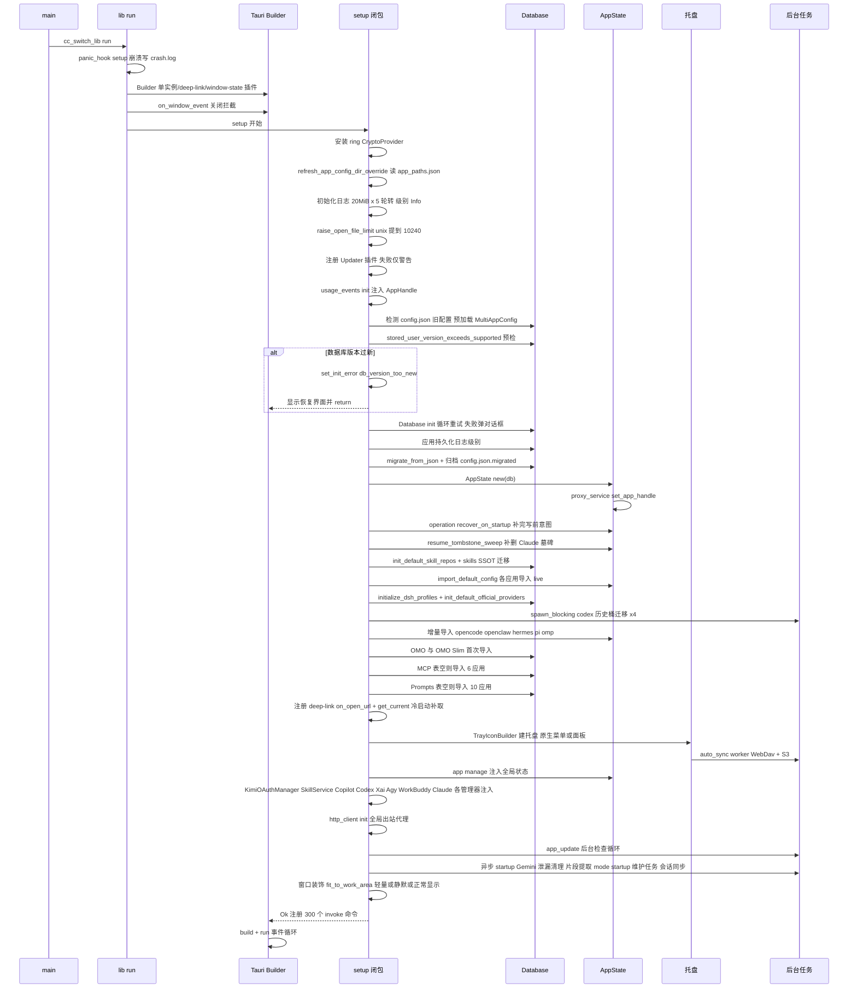
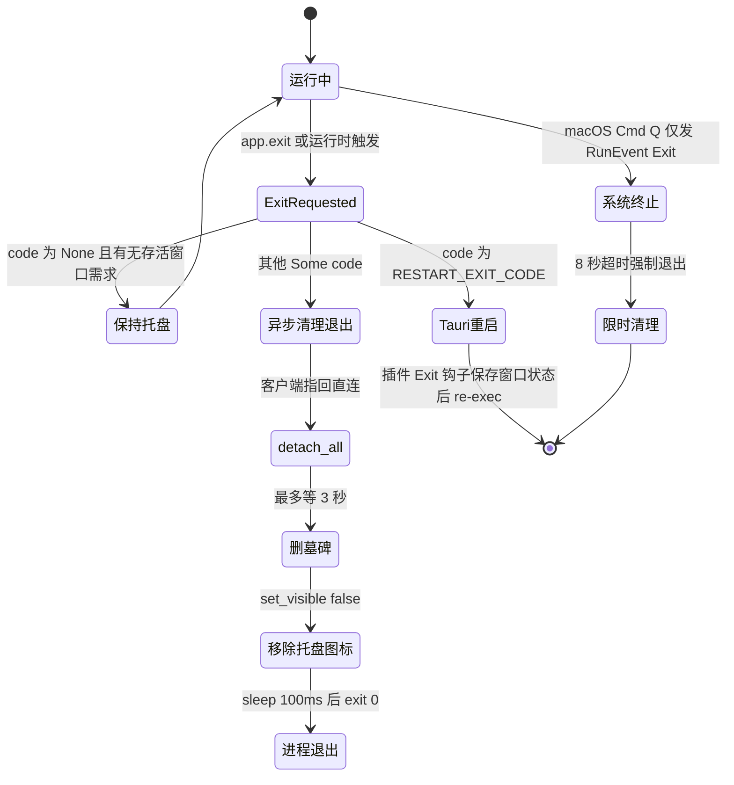
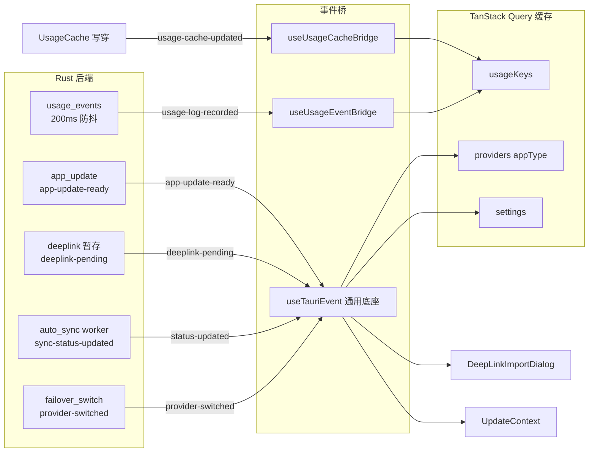

# 03 · 运行原理报告（启动、退出、事件、恢复）

> 覆盖进程从 `main()` 到退出的完整生命周期，以及贯穿运行期的事件系统、日志系统、崩溃恢复机制。所有论断附 `文件路径:行号` 引用。

---

## 1. 进程入口（main.rs）

`src-tauri/src/main.rs:4-35`：仅两件事——Linux 上设置 WebKit 环境变量（`WEBKIT_DISABLE_DMABUF_RENDERER=1`、`WEBKIT_DISABLE_COMPOSITING_MODE=1` 防 DMA-BUF 白屏，:8-18；`CC_SWITCH_GDK_BACKEND` 逃生开关覆盖 AppImage GTK 钩子强写的 `GDK_BACKEND=x11`，:27-31），随后 `cc_switch_lib::run()`。Windows release 附加 `windows_subsystem = "windows"` 隐藏控制台（:2）。

---

## 2. 应用启动流程（lib.rs run()）

### 2.1 完整启动时序



### 2.2 setup 阶段关键步骤明细（lib.rs:611-1583）

1. **路径覆盖预刷新**（:615-616）：`app_store::refresh_app_config_dir_override` 必须先于日志/数据库路径读取。
2. **日志初始化**（:619-657）：`tauri-plugin-log` 输出 Stdout + `<app_config_dir>/logs/cc-switch.log`，`RotationStrategy::KeepSome(4)` + `max_file_size 20MiB`；底层 Trace 能力保留、全局收紧到 Info（:655）；分发层补过滤约束前端日志（:636-638）。
3. **数据库初始化**（:687-818）：
   - 旧 `config.json` 存在且无 db → 先循环加载 `MultiAppConfig`（失败弹原生对话框「重试/退出」，:697-722，用户退出时 db 尚未创建，下次可重试）；
   - 预检版本过新 → `init_status::set_init_error(kind="db_version_too_new")` 并强制显示主窗口进恢复界面（:732-754）；
   - `Database::init()` 失败循环重试（:762-777）；
   - db 可用后立即应用持久化日志级别（:781-794）；
   - `migrate_from_json` 成功后旧文件归档为 `config.json.migrated`（:797-817）。
4. **崩溃恢复**（:820-829）：`AppState::new` → `mode::operation::recover_on_startup`（补完/放弃上次写前意图，须在任何写客户端文件的步骤之前）→ `claude_direct::resume_tombstone_sweep`。
5. **首次导入链**（:831-1181，逐表独立判断）：
   - 默认 Skill 仓库种子（:836-842）→ skills SSOT 迁移（`skills_ssot_migration_pending` 标志门控，:846-883）；
   - 各切换式应用 `import_default_config`（先导入用户 live 为 "default" 供应商，再 seed 官方预设——顺序有意为之，:885-945）；
   - Codex 历史桶迁移 ×4（spawn_blocking，:947-1027）；
   - 增量导入 OpenCode/OpenClaw/Hermes/Pi/OMP（幂等，:1045-1079）；
   - OMO / OMO Slim（:1082-1130）；
   - MCP 表空 → 从 6 个应用导入（:1133-1152）；
   - Prompts 表空 → 从 10 个应用导入（:1155-1181）。
6. **deep-link**（:1190-1269）：Linux/Windows debug 显式注册 scheme；`on_open_url` 回调注册后，`get_current()` 补取冷启动链接（插件解析早于回调注册的场景）。
7. **托盘**（:1271-1305）：`TrayIconBuilder` + 原生菜单或面板模式（`tray_panel::uses_native_menu`）；Windows 安装 `tray_compat`。
8. **后台 worker 启动**：WebDAV/S3 自动同步（:1306-1312）、自动更新循环 `spawn_background_loop`（:1416）。
9. **状态注入**（:1314-1382）：`AppState`、`KimiOAuthManager`、`SkillService`、`CopilotAuthManager`、`CodexOAuthManager`、`XaiOAuthManager`、`AgyAccountManager`、`WorkBuddyAccountManager`、`ClaudeAccountManager`（附带后台线程恢复官方登录切换 + 同步共享目录）。
10. **全局出站代理**（:1384-1413）：读 `global_proxy_url` 初始化 `http_client`；失败清除无效配置并回退直连。
11. **异步启动阶段**（:1419-1526）：清理 Gemini 通用配置泄漏凭据 → 自动提取各应用通用配置片段（须在代理重接管之前读直连 live）→ `mode::controller::startup`（按 Claude→Codex→Gemini→GrokBuild→ClaudeDesktop 顺序恢复代理接管，`controller.rs:1741-1755`）→ 清理旧版 agy 启动器 → `mark_startup_settled`（托盘此后才报「路由服务没在运行」）→ Codex 官方模型后台检查（每 15 分钟）→ 每日维护任务（备份 + rollup + vacuum，:1457-1472）→ 会话用量同步（启动首轮含费用回填，之后每 10 分钟，:1476-1525）。
12. **窗口显示策略**（:1528-1580）：Linux 按 `use_app_window_controls` 决定装饰；Windows 一律去系统标题栏；`window_fit::fit_to_work_area` 收回工作区；三分支：轻量模式恢复（非深链接冷启动）/ 静默启动（隐藏 + skip_taskbar）/ 正常启动（Windows 等 on_page_load 再显示，:539-553）。

### 2.3 数据库初始化细节

`Database::init()`（`database/mod.rs:146-203`）：开库 → `PRAGMA foreign_keys=ON` → 新库启用 `auto_vacuum=INCREMENTAL` → 注册 update_hook（INSERT/UPDATE/DELETE → `auto_sync::notify_db_changed(table)`，:129-140）→ `create_tables`（SAVEPOINT 包裹）→ 版本升级前自动快照备份（:175-187）→ `apply_schema_migrations`（user_version 步进至 27）→ `ensure_model_pricing_seeded` + 同步本地 `model-pricing.json` 覆盖。

---

## 3. 退出流程

### 3.1 退出请求三分类

`lib.rs:2362-2384` `classify_exit_request(code)`：

| code | 分类 | 处理 |
|---|---|---|
| `None` | `StayInTray` | 运行时自动触发（隐藏窗口被 WebView 回收）→ `prevent_exit()` 保持托盘（:1971-1975） |
| `Some(RESTART_EXIT_CODE)` | `DeferToTauriRestart` | 置 `RESTART_REQUESTED` 后交还 Tauri 默认 re-exec；**禁止复用异步清理**（与 window-state 插件 Exit 钩子互等死锁，#3998，:1977-1997） |
| 其他 `Some(_)` | `CleanupAndExit` | `prevent_exit` → 异步 `cleanup_before_exit` → 移除托盘图标 → 等 100ms → `std::process::exit(0)`（:2003-2023） |

### 3.2 清理内容

`cleanup_before_exit`（lib.rs:2074-2085）：`mode::controller::detach_all`（把接上代理的客户端指回直连，模式与路由保留待下次启动）→ spawn_blocking `claude_direct::finish_tombstones_before_exit`（最多等 `TOMBSTONE_MIN_VISIBLE=3s` 删墓碑）。macOS 系统终止（⌘Q/注销）走 `RunEvent::Exit` 分支，主线程限时 8 秒等清理（`SYSTEM_EXIT_CLEANUP_TIMEOUT`，:2093-2114）。

`remove_tray_icon_before_exit`（:2126-2134）：`set_visible(false)` 触发 `NIM_DELETE`，防 Windows 托盘残留死图标。`restart_process`（:2424-2431）：显式移除托盘 + 释放 single-instance 锁 + macOS 经 `open -n` LaunchServices 重启（前台激活协作式要求，:2439-2463）。

### 3.3 退出路径状态图



---

## 4. 窗口与托盘生命周期

### 4.1 窗口关闭拦截（lib.rs:560-600）

`CloseRequested` 时：数据库恢复模式（`db_version_too_new`）→ 直接退出防隐身后台；托盘面板窗口（`tray_panel::PANEL_LABEL`）自行处理；`minimize_to_tray_on_close=true`（默认）→ `prevent_close` + hide + Windows `skip_taskbar(true)` + macOS `apply_tray_policy`；否则退出应用。

### 4.2 轻量模式（lightweight.rs）

进入（:7-35）：隐藏任务栏/Dock → 保存窗口状态 → **销毁主窗口** → 置 `LIGHTWEIGHT_MODE` → 关闭会话缓存 `TranscriptCache::set_enabled(false)` → 释放托盘面板 WebView → 刷托盘。退出（:37-106）：窗口在则 show，否则 `WebviewWindowBuilder::from_config` 重建 + `fit_to_work_area`。`persist_lightweight_mode`（:109）写 settings.json 供下次启动恢复。

### 4.3 托盘面板（tray_panel.rs）

窗口懒创建、只隐藏不销毁、失焦即隐藏（模块头 :14）；常量 `REVEAL_FALLBACK=600ms`、`BLUR_CLICK_GRACE=300ms`（:52-54）。前端通过 `tray_panel_state / placement / layout / hide / action` 五个命令交互；点击统一走 action id（`src/tray-panel/api.ts:133-139`）。

---

## 5. 事件系统（后端 → 前端）

全部 16 类事件的监听方与处理：

| 事件名 | 发射方 | 监听位置 | 处理 |
|---|---|---|---|
| `configLoadError` | 后端初始化失败 | `src/main.tsx:87` | 系统错误框 + exit(1) |
| `provider-switched` | failover_switch.rs:111 / 切换命令 | `lib/api/providers.ts:216` + App.tsx:519 | 按前缀失效 `["providers", appType]`；重查失败的 codex_oauth quota |
| `universal-provider-synced` | 统一供应商同步 | App.tsx:564 | 失效全部 providers + updateTrayMenu |
| `codex-unify-migration-finished` | codex 历史迁移 | App.tsx:574-577 | 提示可重启 Codex |
| `profile-applied` | profile 应用 | App.tsx:581、PromptPanel.tsx:182 | 失效 profiles/mcp/skills/providers(claude-desktop)；提示词面板重载 |
| `webdav-sync-status-updated` / `s3-sync-status-updated` | auto_sync worker | App.tsx:594/:610 | 失效 settings；auto+error 时 toast |
| `proxy-official-warning` | controller warn_if_official_route | App.tsx:626 | warning toast |
| `proxy-loopback-hijacked` | loopback 自检 | App.tsx:641 | 15 秒 warning |
| `usage-log-recorded` | usage_events.rs（200ms 防抖合并） | `hooks/useUsageEventBridge.ts:17` | invalidate `usageKeys.all`（失焦只标 stale） |
| `usage-cache-updated` | UsageCache 写穿 | `hooks/useUsageCacheBridge.ts:30` | setQueryData 直写 script/subscription 缓存 |
| `tray-navigate` | 托盘菜单/面板 | `hooks/useTrayNavigation.ts:68` | 导航/needsRoute 弹窗/开新增 |
| `deeplink-pending` | handle_deeplink_url | `DeepLinkImportDialog.tsx:222` | 处理待导入深链 |
| `app-update-ready` | app_update.rs | `contexts/UpdateContext.tsx:119` | 更新 readyUpdate 状态 |
| `tray-panel-show` / `tray-panel-changed` | tray_panel.rs:38-41 | `tray-panel/TrayPanel.tsx:653-656` | 面板排版/数据重取 |
| `main-window-visibility-changed` | 窗口事件（lib.rs:549 等 5 处） | `lib/windowActivity.ts:127` | 窗口可见性跟踪 |

事件推送原则：数据库写入密集路径（用量日志）经 `usage_events.rs` 200ms 防抖合并（:21,46-60）；proxy 状态不用事件而用 2 秒轮询（`lib/query/proxy.ts:33,46`）。



---

## 6. 日志系统

- **输出目标**：Stdout + `<app_config_dir>/logs/cc-switch.log`（`lib.rs:639-645`），轮转 KeepSome(4) × 20MiB（约 100MiB 上限）。
- **动态级别**：级别存数据库（`get_log_config`，`dao/settings.rs:263-272`），启动早期保守 Info，db 可用后立即应用持久化级别（`lib.rs:781-794`）；前端命令经 plugin-log 直达 logger，分发层补一次全局 max_level 过滤（:636-638）。
- **脱敏体系**（lib.rs:153-303）：
  - `redact_url_for_log`：剥 userinfo 与整个 query/fragment，保留 scheme/host/port/path；
  - `redact_known_secrets`：只替换确切持有的密钥值（最短 8 字符防误伤，:185），不做形状猜测；
  - `redact_url_origin_for_log`：无已知密钥时凭据可能内嵌 path，只记 origin；
  - `error_for_log`：剥掉 TOML 解析诊断引用的源码行（可能含密钥原文）。
- **崩溃日志**：`panic_hook.rs:1-14` panic 写 `<app_config_dir>/crash.log`，上限 5MB × 保留 2 份归档；release 用 `panic="unwind"` 以便捕获 backtrace（Cargo.toml profile.release）。
- **日志码**：代理子系统带分类码（CB/SRV/FWD/FO/RECT/GP/USG，见 02 报告 8.2 节），便于按码检索。

---

## 7. 崩溃恢复机制

### 7.1 写前意图（live-state.json）

`mode/operation.rs:65-205` 的 5 步提交协议：

```mermaid
flowchart TD
    A["1 plan 每文件解析补丁<br/>解析失败不写"] --> B["2 stage 写临时文件<br/>.tmp.pid.ts.n"]
    B --> C["3 set_pending 写 live-state.json<br/>记录 pre hash planned hash published false"]
    C --> D["4 publish 逐文件 rename<br/>rename 前重读比对 hash<br/>外部改过则 replan 最多 3 次<br/>换第一个文件前置 published true"]
    D --> E["5 commit_target<br/>settings set_current_provider<br/>db set_current_provider<br/>模式 Written Stack 写 state"]
    E --> F["清 pending"]
    D -- "任一步崩溃" --> REC["recover 启动恢复"]
    REC --> G{"published 标记"}
    G --|false| H["丢弃 Discarded<br/>删临时文件 state 不变"]
    G --|true| I["前滚 RolledForward<br/>按 planned 继续发布 再 commit_target"]
    I --> J{"逐文件校验"}
    J -- "全部匹配" --> K["RolledForward"]
    J -- "部分不符" --> L["RolledForwardExcept paths"]
    J -- "无法判定" --> M["Abandoned paths"]
```

判定规则（operation.rs 头注释 1-16）：`pre` 与磁盘内容一致 → 未发布，丢弃；`published=true` → 前滚到 `planned`。`recover_before_write`（:327）在每次拿写锁后调用；`settle`（:313）保证读指针/模式前先补完（不可重入，先于代理切换锁）。

### 7.2 Claude 空值墓碑

`services/provider/claude_direct.rs`：

| 常量 | 值 | 行号 | 语义 |
|---|---|---|---|
| `TOMBSTONE_TTL` | 10s | :141 | Claude Code settings 监听写稳 1s、每 500ms 查一次（2.1.318），10s 留足余量 |
| `TOMBSTONE_MIN_VISIBLE` | 3s | :145 | 退出时墓碑至少留 3s 才删，不让退出等满 TTL |
| `TOMBSTONE_MARKER` | claude-tombstones.json | :152 | 记录文件，存 `~/.cc-switch/`；`TombstoneMarker{keys, written_at_ms}`（:154-161） |

流程：`note_tombstones`（:192-233）**先记后写**（拿写锁后、写入前，合并旧未删墓碑）→ 写 `""` 空值 → `after_live_write`（:244-268）按 `LIVE_WRITES` 代数安排 10s 后 `sweep_tombstones`（:392-421，重新拿锁、校验代数、只删值仍为 `""` 的键——用户在窗口期写回真值则跳过）。三个删除时机：TTL 到期后台删除、启动恢复 `resume_tombstone_sweep`（:347-362）、退出前 `finish_tombstones_before_exit`（:366-384）。DETACH（退出 CC Switch）不加墓碑（:132-137）。

### 7.3 数据库侧保障

- 版本升级前自动快照（`database/mod.rs:175-187`）；
- 备份发布用临时文件 + `persist_noclobber` 原子替换（`backup.rs:487-569`），目录操作全局锁串行；
- SQL 导入在 NamedTempFile 暂存库执行，authorizer 白名单拒绝 ATTACH/VACUUM INTO/vtable（`backup.rs:61-81`），校验后经 SQLite Backup API 原子替换主库（:231-242）。

---

## 8. 定时任务一览

| 任务 | 周期 | 启动位置 | 实现 |
|---|---|---|---|
| 数据库维护（备份+rollup+vacuum） | 24h（首 tick 立即） | lib.rs:1457-1472 | `periodic_backup_if_needed`（MissedTickBehavior::Skip，睡眠后不补跑） |
| 会话用量同步 | 10min（启动首轮立即） | lib.rs:1476-1525 | `run_session_sync(backfill)`，手动扫描模式下跳过定时轮 |
| Codex 官方模型刷新 | 15min | `codex_official_models::start_background_checks`（lib.rs:1448） | 缓存 1h 内视为新鲜 |
| WebDAV/S3 自动上传 | 去抖 1s / 最长等待 10s | `auto_sync::start_worker`（lib.rs:1306-1310） | `AUTO_SYNC_DEBOUNCE_MS=1000`、`MAX_AUTO_SYNC_WAIT_MS=10_000`（auto_sync.rs:22-23） |
| 自动更新检查 | 首查延迟 60s，之后 6h | `app_update::spawn_background_loop`（lib.rs:1416） | 已下载安装包存进程内存（轻量模式销毁窗口不丢） |
| 用量事件防抖 | 200ms | usage_events.rs:21 | 合并密集写库的通知 |

---

## 9. 前端运行原理

### 9.1 引导序列（main.tsx:95-179）

1. `initializeInterfacePrefs()`（密度/缩放先于任何 UI）；
2. 主动 `invoke("get_init_error")`：`db_version_too_new` → 渲染 `DatabaseUpgrade` 恢复界面并终止引导；其他错误走 `configLoadError` 处理；
3. `initializeWindowActivity / initializeInputModality`；
4. 语言校正：`queryClient.fetchQuery(["settings"])` → `syncLanguageFromSettings`（与 useSettingsQuery 共用缓存，避免闪切语言）；
5. 渲染 Provider 链（见 01 报告 6.1）；
6. 渲染后异步 `syncModelsDevPricingOnStartup()`，成功失效 `["usage"]`。

### 9.2 数据获取节奏

| 数据 | 策略 | 位置 |
|---|---|---|
| providers | gcTime Infinity；代理运行时 10s 轮询 | `lib/query/queries.ts:85-90` |
| proxyStatus / takeoverStatus | running 时 2s 轮询（不走事件） | `lib/query/proxy.ts:28-37,42` |
| usage 全家 | **不轮询**；事件驱动失效 + 页面打开时按设置间隔加扫会话 | `UsageDashboard.tsx:425-428` + `useUsageAutoRefresh` |
| settings | 常规 staleTime 0 + focus 重取 | `queries.ts:95` |

### 9.3 keep-last-good 用量机制

`useUsageQuery`（`queries.ts:121-193`）：查询失败时保留最后有效值 10 分钟，瞬态错误白名单 `isTransientUsageError` 决定是否透出错误——用量接口偶发失败不打断仪表盘。

---

## 10. 全局出站代理与网络层

- `http_client.rs` 维护三个全局静态：`GLOBAL_CLIENT`（跟随全局代理）、`DIRECT_CLIENT`（永不走代理）、`CURRENT_PROXY_URL`；`CC_SWITCH_PROXY_PORT` 记录本地监听端口用于回环检测（:13-37）。
- `get_for_url(url)`（:162）：目标是本机（如本地代理自身、models.dev 之外的局域网网关）→ 直连客户端，避免代理环。
- 回环劫持检测（:329-346 + `loopback_probe.rs:18`）：系统代理指向自身监听端口时，代理请求会形成自转发死循环；`spawn_loopback_check` 按「客户端方式」访问 `<origin>/health` 自检，被劫持则 emit `proxy-loopback-hijacked`。
- 保 header 大小写路径：`hyper_client.rs` 手写原始请求头（`build_raw_request` :633 按 `OriginalHeaderCases` 逐字节还原），保证上游收到与 CLI 直连一致的 wire 级形态（server.rs:5-9 注释）；SOCKS5 场景回落 reqwest 池（`forwarder/send.rs:11-95`）。
