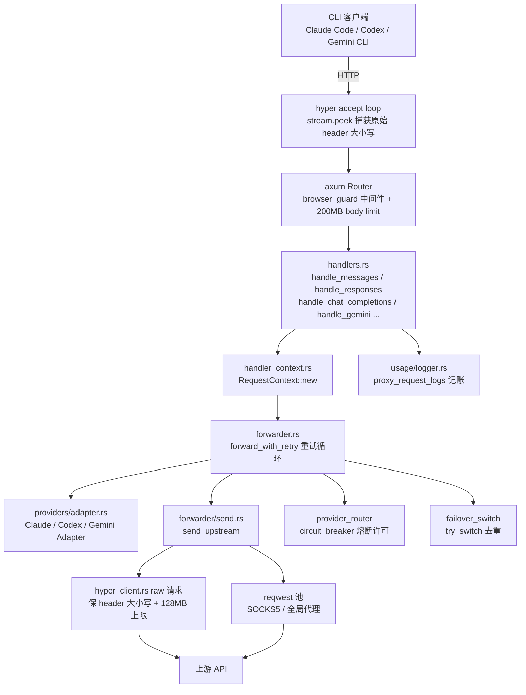
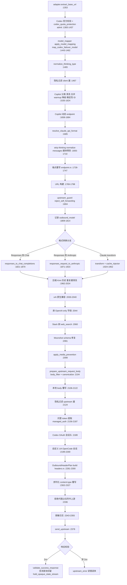
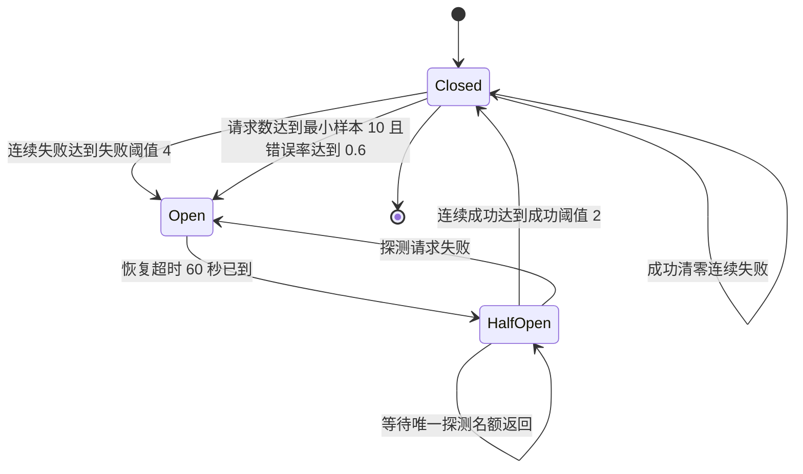
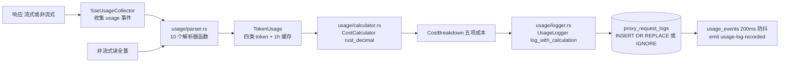
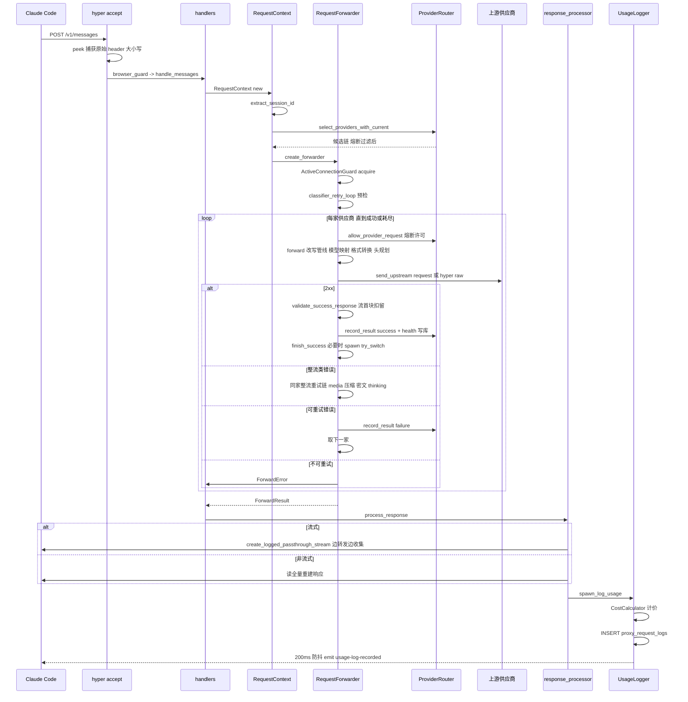

# 04 · 本地代理引擎报告（proxy/ 子系统）

> 覆盖 `src-tauri/src/proxy/`（103,943 行）：服务器架构、请求完整生命周期、路由选择、转发重试、协议转换、熔断与故障转移、用量记账、守卫模块。所有论断附 `文件路径:行号` 引用（省略 `src-tauri/src/proxy/` 前缀）。

---

## 1. 服务器架构（server.rs）

### 1.1 启动流程 `ProxyServer::start()`（server.rs:104-233）

1. 已运行 → `ProxyError::AlreadyRunning`（:106-108）。
2. 解析 `listen_address:listen_port`；默认 `127.0.0.1:15721`（types.rs:16-20）；端口写 0 由 OS 分配（测试用）。
3. `build_router()` 构建 axum Router → `TcpListener::bind` → 取实际端口 → `http_client::set_proxy_port`（:133，供回环自检）。
4. **手动 hyper HTTP/1.1 accept loop**（:151-218）而非 `axum::serve`：每条连接先 `stream.peek` 8192 字节（:170-171），`OriginalHeaderCases::from_raw_bytes` 捕获客户端原始 header 大小写（:173），以 `preserve_header_case(true)` 的 `http1::Builder` 服务并桥接回 axum Router（:188-206）——目的：上游收到与 CLI 直连完全一致的 wire 级 header（文件头注释 :5-9）。
5. `tokio::select!` 监听 accept 与 shutdown oneshot；accept 失败退避 50ms。
6. 停止 `stop()`（:235-265）：发关闭信号 → 5 秒超时 join → 超时 `StopTimeout`。

### 1.2 路由表（build_router，server.rs:301-432）

| 路径 | 方法 | handler | 说明 |
|---|---|---|---|
| `/health` | GET | `health_check`（handlers.rs:64） | 回显探测头 |
| `/status` | GET | `get_status` | ProxyStatus JSON |
| `/v1/messages`、`/claude/v1/messages` | POST | `handle_messages`（handlers.rs:265） | Claude Messages |
| `/claude-desktop/v1/models`、`/claude-desktop/v1/messages` | GET/POST | `handle_claude_desktop_*`（handlers.rs:272/288） | Desktop 独立命名空间（网关 token 校验） |
| `/chat/completions`、`/v1/chat/completions`、`/v1/v1/chat/completions`、`/codex/v1/chat/completions` | POST | `handle_chat_completions`（handlers.rs:997） | OpenAI Chat |
| `/models`、`/v1/models` | GET | `handle_models`（handlers.rs:105） | 模型发现（Codex 可达性探测） |
| `/responses`、`/v1/responses`、`/v1/v1/responses`、`/codex/v1/responses` | POST（GET 回 426） | `handle_responses`（handlers.rs:1095/1081） | OpenAI Responses |
| `/grokbuild/v1/responses`（+ `/compact`） | POST | `handle_grokbuild_responses`（:1110/:1493） | Grok Build 命名空间 |
| `/responses/compact` ×4 别名 | POST | `handle_responses_compact`（:1372） | 远程压缩 |
| `/alpha/search` ×4 别名 | POST | `handle_alpha_search`（:1393） | Alpha Search |
| `/images/generations`、`/images/edits` 各 4 别名 | POST | `handle_images_*`（:1401/:1414） | 旧版 Images API |
| `/v1beta/*path`、`/gemini/v1beta/*path`、`/gemini/v1/*path` | any | `handle_gemini`（handlers.rs:2542） | Gemini native 全方法透传 |

全局：`DefaultBodyLimit::max(200MB)`（:425）+ 最外层 `browser_guard::reject_browser_requests` 中间件（:427-430）。

### 1.3 服务器结构图



---

## 2. 请求处理入口层（handlers + handler_context + handler_config）

### 2.1 RequestContext 构建（handler_context.rs:96-236）

流程：读 per-app 代理配置（:108）→ 读整流器/优化器/Copilot 优化器/隐私过滤四类配置（:115-118）→ `session::extract_session_id`（:121）→ Stack 分支（:133-154，单家、关故障转移）或常规分支：`mode::current::provider_in_use` 读当前供应商（:156-162）→ 从 body 提取模型名（:165-169）→ `provider_router.select_providers_with_current` 生成候选链（:181-197）。

其他方法：`with_model_from_uri`（Gemini 模型名在 URI，:242-251）、`create_forwarder`（:260-307，故障转移关闭时超时全 0、max_retries 强制 0）、`streaming_timeout_config`（:328-342）。

### 2.2 用量解析配置（handler_config.rs）

类型别名：`StreamUsageParser = fn(&[Value])->Option<TokenUsage>` 等 4 个（:9-20）；`UsageParserConfig{stream_parser, response_parser, model_extractor, stream_event_filter, app_type_str}`（:24-35）。四套常量：`CLAUDE_PARSER_CONFIG`（:140-146）、`OPENAI_PARSER_CONFIG`（:149-155）、`CODEX_PARSER_CONFIG`（自动检测格式，:158-164）、`GEMINI_PARSER_CONFIG`（:167-173）。

### 2.3 主链路 handler

`handle_messages_for_app`（handlers.rs:333-457，Claude 主链路）：解压请求体 → `RequestContext::new` → `create_forwarder` → `forward_with_retry` → `process_response`（流式/非流式/转换三分支）。`handle_responses_for_app`（:1141-1296）按 `codex_upstream_format` 分发：Chat 逆转换（:1236）/ Anthropic 逆转换（:1224）/ 原生压缩补条目（:1251）/ xAI 改写（:1262）/ late-arguments 修复（:1276）/ 原生透传（:1287）。错误行写库 `log_forward_error`（:3257-3307）；成功用量 `log_usage`（:3311-3379，spawn_blocking）。

---

## 3. 会话识别与粘性（session.rs）

`extract_session_id(headers, body, client_format)`（session.rs:73-104）提取优先级：

- **Claude / ClaudeDesktop**：`x-claude-code-session-id` 头（:111-123）→ `metadata.user_id` 内嵌 session_id（`parse_session_from_user_id` :214-232）→ `metadata.session_id`（:198-205）→ 新 UUID。
- **Codex / OpenAI / GrokBuild**：`extract_responses_session`（:129-180）——Codex 头序 `session_id`→`x-session-id`→`session-id`→`thread-id`（长度 >20 加 `codex_` 前缀）；Grok Build 用 `x-grok-conv-id`→`x-grok-session-id`（`grokbuild_` 前缀）；回落 `metadata.session_id`。**明确不用 `previous_response_id`**（:175-178 注释，防每轮换缓存 key）。

粘性实现（无会话表）：session_id 用于（1）上游缓存身份 `prompt_cache_key`（仅客户端提供的 session 才作 key，handler_context.rs:69 注释）；（2）Codex OAuth 会话路由头（forwarder.rs:2189-2194）；（3）GeminiShadowStore 与 CodexChatHistoryStore 按 `(provider_id, session_id)` 索引（gemini_shadow.rs:111-168、codex_chat_history.rs:56-107）。同一会话稳定粘同一家靠：failover 队列顺序稳定 + 成功后不换家 + 仅换家成功才 `try_switch`。

---

## 4. 供应商路由（provider_router.rs）

`ProviderRouter { db, circuit_breakers: Arc<RwLock<HashMap<String, Arc<CircuitBreaker>>>> }`，key=`"app_type:provider_id"`（:29-34）。

`select_providers_with_current(app_type, current, auto_failover_enabled)`（:69-127）决策：

1. Codex 官方托管账号即使残留故障转移配置也**只保留单路由**（:79-88，防 inbound token 复用到另一张卡）；
2. 故障转移开启：按 `db.get_failover_providers` 队列顺序（= 前端展示顺序，`sort_index`）过滤 `provider_supports_failover`（Codex Official 不参与，:24-26）与熔断 `is_available()`（:98-106）；
3. 故障转移关闭：仅当前供应商，**跳过熔断检查**（:109-113）；
4. 空结果：全部熔断 → `AllProvidersCircuitOpen`（FO-004）；无配置 → `NoProvidersConfigured`（FO-005）。

`allow_provider_request`（:137-155）返回 `ProviderPermit{allowed, used_half_open_permit, _guard}`——guard 持有期间占用 HalfOpen 名额，drop 归还。`record_result`（:158-195）：更新熔断器 → `db.update_provider_health_with_threshold` 写库。

---

## 5. 转发重试循环（forwarder.rs）

### 5.1 状态机总览

```mermaid
stateDiagram-v2
    [*] -> 路由选择
    路由选择 -> 单家直连 : 故障转移关闭或 Stack 请求
    路由选择 -> 队列遍历 : 故障转移开启
    单家直连 -> 尝试转发
    队列遍历 -> 熔断跳过 : 熔断器未放行
    熔断跳过 -> 队列遍历 : 取下一家
    队列遍历 -> 尝试转发 : 熔断器放行且未达上限
    尝试转发 -> 整流重试 : 命中签名或预算或媒体或密文整流
    整流重试 -> 尝试转发 : 同一家重试一次
    整流重试 -> 队列遍历 : 供应商类错误
    整流重试 -> 直接失败 : 客户端类错误
    尝试转发 -> 成功收尾 : 响应 2xx 且语义校验通过
    尝试转发 -> 队列遍历 : 可重试错误
    尝试转发 -> 直接失败 : 不可重试错误
    队列遍历 -> 直接失败 : 达到最大尝试数或全部熔断
    成功收尾 -> [*] : 记熔断成功并按需切换供应商
    直接失败 -> [*] : 记失败数与最近错误
```

### 5.2 重试循环明细（forward_with_retry_inner，forwarder.rs:726-1327）

1. `classifier_guard::classifier_retry_loop` 预检（:736-748）：auto 模式安全分类器连续 3 轮工具失败死循环直接本地拒绝。
2. 遍历候选：上限检查（`max_attempts = max_retries+1`，:786-793）→ 熔断许可（:799-807；单 provider 或 Stack 请求 bypass :773）→ Bedrock 预发送优化（thinking_optimizer + cache_injector，:824-834）→ `forward()`（:856-862）。
3. 失败后的**同家整流重试链**（按序，每条失败经 `handle_rectifier_retry_failure` :519-553 区分供应商错误→下一家 / 客户端错误→直接返回）：
   - media 降级重试（:883-952，text-only 模型剥图片）
   - 压缩回合去 tool_choice 重试（:956-992）
   - 密文整流重试 `opaque_state_retry_rejection`（:994-1086）
   - thinking 签名整流重试（:1090-1168）
   - thinking budget / disabled 整流重试（:1172-1257）
4. 最终分类 `categorize_proxy_error`（:2416-2461）：**不可重试** = 400/405/406/413/414/415/422/501（:2449）+ Codex 官方路由与 xAI OAuth 的 AuthError（:2420-2429）；其余 4xx 与全部 5xx 可重试。
5. `finish_success`（:570-627）：HalfOpen 探测同步记录；更新 `current_providers`；**实际用的家 ≠ 请求开始那家 → failover_count+1 并 spawn `failover_manager.try_switch`**（:611-621）。

### 5.3 forward() 单次尝试改写管线（:1335-2414）



### 5.4 出站头规划（forwarder/headers.rs）

`OutboundHeaderPlan<'a>`（:386-405，14 字段）+ `build(headers) -> HeaderMap`（:410-669）。规则：按客户端原顺序（host 原位换上游 host :423-429）；剥连接/追踪/CDN 头（:433-464）；认证头**原位替换**（:466-490，Codex 官方 passthrough 例外 :476-481）；Codex 指纹头剥离（:509-519）；Codex→Anthropic 强制 `Accept: application/json`（:526-535）；transform/SSE 强制 `accept-encoding: identity`（:538-551）；`anthropic-beta` 重建（:567-576）；补 `anthropic-version: 2023-06-01`（:653-660）；注入 Codex OAuth 会话头（:664-666）。

---

## 6. 熔断器状态机（circuit_breaker.rs）



细节：`half_open_slots: AtomicU64` 高 32 位轮次 + 低 32 位名额（:91-94）；每轮只放 1 个探测名额 `allow_half_open_probe`（:365-386）；`HalfOpenPermitGuard` drop 归还且只归还自己那一轮（:397-408，修复 #7206/#9292 请求取消导致名额泄漏）；配置可热更新（:157-159）；每次结果经 `record_result` 同步写 provider_health 表。

---

## 7. 故障转移切换（failover_switch.rs + switch_lock.rs）

`FailoverSwitchManager { pending_switches: Arc<RwLock<HashSet<String>>> }`（key=`"app_type:provider_id"`，:17-21）。

`try_switch`（:38-69）：去重（同一切换进行中直接 false）→ `do_switch`（:71-122）：非代理模式直接返回；`mode::controller::record_failover_route` **只换代理路由、不写客户端文件**（:92-100）；`tray::refresh_tray_menu`（:107）；`emit("provider-switched", {appType, providerId, source:"failover"})`（:111-118）。

`SwitchLockManager`（switch_lock.rs:13-16）：`locks: HashMap<String, Arc<Mutex<()>>>`，`lock_for_app(app_type) -> OwnedMutexGuard`——同一应用的「切换/进入退出代理」串行化，不同应用并行；不在单请求转发路径上。

---

## 8. 供应商适配与协议转换（providers/）

### 8.1 基础抽象

- `trait ProviderAdapter`（adapter.rs:16-51）：`name / extract_base_url / extract_auth / build_url / get_auth_headers / needs_transform / transform_request`。
- `AuthInfo { api_key, strategy, access_token }`（auth.rs:9-16）；`AuthStrategy` 八种（:42-94）：Anthropic（x-api-key）、ClaudeAuth（Bearer）、Bearer、Google（x-goog-api-key）、GoogleOAuth、GitHubCopilot、CodexOAuth（+ChatGPT-Account-Id + originator/version）、XaiOAuth。
- `ProviderType` 八值（mod.rs:104-121）；`get_adapter(app_type)`（:124-140）：Claude/ClaudeDesktop→ClaudeAdapter；Codex/GrokBuild/OpenCode/OpenClaw/Hermes→CodexAdapter；Gemini→GeminiAdapter；Pi/Mcode/Kimi/Dsh/Agy/Omp/Copilot/WorkBuddy 不支持代理路由。

### 8.2 协议转换矩阵（39 文件）

| 转换方向 | 文件 | 关键函数（调用点） |
|---|---|---|
| Claude → openai_responses | transform_responses.rs（5,802 行）+ streaming_responses.rs（7,529 行） | forwarder.rs:1924-1952 |
| Codex Responses → Chat Completions | transform_codex_chat.rs（7,373 行）+ streaming_codex_chat.rs + codex_chat_common.rs + codex_chat_tool_history.rs | `responses_to_chat_completions_with_reasoning`（forwarder.rs:1849） |
| Codex Responses → Anthropic Messages | transform_codex_anthropic.rs + streaming_codex_anthropic.rs | `responses_request_to_anthropic`（forwarder.rs:1895） |
| Claude → Gemini native | transform_gemini.rs（3,836 行）+ streaming_gemini.rs + gemini_schema.rs | forwarder.rs 端点重写 `:streamGenerateContent?alt=sse`（endpoint.rs:123-151） |
| xAI 原生 Responses 消毒 | transform_codex_responses_xai_sanitize.rs | forwarder.rs:2035-2046 |
| Moonshot `$ref` sibling→allOf | transform_codex_chat_moonshot_schema.rs | forwarder.rs:2086 |
| Kimi/DeepSeek 空助手消息修复 | transform_codex_responses_kimi_history.rs | forwarder.rs:1989-1994 |
| 工具命名空间扁平化/还原 | transform_codex_responses_namespace.rs | handlers.rs:1191 |
| Claude api_format 适配 | claude.rs | `transform_claude_request_for_api_format`（forwarder.rs:1942） |
| 推理条目跨协议桥接 | claude_reasoning.rs / reasoning_bridge.rs / inline_think.rs | opaque_state_rectifier.rs:22 |

### 8.3 状态回放存储

- `GeminiShadowStore`（gemini_shadow.rs:111）：按 `(provider_id, session_id)` 记 assistant 回合，供 thoughtSignature / tool call 回放（`record_assistant_turn` :138、`latest_assistant_content` :168）。
- `CodexChatHistoryStore`（codex_chat_history.rs:56）：`record_response`（:61）/ `enrich_request`（:107）恢复 `previous_response_id` 指向的 function call。

---

## 9. 守卫与整流模块（每模块职责 + 关键签名）

| 模块 | 职责 | 关键函数 |
|---|---|---|
| browser_guard.rs | 拒绝网页发起请求（Origin 即 403，防 DNS rebinding）；`/claude-desktop/` 只靠网关 token | `reject_browser_requests`（:30-60） |
| upstream_guard.rs | 拒绝指回自身监听器的供应商 URL（防自转发 #3787） | `reject_self_forwarding`（:6-45） |
| classifier_guard.rs | auto 分类器死循环本地拒绝 | `classifier_retry_loop`（:9-42） |
| loopback_probe.rs | 按客户端方式探测 `<origin>/health`，检出系统代理劫持（#4789/#8611/#9221） | `hijack_reason`（:18） |
| thinking_rectifier.rs | 修复 Anthropic "Invalid signature in thinking" | `rectify_anthropic_request`（:118） |
| thinking_budget_rectifier.rs | 修复 budget_tokens/max_tokens 约束错误 | `rectify_thinking_budget`（:81）、`rectify_thinking_disabled`（:150） |
| thinking_optimizer.rs | Bedrock 预发送 thinking 优化（skip/adaptive/legacy 三路径） | `optimize`（:12） |
| media_sanitizer.rs | text-only 模型媒体降级（声明驱动 + 注册表启发） | `replace_images_for_text_only_model`（:31） |
| opaque_state_rectifier.rs（1,056 行） | Responses 密文整流：剥离别家签发的推理/加密/压缩条目后同家重试；含流内拒绝（200-后-输出前）与 Claude→Responses 回放（#9424） | `detect_opaque_state_rejection`（:79）、`rectify_opaque_state`（:327） |
| codex_quota_protection.rs | Codex 官方额度预耗尽保护：响应头 `x-codex-*` 记账（快照 TTL 300s），请求前 admit；best-effort 永不 fail-closed | `admit`（:294）、`observe_response`（:307） |
| privacy_filter/ | 正则 PII/密钥脱敏（gitleaks 规则内置 + 香农熵）；五语言占位符 | `redact_request_body`（mod.rs:258） |
| body_filter.rs | 递归过滤 `_` 前缀私有参数（白名单豁免 JSON Schema 字段名） | `filter_private_params_with_whitelist`（:68） |
| cache_injector.rs | 注入 cache_control 断点（Bedrock Prompt Caching） | `inject`（:9） |
| model_mapper.rs | 模型档位映射（haiku/sonnet/opus/fable/subagent；fable→opus 降级）与 `[1m]` 后缀剥离 | `apply_model_mapping`（:129） |
| copilot_optimizer.rs（1,637 行） | Copilot 请求分类/结果合并/压缩检测/确定性 request_id/warmup 降级（默认全开，#1813） | 见 types.rs `CopilotOptimizerConfig` |
| content_encoding.rs | 手动 gzip/deflate/zstd/br 解压（reqwest 自动解压禁用） | `decompress_body_with_limit`（:133） |
| json_canonical.rs | 缓存敏感的稳定 JSON 序列化 | `canonicalize_value`（:7）、`short_value_hash`（:89） |
| sse.rs | SSE 解析原语 | `SseBuffer`（response_processor.rs:17 使用） |

---

## 10. 用量记账（usage/）

### 10.1 数据流



### 10.2 解析器族（parser.rs）

`from_claude_response`(:132)、`from_claude_stream_events`(:159)、`from_converted_claude_stream_events`(:288)、`from_codex_response`(:313)、`from_codex_response_auto`(:359)、`from_codex_stream_events_auto`(:379)、`from_openai_response`(:414)、`from_openai_stream_events`(:446)、`from_gemini_response`(:467)、`from_gemini_stream_chunks`(:497)。去重键 `dedup_request_id(scope)` → `session:{message_id}`（Claude 无作用域与 session JSONL 收敛；其他 app 加 `app:provider` 作用域，:105-115）。

### 10.3 写库幂等（logger.rs:115-240）

`INSERT OR REPLACE`（proxy 行覆盖同 request_id 的 session_log 来源行）或 `INSERT OR IGNORE`；相同 proxy 语义行（`UsageSemantic::sha256` 一致）直接 Ok；主键冲突回落 `{request_id}:collision:{sha256}`。错误消息截断 4,096 字符（:17-21）。计价模型选择 `resolve_pricing_model_source`（:366）决定按 request_model 还是 outbound model 计价。

### 10.4 计费规则（calculator.rs:36-91）

- OpenAI/Gemini 语义：input 已含 cache read，需扣减后计价（:62-69）；
- 1h 缓存写入按 5min 单价 ×1.6（:78-87）；
- 总成本 × `cost_multiplier`（供应商 `meta.billing_multiplier`，默认 "1"）。

---

## 11. 请求完整生命周期时序（Claude POST /v1/messages）



失败路径：`log_forward_error`（handlers.rs:3257）→ `log_error_with_context`（logger.rs:314）写错误行；`ActiveConnectionGuard` 随响应 body future drop 释放（forwarder.rs:96-98）。

---

## 12. 性能与资源控制点

| 控制点 | 值 | 位置 |
|---|---|---|
| 请求体上限 | 200 MB（axum DefaultBodyLimit） | server.rs:425 |
| 响应体上限 | 128 MB 逐块截停 | hyper_client.rs:77,169-191 |
| 文件描述符软上限 | 提升至 10240（unix） | lib.rs:404-439 |
| 默认超时 | 流式首包 60s / 流式空闲 120s / 非流式 600s（各应用可调） | types.rs:128-153、schema.rs:194-229 |
| claude 档差异化默认 | 熔断 8 次失败 / 90s / 错误率 0.7 / 15 样本 | schema.rs:194-229 |
| HalfOpen 探测名额 | 每轮 1 个 | circuit_breaker.rs:365-386 |
| 停服超时 | 5 秒 | server.rs:244-245 |
| 错误消息截断 | 4,096 字符 | logger.rs:17-21 |
