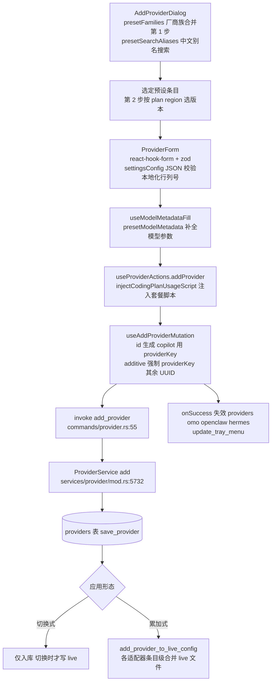
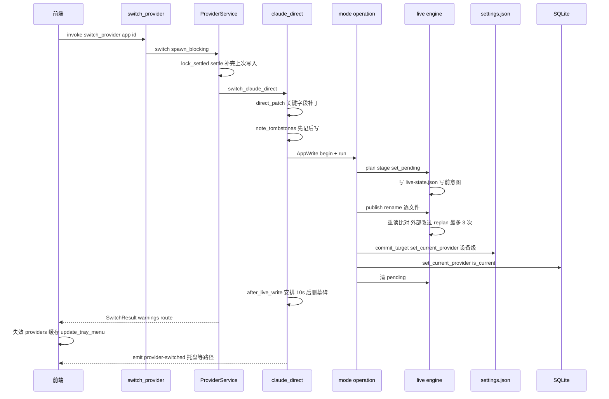
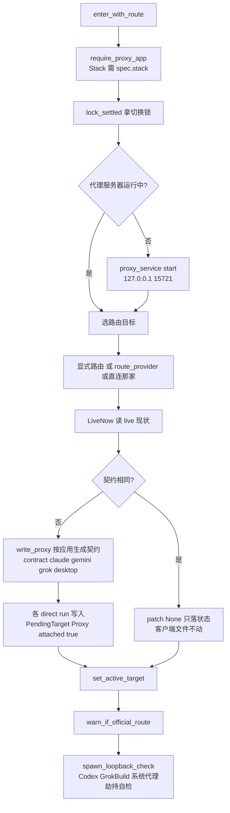
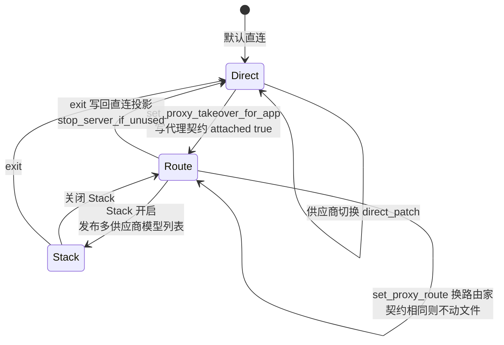
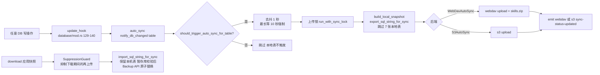
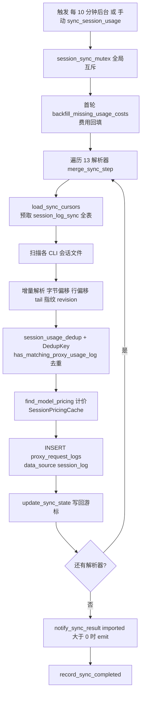
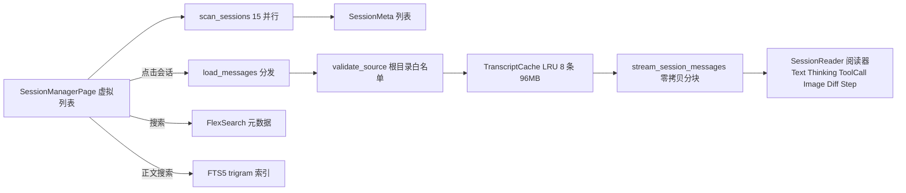
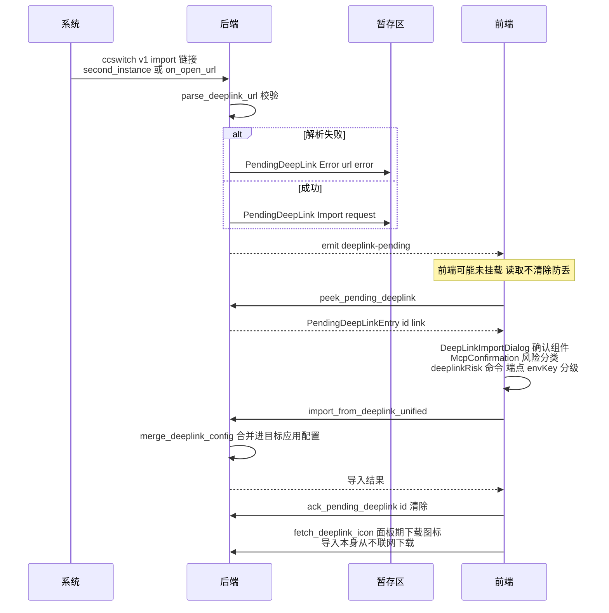
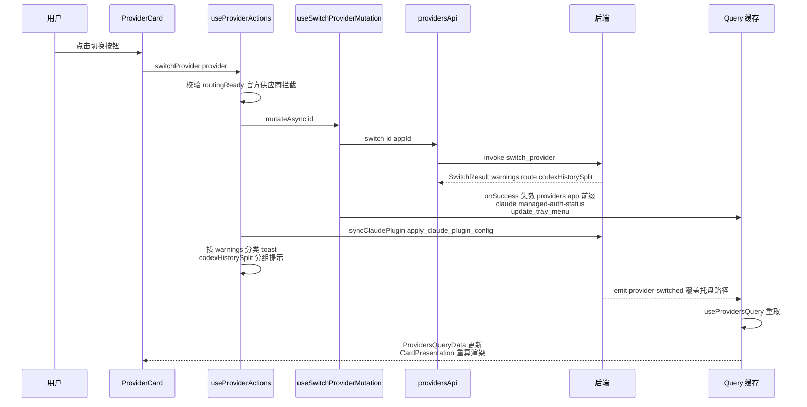

# 05 · 业务工作流报告

> 覆盖全部核心业务流程：供应商添加/切换、代理接管、配置同步、用量采集、会话管理、MCP/Skills/Prompts 管理、深链接导入、托盘交互、自动更新。每个流程附调用链与 Mermaid 图；所有论断附 `文件路径:行号` 引用。

---

## 1. 供应商添加工作流（预设 → 表单 → DB → live）

### 1.1 数据流

### 1.2 要点

- 累加式应用（OpenCode/OpenClaw/Hermes/Pi/Mcode/Kimi/Dsh/Omp/WorkBuddy）添加即合并进 live 文件；切换式（Claude/Codex/Gemini/GrokBuild/ClaudeDesktop）只在切换时写 live。
- 预设注入表单的载体因应用而异：Claude=`settingsConfig.env` 对象、Codex=`auth` JSON + `config` TOML 字符串（`src/config/codexProviderPresets.ts:18-53`）、OpenCode=provider+models 结构、Pi=provider 节点。
- 编辑器投影：`editorView:true` 的应用可调 `get_provider_editor_view` 查看「切到这家之后配置文件长什么样」（`lib/api/providers.ts:83-86`）。

---

## 2. 供应商切换工作流（Claude 直连模式）

### 2.1 完整调用链

1. `switch_provider`（`commands/provider.rs:211`，spawn_blocking）；
2. `ProviderService::switch`（`services/provider/mod.rs:6999`）→ `switch_inner`（:7028）；
3. `lock_native_provider_operations`（:7033/:185，Mcode/Kimi/Dsh/Copilot/WorkBuddy 取切换互斥锁）+ `mode::controller::lock_settled_blocking`（:7113，内部 `operation::settle` 先补完上次写入）；
4. `mode::current::is_proxy` 为否 → `switch_normal`（:7148）→ `switch_claude_direct`（:7319）；
5. `claude_direct::switch_to`（`claude_direct.rs:51`）→ `write`（:69）：`direct_patch(prev, target)` 计算关键字段补丁 → `claude_official::strip_from_patch` 删旧账号目录 → `with_login_switch` 绑号官方卡先换登录；
6. `claude_direct::run`（:100-125）：`for_live` 补丁加墓碑 → `AppWrite::begin`（拿 live 写锁 + recover_before_write）→ `note_tombstones`（写 `claude-tombstones.json`）→ `mode::operation::run` 五步提交；
7. `commit_target`（`operation.rs:411-441`）：`settings::set_current_provider`（设备级）+ `db.set_current_provider`（DB is_current）；
8. `after_live_write`（`claude_direct.rs:244-268`）安排 10s 后 `sweep_tombstones`；
9. `McpService::sync_enabled_for_app`（`mod.rs:7336`）重投影 `~/.claude.json` MCP。

### 2.2 时序图

### 2.3 特殊分支

- **代理模式下切换**：`switch_route_locked`（`controller.rs:1081`）——契约摘要相同则只 `commit_state` 换路由指针不动客户端文件；不同则 `write_proxy` 重写。
- **Codex**：`switch_codex_direct`（`mod.rs:7348-7384`）单事务提交 config.toml + auth.json + 模型目录 + 托管标记 + 指针；「保留登录关闭时切第三方要删 auth.json」失败降级 warning `codex_auth_cleanup_failed`。
- **前端拦截**：路由模式下拒切官方供应商（Codex 官方例外 `supportsOfficialProxyTakeover`，`useProviderActions.ts:201-223`）；未开路由时弹「需要代理」警告（:182-199）。

---

## 3. 代理接管工作流（attach / exit）

### 3.1 进入（手动）

`set_proxy_takeover_for_app`（`commands/proxy.rs:75`）→ `controller::enter_with_route`（:727）→ `try_enter_with_route`（:746，`reject_unsupported_official` :1227）→ `enter_locked`（:780-848）：

### 3.2 启动自动接管

`mode::controller::startup`（`controller.rs:1741-1755`）按 Claude→Codex→Gemini→GrokBuild→ClaudeDesktop 顺序（测试 :1999-2011，Desktop 永远最后）逐 app `startup_app`（:1757-1845）：`drain_legacy_backup`（旧接管备份转存 `~/.cc-switch/backups/proxy-live-backup/`）→ `want_proxy` 判定 → `commit_state` + `enter_locked(op::ATTACH)`；失败记 `StartupAttachFailure` 并 `exit_locked` 退回直连（前端经 `take_startup_attach_failures` 命令取走展示）。

### 3.3 退出

`exit`（:901）→ `exit_locked(keep_mode=false)`（:939-973）→ `write_direct_for_exit`（:975）→ `write_direct`（:521）：把客户端写回直连指针那家（Claude 附带 `with_login_switch`）→ `stop_server_if_unused`（:1002）。退出 CC Switch 用 `detach_all`（:1046，DETACH 不加墓碑）。

### 3.4 模式状态图

---

## 4. 配置同步工作流（WebDAV / S3）

### 4.1 协议与工件

`sync_protocol.rs`：`PROTOCOL_FORMAT="cc-switch-webdav-sync"`（:29，沿用历史名）、`PROTOCOL_VERSION=2`（:30）、`DB_COMPAT_VERSION=6`（:31）；远端工件固定三件：`db.sql` + `skills.zip` + manifest（:33-35）；限额 manifest 1MB / 工件 512MB（:38-39）；传输超时 = 基础 300s + 按体积加时（:55-58），停滞检测 120s（:49）。**无加密**——明文上传，完整性靠 sha256 校验（grep encrypt/AES/cipher 无命中）。

### 4.2 自动上传流程

下载保护：`SYNC_PRESERVE_TABLES`（`backup.rs:96-103`）保留本机数据（proxy 状态、健康度、会话游标等）；导入在 NamedTempFile 暂存库执行并过 authorizer 白名单（:61-81）。

---

## 5. 用量采集工作流（双来源合流）

### 5.1 来源一：代理记账

见 04 报告第 10 节（`data_source='proxy'`，实时）。

### 5.2 来源二：会话文件解析（13 个 CLI）

`sync_all_unlocked`（`services/session_usage.rs:138-205`）依次调度 13 个解析器：

| CLI | 会话文件 | 格式要点 |
|---|---|---|
| Claude | `~/.claude/projects/<项目>/*.jsonl` | 主会话 + 子代理 `<id>/subagents/*.jsonl` + workflow `wf_*`（:498-500）；字节偏移 + tail 指纹增量（:589,1063） |
| Codex | `~/.codex/sessions/YYYY/MM/DD/*.jsonl` + `archived_sessions/` | rollout 双形态 `.jsonl/.jsonl.zst`（`codex_rollout_file.rs`）；thread/revert 分叉与 resume 续写页（`session_usage_codex.rs:686-702`）；父子 rollout token 截止序号验证（:110-185） |
| Gemini | `~/.gemini/tmp/<hash>/chats/session-*.json(l)` | `session_usage_gemini.rs:3-7` |
| OpenCode | `~/.local/share/opencode/opencode.db`（SQLite） | V1/V2 双布局合并读取（头注释 :3-19） |
| Grok Build | `~/.grok/{sessions,archived_sessions}/<enc-cwd>/<id>/updates.jsonl` | `turn_completed` 事件；`costUsdTicks`（1 tick=1e-10 USD）自报成本优先；沉降窗+接管守卫防双算 |
| Pi / OMP | Pi JSONL 共享格式 | 各自 `Flavor`（app_type/data_source/游标独立）；游标带 revision 编码 |
| MCode | MCode 自己的 SQLite 投影 | 只读 |
| Antigravity | agy 导出精确计数器 + 原生模型表 | `session_usage_agy.rs:1-2` |
| Kimi Code | `~/.kimi/sessions/<workspace>/<session>/agents/*.jsonl` | 请求元数据复用 `kimi_session.rs`；按 `kimi_session` 去重（:200） |
| Copilot CLI | `session.usage_record` 事件 | `inputTokens` 含缓存读需 `tokenDetails` 扣减；归属按会话所选 `<卡片id>/<模型>` |
| WorkBuddy | `<data>/projects/<cwd>/<sessionId>.jsonl` | 用量在每请求最后事件 `providerData.rawUsage`；子代理算父会话；`workbuddy:v2:` 字节游标 |
| DSH | `$DSH_HOME/sessions/<项目>/<会话>/session.v4.jsonl.zstd` | zstd 多帧逐帧解码容忍半帧；input 为 fresh 口径 |

### 5.3 同步流程

数据库维护：`rollup_and_prune(30)` 把 30 天前明细聚合进 `usage_daily_rollups` 并删除（`dao/usage_rollup.rs:62`）；`rebuild_codex_usage`（`commands/usage.rs:362-377`）备份→重置→重导 Codex 用量。

---

## 6. 会话管理工作流（session_manager/）

- **扫描**：`scan_sessions_with_status`（`session_manager/mod.rs:97-152`）经 `std::thread::scope` 并行运行 15 个 scanner（:100-117），按 `last_active_at` 排序；`RECENT_SCAN` 5 秒复用窗口（:74-76）。
- **读取**：`load_messages` 分发（mcode/opencode/hermes 走 SQLite 特判，:154-184）→ `content::validate_source` 校验路径归属（防路径逃逸，`provider_roots` 白名单 :301-321）→ `TranscriptCache`（LRU 8 条/96MB，`cache.rs:24-25`）→ `stream_session_messages` 流式分块（`chunk_ranges` :327）。
- **全文检索**：独立 SQLite FTS5 索引 `~/.cc-switch/session-index.db`（不进主库不参与同步）；trigram 分词支持中文/标识符子串；rowid = 源 id × 2^24 + 消息序号（`search.rs:8-15`）。
- **删除**：dsh/copilot/workbuddy/mcode 拒删（保持 CLI 自身一致，:230-253）。

---

## 7. MCP 管理工作流

SSOT 模型：`mcp_servers` 表为唯一事实，各 CLI 配置文件是投影（15 个投影器在 `src/mcp/`：claude→`~/.claude.json`、codex→config.toml `[mcp_servers]`、gemini→settings.json 等）。

| 操作 | 入口 | 行为 |
|---|---|---|
| 增改 | `upsert_mcp_server` → `McpService::upsert_server`（`services/mcp.rs:44`） | 编辑时同步移除取消勾选应用的 live；Copilot/OMP 的原生 MCP 写与 DB 提交同一步 `sync_and_commit`（:59-81） |
| 开关 | `toggle_mcp_app` → `toggle_app_locked`（:263） | DB 单列原子更新 + 单应用重投影 |
| 重同步 | `resync_mcp_to_apps` → `resync_targets`（:486） | 全应用重投影，返回逐应用 `McpAppSyncOutcome{app, ok, error}`（:14-19） |
| 导入 | `import_mcp_from_apps` → `import_from_app`（:576） | 首启动表空时从 6 应用导入（lib.rs:1133-1152） |
| 连通性 | `start_mcp_connectivity_checks`（`mcp_connectivity.rs:87`） | streamable-http/SSE 双协议探测；`ProbeProcess` Drop 取消 |

---

## 8. Skills 管理工作流

`SkillService`（`services/skill.rs`，387KB）核心方法：`install`(:925)/`uninstall`(:1126)/`check_updates`(:1479)/`update_skill`(:1654)/`scan_unmanaged`(:2565)/`import_from_apps`(:2629)/`sync_to_app`(:3296)/`discover_available`(:3412)/`discover_repo`(:3458)/`install_from_zip`(:4993)/`search_skills_sh`(:5270)/备份管理(:2357-2410)/`migrate_storage`(:2188，cc_switch ↔ unified)。

同步方式由 `skill_sync_method` 决定（auto/symlink/copy）；安装目录 `skill_storage_location`（cc_switch=`~/.cc-switch/skills/` 或 unified=各 CLI 共享目录）；`InstalledSkill.content_hash`（SHA-256）驱动更新检测；`skill_repos` 表订阅 GitHub/GitLab（v27 支持 host）仓库自动发现。

---

## 9. 深链接导入工作流（ccswitch://）

### 9.1 协议格式

`ccswitch://v1/import?resource={provider|prompt|mcp|skill}&...`（`deeplink/parser.rs:17-47`）。`DeepLinkImportRequest`（`deeplink/mod.rs:91-203`）字段：version/resource/app/name/enabled + provider（homepage/endpoint/api_key/icon/icon_url/model/notes/haiku|sonnet|opus_model/api_format）+ prompt（content base64）+ mcp（apps 逗号分隔）+ skill（repo/directory/branch）+ v3.8 config（config/config_format/config_url）+ v3.9 用量脚本六字段。

### 9.2 流程

冷启动兜底：插件在回调注册前解析的链接由 `get_current()` 补取（lib.rs:1257-1269）；轻量模式下先退出轻量模式再处理（:1236-1240）。

---

## 10. 托盘工作流

- **菜单结构**（tray.rs 头注释 :3-5）：问题区 → 反馈行 → 打开 CC Switch → 切换式应用子菜单（`TRAY_APPS = [Claude, ClaudeDesktop, Codex, Gemini, GrokBuild]`，:40-46）→ 轻量模式 → 官网/退出；三层架构 collect_* / build_menu_model / attach_*（:10-12）。
- **双形态**：原生菜单（Linux AppIndicator 必需 / 用户可选 `native_tray_menu`）或玻璃面板（Windows 右键 / macOS 左右键；macOS `NSGlassEffectView`，Windows 透明画布+区域裁剪）。
- **导航**：托盘点击 → `take_tray_navigation` 命令暂存 → 前端 `useTrayNavigation` 监听 `tray-navigate` 解析 `{app?, section?, intent: "needsRoute"|"add", providerId?}`（`hooks/useTrayNavigation.ts:9-38`）。
- **状态刷新**：`refresh_tray_menu`（tray.rs:2836）/ `schedule_tray_refresh` 防抖（:3380）；`mark_startup_settled`（:1544）后托盘才报「路由服务没在运行」。

---

## 11. 前端「切换供应商」完整数据流

---

## 12. 自动更新工作流

- 后端 `app_update.rs`：开关打开时首查延迟 60s、之后每 6h（:24-27）；已下载安装包存**进程内存**（轻量模式销毁主窗口不丢状态）；下载完成 emit `app-update-ready`（:20）。
- 前端 `UpdateContext`（`contexts/UpdateContext.tsx:47-279`）：启动 1s 自动检查（:238-245）；监听 `app-update-ready`（:119-127）；正式版+开关开+有新版本 → 主动触发后台下载（:198-220）；dismissed 版本持久化 localStorage。
- 更新源双端点：R2 `https://dl.ccswitch.io/latest.json`（首选）+ GitHub Releases（`tauri.conf.json:59-66`）；minisign 签名验证（镜像不可信问题由签名覆盖，`sync-r2.yml:5-6` 注释）。
- 安装：`install_update_and_restart`（`commands/settings.rs:344`）→ `restart_process`（lib.rs:2424，显式清理托盘 + single-instance 锁）。

---

## 13. 工作流异常恢复路径汇总

| 流程 | 失败点 | 恢复机制 | 位置 |
|---|---|---|---|
| live 写入中途崩溃 | rename 前后任意点 | live-state.json 写前意图：丢弃或前滚 | `operation.rs:208-294` |
| Claude 切换后旧凭据残留 | 运行中会话仍读旧值 | 空值墓碑 10s TTL + 三时机删除 | `claude_direct.rs:141-421` |
| 代理启动接上失败 | want_proxy 为真但写契约失败 | StartupAttachFailure 记录 + 退回直连 | `controller.rs:1803-1811` |
| 数据库版本过新 | 旧应用打开新库 | 恢复界面引导升级，禁止写库 | lib.rs:732-754、schema.rs:500-506 |
| schema 迁移失败 | 磁盘满/损坏 | 迁移前自动快照 + 原生对话框重试/退出 | `database/mod.rs:175-187`、lib.rs:762-777 |
| 配置迁移（JSON→SQLite）失败 | config.json 损坏 | 用户退出时 db 未创建可重试；成功后归档不删除 | lib.rs:697-722, 805-811 |
| 代理请求失败 | 上游 5xx/超时 | 重试循环 + 熔断 + 故障转移队列 | `forwarder.rs:726-1327` |
| 上游密文状态拒绝 | 跨家 reasoning 条目 | opaque_state 整流重试 | `opaque_state_rectifier.rs` |
| 系统代理劫持本地端口 | 环境代理指向自身 | loopback 自检 + 前端警告 | `loopback_probe.rs:18` |
| 同步上传与下载竞争 | 双端同时变更 | 上传锁 + SuppressionGuard + 语义去重 | `auto_sync.rs:59,183` |
| settings.json 损坏 | 截断/非法 JSON | lenient 解析逐字段丢弃 + 备份 `.broken-*.bak` | settings.rs:991-1036 |
| 半 Open 探测名额泄漏 | 请求被取消 | 轮次化名额 guard 只归还本轮 | `circuit_breaker.rs:397-408` |
