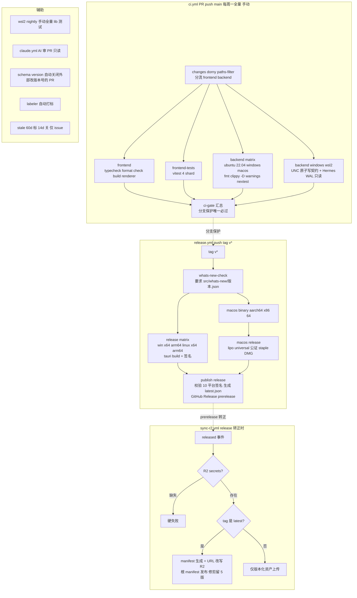

# 06 · 工程体系报告（测试、CI/CD、构建与发布）

> 覆盖测试策略、CI/CD 管线、构建配置、发布与分发。所有论断附 `文件路径:行号` 引用。

---

## 1. 测试体系

### 1.1 规模与分布

| 类别 | 数量 | 统计口径 |
|---|---|---|
| 前端测试（tests/） | 322 个文件 | components 170 / config 48 / hooks 37 / lib 26 / utils 15 / i18n 4 / msw 4 / integration 2 / fixtures 9 / 其他 7 |
| 前端内联测试（src/） | 20 个 | config 12（预设专测）+ lib 3 + utils 5 |
| Rust `#[test]` | 4,449 个 | grep 统计 src-tauri/src 全目录 |
| Rust `#[tokio::test]` | 610 个 | 同上 |
| 独立 Rust 测试文件 | 19 个 | agy_smoke_tests、commands/{provider_concurrency,session_manager,startup}_tests、database/{tests,providers_tests}、deeplink/tests、frontend_parity_tests、proxy/{forwarder,privacy_filter,session} 测试、services/* 等 |

### 1.2 前端测试基础设施

- `vitest.config.ts:14-17`：include `{src,tests}/**/*.{test,spec}.*`（src 内联与 tests 一并跑）；environment jsdom；setupFiles `tests/setupGlobals.ts` + `tests/setupTests.ts`；globals true；coverage text+lcov。
- `tests/msw/`：MSW handlers/server/state/tauriMocks 四件——Tauri `invoke` 在测试层被 mock（tauriMocks），网络层经 MSW 拦截。
- `tests/fixtures/sessions/*.messages.json`：会话阅读器前后端契约样例（claude/codex/gemini/generic/opencode/pi）。

### 1.3 前后端契约测试（双端对齐机制）

| 金标文件 | 生成方 | 比对方 |
|---|---|---|
| `tests/config/backendConstants.json` | `frontend_parity_tests.rs:1-6`（Rust 测试生成，`CC_SWITCH_UPDATE_GOLDEN=1 cargo test` 重生成） | `tests/lib/registeredCommands` 与 backendConstants.test.ts |
| `tests/config/appSpecs.json` | 后端测试生成 | `tests/config/appSpecs.test.ts`（`src/config/appSpecs.ts:7-8` 注释） |
| `tests/config/languages.json` | 后端 | `tests/i18n/localeCoverage` / `localeParity`（8 语言完整性比对） |
| `tests/config/claudeKeyFields.json` | 后端 floor 键清单 | 前端 key 字段测试 |
| `tests/config/tools.json` | 后端工具发现 | 前端 AppsPage |

`frontend_parity_tests.rs` 覆盖的共享常量（:139-162）：copilotReasoningEfforts、codexReservedModelProviderIds、codexWireApis、hermesProviderSource、codingPlanProviderByUrl（28 个 URL 样例）、quotaWarnBelowPercent、exchangeRateCurrencies、customIcon 规则、profileScopeByApp、userAgentValid（12 样例）、providerNeedsRouting（9 卡片 × 托盘应用矩阵）。

### 1.4 Rust 测试纪律（示例）

- `mode/current.rs:123-191`：强制「读当前供应商」白名单；
- `provider_kind.rs:166-202`：Copilot URL 判定只能存在于 provider_kind；
- `lib.rs:2465-2621`：退出分类、URL 脱敏、TOML 错误脱敏的单元测试；
- `server.rs:469-488`：Windows 监听 socket 不可被子进程继承（issue #8552 回归测试）；
- nextest CI profile（`src-tauri/.config/nextest.toml`）：slow-timeout 60s × 3 周期终止；`fail-fast=false`。

---

## 2. CI/CD 管线

### 2.1 全景图

### 2.2 ci.yml 要点（344 行）

- 触发：PR→main、push→main、每周一 03:41（北京时间）定时全量、手动（:3-10）；并发组按 PR number 取消旧跑（:13-18）。
- backend 矩阵三平台（:138）；rust-cache 只在 main 保存；clippy `-D warnings`；`cargo nextest run --profile ci`（:201）。
- backend-windows-wsl2（:203-322）：windows-2025 + WSL2 Ubuntu-24.04，HOME/TEMP 指向 `\\wsl.localhost`；跑两个 ignored 契约测试：WSL UNC 原子写（`config::tests::atomic_write_replaces_existing_wsl_unc_file`）与 Hermes WAL 只读。
- ci-gate（:327-344）：`if: always()` 汇总，结果必须 success/skipped——分支保护唯一必过检查。

### 2.3 release.yml 要点（975 行）

- whats-new-check（:23-60）：tag 必须伴随 `src/whats-new/<版本>.json`，并跑 whatsNewEntries 测试。
- 四平台矩阵 + macOS 双架构（:69-75）；Tauri 签名 key 经 action 准备（:163-168）；Linux bundles `appimage,deb,rpm`。
- macOS：lipo 合并 universal → `tauri bundle --bundles app` 签名+公证（重试 3 次）→ stapler → `create-dmg` → DMG 单独公证+staple → 验签（:512-711）。
- publish-release（:799-975）：校验 10 组平台签名齐全（缺一失败，:871-885）→ 生成 `latest.json`（darwin 双键指向 universal）→ `softprops/action-gh-release` 发布 **prerelease: true**。
- workflow_dispatch 为干跑（完整编译签名公证但不发布）。

### 2.4 sync-r2.yml（222 行）

触发 `release: [released]`（prerelease 转正）或手动回填 tag。镜像产物到 Cloudflare R2（`dl.ccswitch.io`），使下载页与应用内更新不依赖 GitHub；updater 靠 minisign 签名保证镜像可信。版本化资产 immutable 长缓存；根 manifest 仅 latest tag 可动；修剪只留 5 个版本（KEEP_VERSIONS :50）。

### 2.5 辅助 workflow

| workflow | 触发 | 行为 |
|---|---|---|
| claude.yml | issue/PR 评论 @claude（OWNER/MEMBER/COLLABORATOR） | `claude-code-action` 只读审查（禁编辑工具）；≥80 置信度、Nit ≤5 条、不下 APPROVE 结论（:55-61） |
| schema-version.yml | PR opened（非协作者） | patch 增加 `SCHEMA_VERSION` 的 PR 自动关闭并双语评论（迁移不可回滚、版本号由维护者分配，:22-33） |
| wsl2-nightly.yml | 仅手动 | Windows+WSL2 跑整个 lib 测试套件（`--test-threads 1 --retries 2`，跳过 database:: 测试） |
| labeler.yml / stale.yml | PR 打标 / 每日 | labeler v5；stale 60 天标 + 14 天关，仅 issue，security/performance 豁免 |

---

## 3. 构建配置

### 3.1 tauri.conf.json（src-tauri/tauri.conf.json:1-77）

| 配置块 | 值 |
|---|---|
| productName / identifier | CC Switch / `com.ccswitch.desktop` |
| beforeBuildCommand | `pnpm run build:renderer` |
| 窗口 | label main、titleBarStyle Overlay、1000×650（min 900×600）、初始 `visible:false`（Windows 等页面加载完成再显示）、center |
| CSP | script-src self+hash；connect-src 允许 https/http+ipc |
| bundle | targets all、`createUpdaterArtifacts: true`、Windows WiX 每用户模板 `wix/per-user-main.wxs`、macOS 最低 12.0 |
| deep-link | desktop scheme `ccswitch` |
| updater | minisign 公钥 + 双端点（R2 首选 + GitHub） |

### 3.2 capabilities（最小权限）

- `default.json`（windows: ["main"]）：core:default、opener、updater、log、窗口操作子集、set-webview-zoom、process exit/restart、dialog:default。
- `tray-panel.json`（windows: ["tray-panel"]）：仅 `core:default`（只读数据、发事件）。

### 3.3 Vite / 前端构建

`vite.config.ts:1-39`：root src；**双入口** main + tray-panel（托盘面板不加载主界面）；dev 端口 3000 strictPort；serve 模式启用 code-inspector-plugin。Tailwind（tailwind.config.cjs）：darkMode `["selector",".dark"]`；shadcn/ui CSS 变量色板 + v7 设计 token（app/sidebar/subtle/selected/surface/fg-1..3/action/inverse/overlay）；统一禁用态透明度 45。

### 3.4 Cargo profile

- `[profile.dev] debug = "line-tables-only"`（本地测试与 CI 同一份调试级别；完整调试信息占测试二进制九成）。
- `[profile.release]`：`codegen-units=16`（主 crate 编译快约 64%，二进制 +17%）、`lto="thin"`、`opt-level="s"`、`panic="unwind"`（panic hook 捕获 backtrace）、`strip="symbols"`。
- lib crate-type 仅 `rlib`、`doctest=false`（省约 1GB 链接产物，Cargo.toml:16-21 注释）；feature `test-hooks` 供测试注入。

### 3.5 脚本

- `scripts/generate-download-manifest.mjs`：从 release 资产生成下载页 manifest（RULES 表按文件名分类平台/架构）。
- `scripts/rewrite-updater-manifest.mjs`：把 latest.json 的 URL 从 GitHub 改写为 R2（从文件名重建 URL 而非前缀替换，布局变化即失败；minisign 签名覆盖内容故仍有效）。

---

## 4. 版本与变更管理

- 版本号三处同步：`package.json:3`、`src-tauri/Cargo.toml:4`、`src-tauri/tauri.conf.json`（version 4.0.35）。
- 每版公告：`src/whats-new/<版本>.json`（4.0.0–4.0.35 共 36 个；格式 `{version, items:[{type:"new"|"fix"|"improve", zh, zh-TW, en, ja}]}`），`import.meta.glob` eager 打包不联网；release CI 强制 tag 与公告并存。
- CHANGELOG.md（982KB）随版本累积。
- `SCHEMA_VERSION` 由维护者统一分配：外部 PR 改动会被 schema-version.yml 自动关闭。
- 数据库 schema 演进纪律（`database/mod.rs:52-54` 注释）：改表先 `SCHEMA_VERSION += 1`，在 schema.rs match 加一步迁移；跨版本升级自动预备份。

---

## 5. 质量门禁汇总

| 门禁 | 位置 | 说明 |
|---|---|---|
| TypeScript 严格检查 | `pnpm typecheck`（CI frontend） | tsc --noEmit |
| Prettier | `pnpm format:check` | CI frontend |
| Rust fmt + clippy | CI backend | clippy `-D warnings` |
| 前端单测 | CI 4 shard | vitest |
| 后端单测 | CI 三平台 nextest | 每测试一进程、180s 超时 |
| WSL2 契约测试 | CI + nightly 手动 | UNC 原子写、WAL 只读 |
| 前后端常量对齐 | frontend_parity + 金标 JSON | 任一端单独改动即失败 |
| whats-new 存在性 | release CI | tag 必须伴随公告 |
| 签名完整性 | publish-release | 10 组平台签名缺一即失败 |
| AI 审查（辅助） | claude.yml | 只读、高置信度 Nit |
